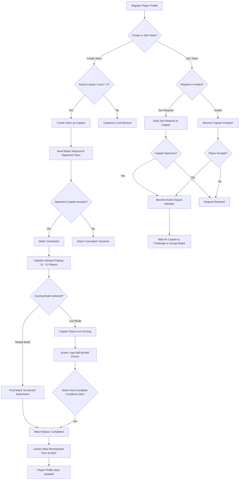
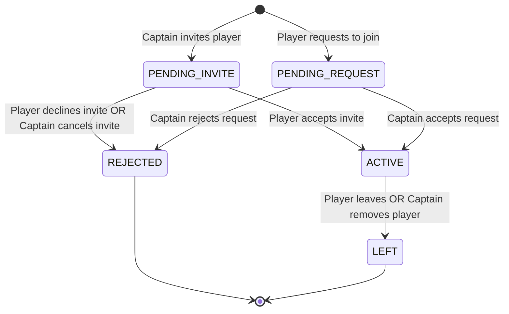
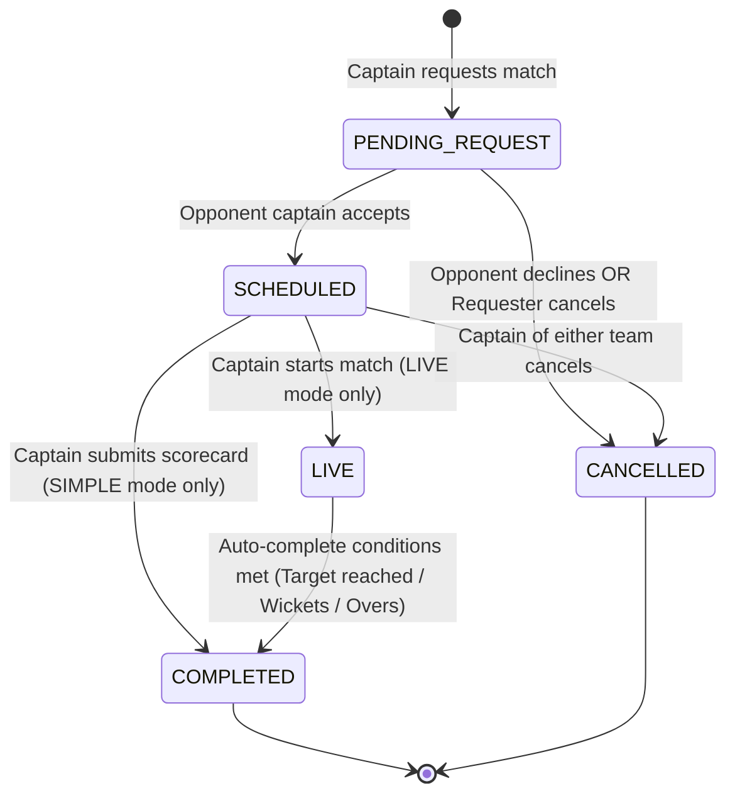
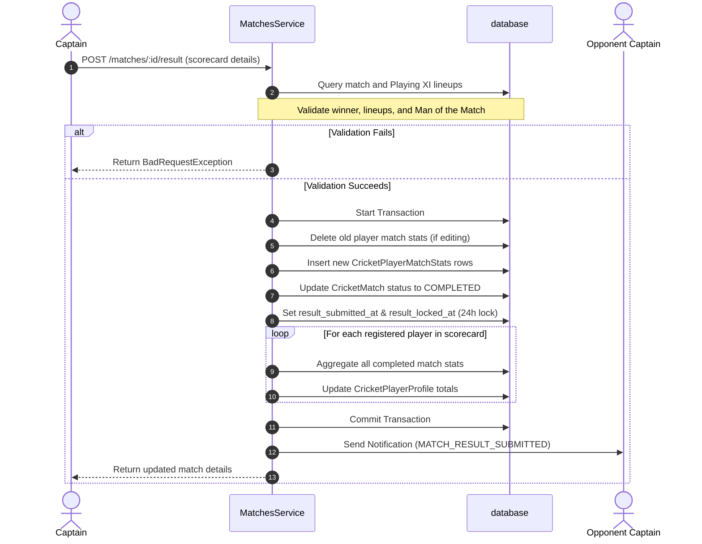
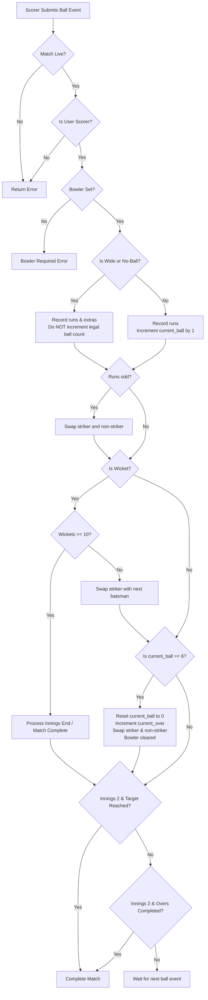
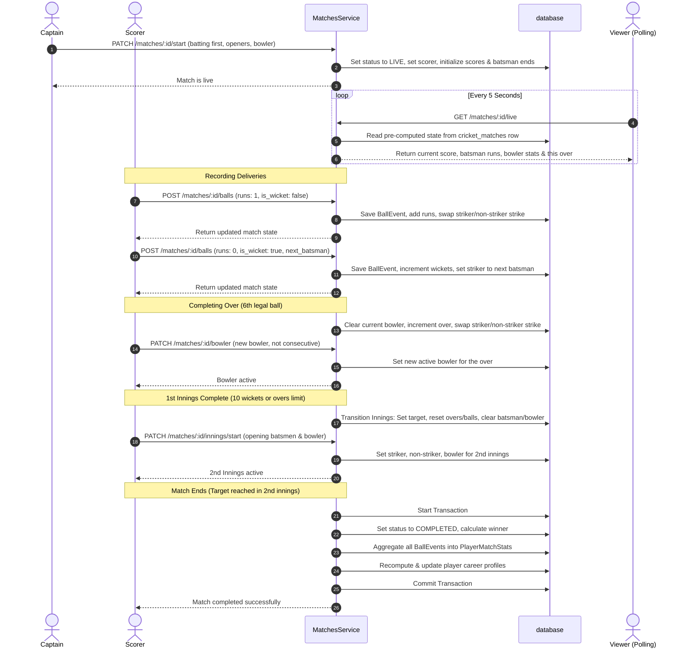
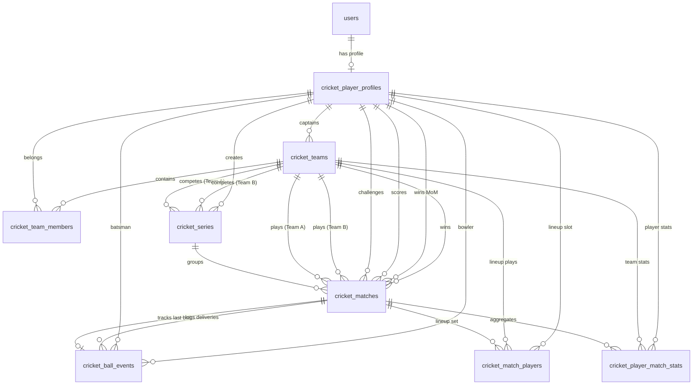
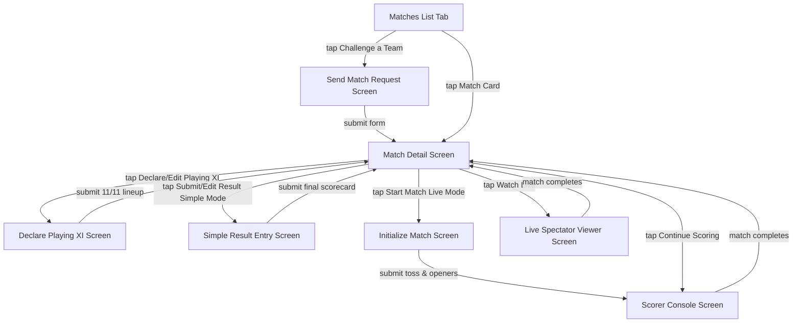
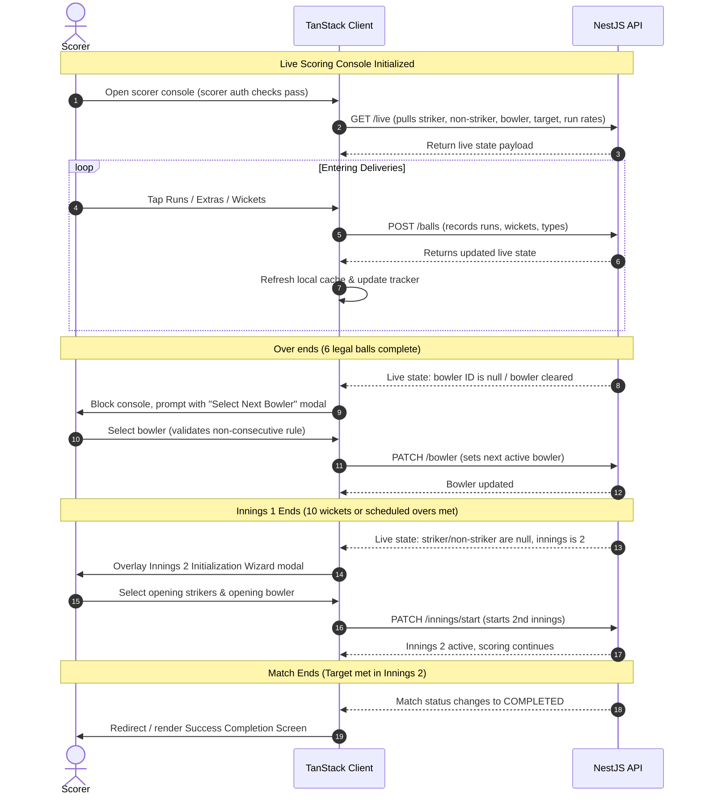

# Cricket Feature Specification and System Record

This document provides a comprehensive, end-to-end written record of the Cricket feature implemented inside the Pabaini app. It covers player profiles, teams, match scheduling, request lifecycles, and both simple (post-match) and live (ball-by-ball) scoring modes. It serves as a precise technical and business spec for developers, product managers, and other stakeholders.

---

## 1. Overview

The Cricket feature replaces manual and error-prone coordination processes—such as scheduling matches via WhatsApp, organizing teams over phone calls, and recording scores on paper scorecards—with a unified, digital match management system. 

The system provides three main modules:
*   **Player Profiles**: Digital cricket profiles containing player roles, hand/arm styles, and automatically aggregated career stats.
*   **Teams**: Squad management tools that support team creation, captaincy limits, squad invitations, player join requests, and captaincy transfers.
*   **Matches**: A multi-stage match engine supporting match requests, Playing XI lineup declaration, simple post-match scorecard entry (with a 24-hour edit lock window), and real-time live ball-by-ball scoring. Live matches write to a permanent ball log while updating a pre-computed "live state" directly on the match record to support high-performance, real-time polling.

---

## 2. Player Journey Map

The flowchart below traces the complete lifecycle of a player from their initial registration to joining squads, participating in matches, and seeing their career statistics automatically update on their profile.

---

## 3. Player Profiles

Every player in the Pabaini cricket system must establish a digital profile before interacting with teams or matches. Player profiles map one-to-one with user accounts and track individual playing styles and career stats.

### Data Fields

The following fields exist on the player profile entity (`CricketPlayerProfile`):

| Database Column | Data Type | Required / Optional | Description |
| :--- | :--- | :--- | :--- |
| `id` | `integer` (Primary Key) | Required | Auto-incrementing unique identifier. |
| `user_id` | `integer` (Unique FK) | Required | References the central user account (`users.id`). |
| `role` | `enum` (`CricketRole`) | Required | Player style: `batsman`, `bowler`, `allrounder`, or `keeper`. |
| `batting_hand` | `enum` (`BattingHand`) | Required | Left or right handed batsman: `left` or `right`. |
| `bowling_arm` | `enum` (`BowlingArm`) | Required | Arm used for bowling: `left`, `right`, or `none`. |
| `bowling_type` | `enum` (`BowlingType`) | Required | Type of bowling: `fast`, `medium`, `spin`, or `none`. |
| `is_active` | `boolean` | Required | Defaults to `true`. Determines if the player profile is active. |
| `total_matches` | `integer` | Required | Career matches played. Defaults to `0`. |
| `total_runs` | `integer` | Required | Total runs scored. Defaults to `0`. |
| `total_balls_faced` | `integer` | Required | Total deliveries faced while batting. Defaults to `0`. |
| `total_fours` | `integer` | Required | Total fours hit. Defaults to `0`. |
| `total_sixes` | `integer` | Required | Total sixes hit. Defaults to `0`. |
| `highest_score` | `integer` | Required | Maximum runs scored in a single innings. Defaults to `0`. |
| `total_wickets` | `integer` | Required | Total wickets taken as a bowler. Defaults to `0`. |
| `total_overs_bowled`| `decimal(5,1)` | Required | Total overs bowled. Defaults to `0.0`. |
| `total_runs_given` | `integer` | Required | Total runs conceded while bowling. Defaults to `0`. |
| `created_at` | `timestamp` | Required | Auto-set timestamp when the profile is created. |
| `updated_at` | `timestamp` | Required | Auto-set timestamp when the profile is updated. |

### Validation Rules
1.  **Bowling Arm & Type Consistency**: If a player's `bowling_arm` is set to `none`, then their `bowling_type` must also be set to `none`. Any attempt to violate this consistency rule throws a `BadRequestException` ("If bowling arm is none, bowling type must also be none"). This is enforced during profile creation and profile updates.
2.  **Unique Profile**: A user can only have one cricket player profile. Creating a duplicate profile throws a `ConflictException` ("Cricket player profile already exists").

### Searchable Player Directory
The mobile client provides a dedicated discover page (`players/index.tsx`) where users can search all registered players in the village. It features:
*   **Sticky Name Search Bar**: Filters players dynamically by name on the backend.
*   **Skeletons & Infinite Scroll**: Paginated list fetching 10 players at a time with smooth infinite scroll and placeholder skeleton loading states.
*   **Pull-to-refresh**: Enables dragging down the player feed to refresh registered profiles.
*   **See All CTA**: Accessible from the Sports Tab dashboard as a redirect next to the "Other Registered Players" section.

### Real-Time Career Statistics Engine
Rather than simple static mock figures, the backend aggregates career metrics directly from the match player stats table.
*   **Tier Segregation**: Career stats are divided into **Competitive** (associated with a tournament series) and **Casual** (standard friendly matches) tiers.
*   **Metrics Aggregated**: Runs, matches, innings, highest score, batting average, strike rate, boundaries (fours/sixes), wickets, economy, and best bowling figures.
*   **Recalculation Trigger**: Full recalculations are run inside a transaction whenever a scorecard is submitted or edited, preventing drift and race conditions.

---

## 4. Teams

Teams gather player profiles into formal squads. Squad management enforces structural limits to prevent players from over-committing as captains, while leaving player membership open for flexible participation.

### Team Creation and Captaincy Limit
*   **Captaincy Limit**: A player can be the active captain of at most **2 active teams**. This constraint is enforced in the `TeamsService.createTeam` method. It counts the active teams where `captain_id` equals the player's profile ID and `is_active` is `true`. If this count is 2 or more, it throws a `BadRequestException` ("You are already captain of 2 active teams. Transfer captaincy or dissolve a team before creating a new one.").
*   **Team Name Uniqueness**: Team names must be unique across the platform. Creating a team with a name that is already in use throws a `ConflictException` ("Team name already exists").

### Squad Membership Rules
*   **No Membership Cap**: There is currently no cap on how many teams a player can join as a normal squad member. This design decision was made to allow players to play in various friendly matches, deferring strict team limits to tournament-level rules when the tournament feature is introduced.
*   **Squad Invites**: Captains can invite players to join their squad (`TeamsService.invitePlayer`). The system validates that the target player is active, is not the captain themselves, and doesn't already have an active or pending membership on the team. If valid, a membership record is created with the status `pending_invite`, and a notification (`TEAM_INVITE`) is sent to the player.
*   **Join Requests**: A player can request to join an active team (`TeamsService.joinRequest`). The system validates that the team is active, that the player isn't already the captain of the team, and that they do not already have an active or pending membership on the team. A membership record is created with the status `pending_request`, and a notification (`TEAM_JOIN_REQUEST`) is sent to the team captain.

### Captaincy Transfer
A captain can transfer captaincy to any active team member using the `TeamsService.transferCaptaincy` method.
*   **Validation**: The target player must be an active member of the team.
*   **Transaction**: The transfer is processed inside a database transaction:
    1.  The old captain's membership role is changed from `captain` to `player`.
    2.  The new captain's membership role is changed to `captain`.
    3.  The team's `captain_id` column is updated to reference the new captain's profile ID.
*   **Notification**: A notification (`TEAM_CAPTAINCY_TRANSFERRED`) is sent to the new captain.

### Squad Membership State Machine
Team membership transitions are controlled by the `TeamMemberStatus` enum (`pending_invite`, `pending_request`, `active`, `rejected`, `left`).

---

## 5. Matches

Matches represent the central gameplay engine of the cricket feature. The system supports scheduling, challenge validation, and two distinct scoring pathways.

### 5A. Match Request Lifecycle

Matches begin as challenges between two squads. The lifecycle transitions through various statuses (`pending_request`, `scheduled`, `live`, `completed`, `cancelled`, `no_result`).

#### Match Request Business Rules

| Rule | Description | File / Method |
| :--- | :--- | :--- |
| **Who can request** | Only team captains can send match requests to other teams. | `MatchesService.requestMatch` |
| **Self-Challenge Block** | A captain cannot challenge their own team. | `MatchesService.requestMatch` |
| **Duplicate Challenge Prevention** | Teams cannot have multiple pending requests active between them. | `MatchesService.requestMatch` |
| **Accept/Decline** | Only the captain of the challenged team can accept or decline a pending match request. | `MatchesService.acceptMatch` / `declineMatch` |
| **Who can edit** | Only the requesting captain can edit match details (overs, venue, schedule, scoring mode), and only while it is pending. | `MatchesService.updateMatch` |
| **Who can cancel** | If the match is in `pending_request`, only the requesting captain can cancel. If `scheduled`, the captain of either team can cancel. | `MatchesService.cancelMatch` |

---

### 5B. Playing XI Declaration

Before starting live scoring or submitting a scorecard, captains must declare their starting lineup (the Playing XI).

*   **Lineup Requirement**: A lineup must consist of **exactly 11 players**.
*   **Registered vs. Guest Players**:
    *   **Registered Players**: Users with profile accounts (`player_id` is set). Career stats are tracked and updated dynamically for these players.
    *   **Guest Players**: Players who do not have accounts (`guest_name` is set, `player_id` is null). This allows squads to record complete scorecards when playing with temporary players or non-users.
*   **Lineup Validation**:
    *   Registered players declared in the lineup must be active squad members (`status: active` in `cricket_team_members` for that team).
    *   Each lineup entry must specify either a `player_id` or a `guest_name`, but never both.
    *   Each player must be assigned a unique batting order between `1` and `11`.
*   **Prerequisite Gate**: Lineup declaration is an absolute prerequisite. Live scoring cannot be started unless both teams have successfully set `team_a_lineup_set = true` and `team_b_lineup_set = true`.

---

### 5C. Simple Scoring Mode

Simple Scoring Mode is a retroactive, post-match data entry tool. It is used to record the results of completed matches in a single, one-time submission.

*   **Who can submit**: The captain of either team.
*   **Submission Payload**: Includes final team scores, the winner, the Man of the Match, and complete match cards for every player (runs, balls faced, boundaries, wickets, runs conceded, and bowling extras).
*   **Validation Rules**:
    *   The match must be in `scheduled` status.
    *   The winner team ID must match one of the participating team IDs.
    *   All player stats submitted must belong to players declared in the Playing XI.
    *   The Man of the Match must be a player in the match lineup (either a registered player by ID or a guest player by name).
*   **24-Hour Edit Window**:
    *   Upon result submission, the backend records `result_submitted_at = now()` and sets a lock boundary `result_locked_at = now() + 24 hours`.
    *   Captains can edit the results (`MatchesService.editResult`) as long as the current time is before `result_locked_at`.
    *   Once `result_locked_at` passes, the edit endpoint throws a `BadRequestException` ("Match results are locked and can no longer be edited").
*   **Career Stats Aggregation**:
    *   **Recompute from Scratch**: Rather than incrementing stats, the backend runs a complete re-calculation query on every submission or edit. It fetches all completed match stats for the affected players, aggregates them, and overwrites the totals in the `cricket_player_profiles` table.
    *   **Why**: This approach is far safer than incremental updates. It guarantees that data edits, cancellations, or out-of-order result submissions never result in stat drift, double counting, or database race conditions.

---

### 5D. Live Ball-by-Ball Scoring Mode

Live ball-by-ball scoring tracks matches in real time, creating a permanent ball log while providing fans and diaspora abroad with an instant, lightweight live view.

#### 1. Scorer Assignment
During the live match start call, the captain designates a **scorer** (`scorer_id`). If not explicitly provided, it defaults to the captain starting the match. The scorer must be an active squad member of either team. The scorer gains exclusive write permissions to all live-scoring endpoints (`/balls`, `/bowler`, `/innings/start`, `/balls/undo`).

#### 2. Match Start
Either captain starts the match by calling `PATCH /matches/:id/start` with the toss details, batting first team, and opening striker, non-striker, and bowler. This call transitions the match status to `live`, initializes the scoring fields (`current_innings = 1`, `current_over = 0`, `current_ball = 0`), and notifies both captains (`MATCH_STARTED`).

#### 3. Ball Entry and Delivery Rules
For every delivery, the scorer posts runs, extra types, runs from extras, and wicket details to `POST /matches/:id/balls`.
*   **Legal Deliveries**: Deliveries where `extra_type` is not `wide` or `no_ball`. Legal deliveries increment the over's ball counter (`current_ball`).
*   **Illegal Deliveries**: Wides and no-balls do *not* increment `current_ball`. They add a penalty run to the batting team's score and are recorded in the bowler's runs conceded, but the batsman is not credited with facing a ball.
*   **Strike Rotation**:
    *   **Runs-based Rotation**: Scoring an odd number of runs (1, 3, or 5) swaps the striker and non-striker.
    *   **Over Completion Rotation**: At the end of an over (after 6 legal deliveries), the striker and non-striker swap ends.
    *   *Note*: If an odd run is scored on the 6th legal delivery of an over, the strike rotates twice, effectively returning the batsmen to their original ends.

#### 4. Over Completion and Bowler Rotation
An over is complete when `current_ball` reaches 6. 
*   The system increments `current_over`, resets `current_ball` to 0, swaps striker/non-striker, and clears the bowler fields (`current_bowler_id = null`).
*   The scorer must select a bowler (`PATCH /matches/:id/bowler`) before entering the next ball.
*   **Consecutive Over Restriction**: A bowler cannot bowl two consecutive overs. The system enforces this by checking the new bowler's identity against the bowler ID recorded in the previous over's final ball event, throwing a `BadRequestException` ("Bowler cannot bowl two consecutive overs") if they match. However, the scorer can bypass this constraint on the backend by passing `bypass_consecutive_check` flag (which prompts a confirmation dialog in the mobile UI). The endpoint is idempotent; if the requested bowler is already active, it returns success without throwing consecutive bowler errors.

#### 5. Wicket Handling
If a wicket falls (`is_wicket = true`), the scorer records the wicket type.
*   **Striker Dismissal Simplification**: To keep scoring fast and simple, run-outs and other wickets are always assumed to dismiss the **striker**.
*   If the innings has wickets remaining (wickets < 10), the scorer must provide a `next_batsman_id` or `next_batsman_guest_name` in the payload. The dismissed striker is replaced on the field by this next batsman. The batsman picker dropdown list filters automatically to only show Playing XI players who have not been dismissed yet.

#### 6. Innings Transition
An innings transitions when 10 wickets fall or the scheduled overs are complete.
*   **Transition from 1st to 2nd Innings**: The system calculates the target score (`innings_1_score + 1`), increments `current_innings` to 2, resets overs/balls to 0, swaps the batting team, and clears the batsmen and bowler fields.
*   The scorer must call `PATCH /matches/:id/innings/start` to set the new opening batsmen and opening bowler for the second innings.

#### 7. Match Auto-Completion
A live match automatically completes and transitions status to `completed` when one of these conditions is met in the second innings:
1.  **Target Reached**: The batting team's score matches or exceeds `target` (Batting team wins).
2.  **All Out**: The batting team loses 10 wickets (Bowling team wins, or tie if scores are equal).
3.  **Overs Complete**: The batting team faces all scheduled overs (Bowling team wins if batting score is less than `target - 1`, tie if score matches `target - 1`).

Upon auto-completion, the backend:
*   Sets status to `completed`, computes the winner (or sets `is_tie`), and formats final scorecards.
*   Aggregates the raw ball logs in `cricket_ball_events` into `cricket_player_match_stats` for all Playing XI players.
*   Runs the career stats recompute transaction for all registered players in the match.
*   Sends notifications (`MATCH_COMPLETED`) to both captains.

#### 8. Undo Last Ball Feature
The scorer can revert mistakes using `PATCH /matches/:id/balls/undo`.
*   **Limitation**: The undo action is restricted to the **single most recent ball** only. Multi-step history undoes are not supported.
*   **Effect**: The backend fetches the event referenced by `last_ball_event_id`, reverses the run changes, wicket counts, overs/balls counters, strike rotations, and bowler assignments, deletes the ball event row, and sets `last_ball_event_id` to the previous ball event.

#### 9. Live Viewing Performance
The public live endpoint `GET /matches/:id/live` fetches pre-computed, current-state fields stored directly on the `cricket_matches` row.
*   **Performance Rationale**: Querying and aggregating the entire `cricket_ball_events` table on every poll request would cause significant database load during popular matches. Reading the pre-computed state from the match row ensures that response times remain fast and database resource consumption is minimized, even when thousands of users are polling simultaneously.

#### Ball Entry Decision Flowchart

#### End-to-End Live Scoring Sequence Diagram

---

## 6. Data Model Reference

The backend database runs on Supabase (PostgreSQL). The relationships and tables supporting the cricket feature are detailed below.

### 1. `cricket_player_profiles`
Stores profiles and aggregated career stats for registered players.
*   `id` (`SERIAL PRIMARY KEY`): Unique profile identifier.
*   `user_id` (`INTEGER UNIQUE REFERENCES users(id) ON DELETE CASCADE`): Maps profile one-to-one to user.
*   `role` (`VARCHAR`): Player role (`batsman`, `bowler`, `allrounder`, `keeper`).
*   `batting_hand` (`VARCHAR`): Batting hand (`left`, `right`).
*   `bowling_arm` (`VARCHAR`): Bowling arm (`left`, `right`, `none`).
*   `bowling_type` (`VARCHAR`): Bowling style (`fast`, `medium`, `spin`, `none`).
*   `is_active` (`BOOLEAN DEFAULT true`): Status indicator.
*   `total_matches` (`INTEGER DEFAULT 0`): Career match counter.
*   `total_runs` (`INTEGER DEFAULT 0`): Career runs.
*   `total_balls_faced` (`INTEGER DEFAULT 0`): Career balls faced.
*   `total_fours` (`INTEGER DEFAULT 0`): Career fours.
*   `total_sixes` (`INTEGER DEFAULT 0`): Career sixes.
*   `highest_score` (`INTEGER DEFAULT 0`): Career high score.
*   `total_wickets` (`INTEGER DEFAULT 0`): Career wickets.
*   `total_overs_bowled` (`DECIMAL(5,1) DEFAULT 0.0`): Career overs bowled.
*   `total_runs_given` (`INTEGER DEFAULT 0`): Career runs conceded.
*   `created_at` (`TIMESTAMP DEFAULT NOW()`): Profile creation time.
*   `updated_at` (`TIMESTAMP DEFAULT NOW()`): Last update time.

### 2. `cricket_teams`
Stores team details and registers team captains.
*   `id` (`SERIAL PRIMARY KEY`): Unique team identifier.
*   `name` (`VARCHAR(100) UNIQUE NOT NULL`): Team name.
*   `description` (`TEXT`): Description of team.
*   `logo_url` (`VARCHAR(500)`): Logo file URL in storage.
*   `home_ground` (`VARCHAR(200)`): Team's home field.
*   `captain_id` (`INTEGER NOT NULL REFERENCES cricket_player_profiles(id) ON DELETE CASCADE`): Profile ID of captain.
*   `founded_year` (`INTEGER`): Year team founded.
*   `is_active` (`BOOLEAN DEFAULT true`): Team status.
*   `created_at` (`TIMESTAMP DEFAULT NOW()`): Team creation time.
*   `updated_at` (`TIMESTAMP DEFAULT NOW()`): Last update time.

### 3. `cricket_team_members`
Stores team memberships and request statuses.
*   `id` (`SERIAL PRIMARY KEY`): Unique membership record ID.
*   `team_id` (`INTEGER REFERENCES cricket_teams(id) ON DELETE CASCADE`): Team ID.
*   `player_id` (`INTEGER REFERENCES cricket_player_profiles(id) ON DELETE CASCADE`): Player profile ID.
*   `role` (`VARCHAR DEFAULT 'player'`): Membership role (`captain`, `vice_captain`, `player`).
*   `status` (`VARCHAR`): Member status (`pending_invite`, `pending_request`, `active`, `rejected`, `left`).
*   `invited_by` (`INTEGER REFERENCES cricket_player_profiles(id) ON DELETE SET NULL`): Inviting captain profile ID.
*   `joined_at` (`TIMESTAMP`): Time membership became active.
*   `created_at` (`TIMESTAMP DEFAULT NOW()`): Record creation time.
*   `updated_at` (`TIMESTAMP DEFAULT NOW()`): Last update time.
*   *Constraint*: Unique composite key on `(team_id, player_id)`.

### 4. `cricket_series`
Stores multi-match bilateral tournament groupings.
*   `id` (`SERIAL PRIMARY KEY`): Series identifier.
*   `title` (`VARCHAR(150) NOT NULL`): Series title.
*   `team_a_id` (`INTEGER NOT NULL REFERENCES cricket_teams(id) ON DELETE CASCADE`): First team.
*   `team_b_id` (`INTEGER NOT NULL REFERENCES cricket_teams(id) ON DELETE CASCADE`): Second team.
*   `total_matches` (`INTEGER NOT NULL`): Total matches scheduled.
*   `team_a_wins` (`INTEGER DEFAULT 0`): Match wins for Team A.
*   `team_b_wins` (`INTEGER DEFAULT 0`): Match wins for Team B.
*   `status` (`VARCHAR DEFAULT 'ongoing'`): Series status (`ongoing`, `completed`).
*   `created_by` (`INTEGER REFERENCES cricket_player_profiles(id) ON DELETE SET NULL`): Creator profile ID.
*   `created_at` (`TIMESTAMP DEFAULT NOW()`): Series creation time.
*   `updated_at` (`TIMESTAMP DEFAULT NOW()`): Last update time.

### 5. `cricket_matches`
Tracks scheduling, request statuses, final results, and pre-computed live score variables.
*   `id` (`SERIAL PRIMARY KEY`): Match identifier.
*   `series_id` (`INTEGER REFERENCES cricket_series(id) ON DELETE SET NULL`): Associated series.
*   `tournament_id` (`INTEGER`): Reserved for future tournament table association.
*   `team_a_id` (`INTEGER NOT NULL REFERENCES cricket_teams(id) ON DELETE CASCADE`): First team.
*   `team_b_id` (`INTEGER NOT NULL REFERENCES cricket_teams(id) ON DELETE CASCADE`): Second team.
*   `requested_by` (`INTEGER NOT NULL REFERENCES cricket_player_profiles(id) ON DELETE CASCADE`): Challenge sender.
*   `overs` (`INTEGER NOT NULL`): Scheduled overs limit.
*   `venue` (`VARCHAR(200)`): Match venue.
*   `scheduled_at` (`TIMESTAMP`): Scheduled match time.
*   `scoring_mode` (`VARCHAR`): Scoring method (`simple`, `live`).
*   `scorer_id` (`INTEGER REFERENCES cricket_player_profiles(id) ON DELETE SET NULL`): Assigned scorer.
*   `status` (`VARCHAR DEFAULT 'pending_request'`): Match status (`pending_request`, `scheduled`, `live`, `completed`, `cancelled`, `no_result`).
*   `winner_team_id` (`INTEGER REFERENCES cricket_teams(id) ON DELETE SET NULL`): Winning team.
*   `man_of_match_id` (`INTEGER REFERENCES cricket_player_profiles(id) ON DELETE SET NULL`): Man of Match.
*   `team_a_score` (`VARCHAR(20)`): Formatted final score string for Team A (e.g. `120/5 (20.0)`).
*   `team_b_score` (`VARCHAR(20)`): Formatted final score string for Team B.
*   `team_a_lineup_set` (`BOOLEAN DEFAULT false`): Lineup flag.
*   `team_b_lineup_set` (`BOOLEAN DEFAULT false`): Lineup flag.
*   `current_innings` (`INTEGER`): Active innings during live play (`1` or `2`).
*   `current_over` (`INTEGER DEFAULT 0`): Active over number.
*   `current_ball` (`INTEGER DEFAULT 0`): Active legal ball count in over (0-5).
*   `current_batting_team_id` (`INTEGER REFERENCES cricket_teams(id) ON DELETE SET NULL`): Team currently batting.
*   `striker_id` (`INTEGER REFERENCES cricket_player_profiles(id) ON DELETE SET NULL`): Striker profile ID.
*   `striker_guest_name` (`VARCHAR(100)`): Striker name if guest.
*   `non_striker_id` (`INTEGER REFERENCES cricket_player_profiles(id) ON DELETE SET NULL`): Non-striker profile ID.
*   `non_striker_guest_name` (`VARCHAR(100)`): Non-striker name if guest.
*   `current_bowler_id` (`INTEGER REFERENCES cricket_player_profiles(id) ON DELETE SET NULL`): Bowler profile ID.
*   `current_bowler_guest_name` (`VARCHAR(100)`): Bowler name if guest.
*   `innings_1_score` (`INTEGER DEFAULT 0`): Total score in 1st innings.
*   `innings_1_wickets` (`INTEGER DEFAULT 0`): Total wickets down in 1st innings.
*   `innings_1_overs` (`DECIMAL(4,1) DEFAULT 0.0`): Total overs bowled in 1st innings.
*   `innings_1_batting_team_id` (`INTEGER REFERENCES cricket_teams(id) ON DELETE SET NULL`): Batting team in 1st innings.
*   `innings_2_score` (`INTEGER DEFAULT 0`): Total score in 2nd innings.
*   `innings_2_wickets` (`INTEGER DEFAULT 0`): Total wickets down in 2nd innings.
*   `innings_2_overs` (`DECIMAL(4,1) DEFAULT 0.0`): Total overs bowled in 2nd innings.
*   `innings_2_batting_team_id` (`INTEGER REFERENCES cricket_teams(id) ON DELETE SET NULL`): Batting team in 2nd innings.
*   `target` (`INTEGER`): Runs required to win in 2nd innings.
*   `last_ball_event_id` (`INTEGER REFERENCES cricket_ball_events(id) ON DELETE SET NULL`): Pointer to last recorded ball.
*   `is_tie` (`BOOLEAN DEFAULT false`): Tie flag.
*   `result_submitted_at` (`TIMESTAMP`): Time scorecard results were first submitted.
*   `result_locked_at` (`TIMESTAMP`): Time result submission lock expires.
*   `created_at` (`TIMESTAMP DEFAULT NOW()`): Match record creation time.
*   `updated_at` (`TIMESTAMP DEFAULT NOW()`): Last update time.
*   *Constraint*: Composite check constraint: `series_id IS NULL OR tournament_id IS NULL`.

### 6. `cricket_match_players`
Stores declared lineups for matches.
*   `id` (`SERIAL PRIMARY KEY`): Lineup entry identifier.
*   `match_id` (`INTEGER NOT NULL REFERENCES cricket_matches(id) ON DELETE CASCADE`): Match ID.
*   `team_id` (`INTEGER NOT NULL REFERENCES cricket_teams(id) ON DELETE CASCADE`): Team ID.
*   `player_id` (`INTEGER REFERENCES cricket_player_profiles(id) ON DELETE SET NULL`): Player profile ID (if registered).
*   `guest_name` (`VARCHAR(100)`): Guest name (if guest player).
*   `batting_order` (`INTEGER`): Batting order slot (1-11).
*   `created_at` (`TIMESTAMP DEFAULT NOW()`): Record creation time.
*   *Constraint*: Composite check constraint: `player_id IS NOT NULL OR guest_name IS NOT NULL`.

### 7. `cricket_player_match_stats`
Stores scorecard stats per player per match. This table is written to by post-match result submission or live-match auto-aggregation.
*   `id` (`SERIAL PRIMARY KEY`): Stats entry identifier.
*   `match_id` (`INTEGER NOT NULL REFERENCES cricket_matches(id) ON DELETE CASCADE`): Match ID.
*   `team_id` (`INTEGER NOT NULL REFERENCES cricket_teams(id) ON DELETE CASCADE`): Team ID.
*   `player_id` (`INTEGER REFERENCES cricket_player_profiles(id) ON DELETE SET NULL`): Player profile ID.
*   `guest_name` (`VARCHAR(100)`): Guest name.
*   `runs` (`INTEGER DEFAULT 0`): Batting runs scored.
*   `balls_faced` (`INTEGER DEFAULT 0`): Batting balls faced.
*   `fours` (`INTEGER DEFAULT 0`): Batting fours hit.
*   `sixes` (`INTEGER DEFAULT 0`): Batting sixes hit.
*   `how_out` (`VARCHAR`): Method of dismissal (`bowled`, `caught`, `run_out`, `lbw`, `stumped`, `hit_wicket`, `retired`).
*   `is_not_out` (`BOOLEAN DEFAULT false`): True if batsman was not dismissed.
*   `overs_bowled` (`DECIMAL(4,1) DEFAULT 0.0`): Overs bowled (decimal representation).
*   `runs_given` (`INTEGER DEFAULT 0`): Runs conceded.
*   `wickets` (`INTEGER DEFAULT 0`): Bowled wickets taken.
*   `wides` (`INTEGER DEFAULT 0`): Wides bowled.
*   `no_balls` (`INTEGER DEFAULT 0`): No-balls bowled.
*   `created_at` (`TIMESTAMP DEFAULT NOW()`): Stats creation time.
*   `updated_at` (`TIMESTAMP DEFAULT NOW()`): Last update time.

### 8. `cricket_ball_events`
Stores a permanent chronological log of every delivery in a live match.
*   `id` (`SERIAL PRIMARY KEY`): Event identifier.
*   `match_id` (`INTEGER NOT NULL REFERENCES cricket_matches(id) ON DELETE CASCADE`): Match ID.
*   `innings` (`INTEGER NOT NULL`): Innings count (`1` or `2`).
*   `over_number` (`INTEGER NOT NULL`): Chronological over count (starts at 0).
*   `ball_number` (`INTEGER NOT NULL`): Incremental index of delivery in the over (both legal and illegal).
*   `batsman_id` (`INTEGER REFERENCES cricket_player_profiles(id) ON DELETE SET NULL`): Facing batsman.
*   `batsman_guest_name` (`VARCHAR(100)`): Facing guest batsman.
*   `bowler_id` (`INTEGER REFERENCES cricket_player_profiles(id) ON DELETE SET NULL`): Delivering bowler.
*   `bowler_guest_name` (`VARCHAR(100)`): Delivering guest bowler.
*   `runs` (`INTEGER DEFAULT 0`): Runs scored off bat.
*   `extra_type` (`VARCHAR`): Extra category (`wide`, `no_ball`, `bye`, `leg_bye`).
*   `extra_runs` (`INTEGER DEFAULT 0`): Runs scored off extras.
*   `is_wicket` (`BOOLEAN DEFAULT false`): Wicket event flag.
*   `wicket_type` (`VARCHAR`): Dismissal type.
*   `created_at` (`TIMESTAMP DEFAULT NOW()`): Log creation time.
*   *Constraint*: Composite unique index on `(match_id, innings, over_number, ball_number)`.

### Database Relationships (ER Diagram)

The relationships between all these tables are shown in the ER diagram below:

---

## 7. Complete Business Rules Ledger

The following ledger details every constraint, business rule, and validation check implemented across players, teams, and matches.

| No. | Rule | Code Location | Exception Thrown / Error Message |
| :--- | :--- | :--- | :--- |
| 1 | **Bowling Arm/Style consistency** | `CricketPlayersService.createProfile` & `updateMyProfile` | `BadRequestException` ("If bowling arm is none, bowling type must also be none") |
| 2 | **One Player Profile per User** | `CricketPlayersService.createProfile` | `ConflictException` ("Cricket player profile already exists") |
| 3 | **Must have profile first** | `TeamsService.getCurrentPlayerProfile` | `ForbiddenException` ("You must set up a cricket player profile first") |
| 4 | **Captaincy Team Limit** | `TeamsService.createTeam` | `BadRequestException` ("You are already captain of 2 active teams. Transfer captaincy or dissolve a team before creating a new one.") |
| 5 | **Unique Team Names** | `TeamsService.createTeam` & `updateTeam` | `ConflictException` ("Team name already exists") |
| 6 | **Inviting self blocked** | `TeamsService.invitePlayer` | `BadRequestException` ("Captain cannot invite themselves") |
| 7 | **Already team member (invite)** | `TeamsService.invitePlayer` | `ConflictException` ("Player is already an active member of this team") |
| 8 | **Pending membership check (invite)** | `TeamsService.invitePlayer` | `ConflictException` ("A pending invite or request already exists for this player") |
| 9 | **Already team member (join)** | `TeamsService.joinRequest` | `ConflictException` ("You are already an active member of this team") |
| 10 | **Pending membership check (join)** | `TeamsService.joinRequest` | `ConflictException` ("A pending invite or request already exists for this team") |
| 11 | **Join own captained team blocked** | `TeamsService.joinRequest` | `BadRequestException` ("You are the captain of this team") |
| 12 | **Captain Accept join request** | `TeamsService.acceptMember` | `ForbiddenException` ("Only the team captain can accept join requests") |
| 13 | **Player Accept invitation** | `TeamsService.acceptMember` | `ForbiddenException` ("Only the invited player can accept invitations") |
| 14 | **Captain Reject join request** | `TeamsService.rejectMember` | `ForbiddenException` ("Only the team captain can reject join requests") |
| 15 | **Declining/Canceling Invite** | `TeamsService.rejectMember` | `ForbiddenException` ("Only the invited player or the team captain can cancel or decline invitations") |
| 16 | **Captain leaving squad** | `TeamsService.removeOrLeaveMember` | `BadRequestException` ("Transfer captaincy before leaving the team") |
| 17 | **Removing team captain** | `TeamsService.removeOrLeaveMember` | `BadRequestException` ("Cannot remove the team captain") |
| 18 | **Remove squad member permissions** | `TeamsService.removeOrLeaveMember` | `ForbiddenException` ("Only the captain or the member themselves can perform this action") |
| 19 | **Transfer captaincy membership** | `TeamsService.transferCaptaincy` | `BadRequestException` ("New captain must be an active member of the team") |
| 20 | **Challenge self team** | `MatchesService.requestMatch` | `BadRequestException` ("You cannot challenge your own team") |
| 21 | **Only captains can challenge** | `MatchesService.requestMatch` | `ForbiddenException` ("Only team captains can perform this action") |
| 22 | **Duplicate match requests** | `MatchesService.requestMatch` | `ConflictException` ("A pending match request already exists between these two teams") |
| 23 | **Accept match status** | `MatchesService.acceptMatch` & `declineMatch` | `BadRequestException` ("Match is not in pending request status") |
| 24 | **Accept match permissions** | `MatchesService.acceptMatch` & `declineMatch` | `ForbiddenException` ("Only the opponent team captain can accept this match request") |
| 25 | **Match Edit status** | `MatchesService.updateMatch` | `BadRequestException` ("Match can only be edited while pending. Cancel and create a new request if needed.") |
| 26 | **Match Edit permissions** | `MatchesService.updateMatch` | `ForbiddenException` ("Only the captain who requested the match can edit it") |
| 27 | **Cancel Match status** | `MatchesService.cancelMatch` | `BadRequestException` ("Only pending or scheduled matches can be cancelled") |
| 28 | **Cancel Match permissions** | `MatchesService.cancelMatch` | `ForbiddenException` ("Only the requesting captain can cancel a pending match request" or "Only the captain of Team A or Team B can cancel a scheduled match") |
| 29 | **Playing XI lineup size** | `MatchesService.declareLineup` | `BadRequestException` ("Playing XI must have exactly 11 players") |
| 30 | **Declare member guest / profile** | `MatchesService.declareLineup` | `BadRequestException` ("Each player in the lineup must have either a player_id or a guest_name" or "cannot have both") |
| 31 | **Roster alignment check** | `MatchesService.declareLineup` | `BadRequestException` ("Player [id] is not an active member of your team") |
| 32 | **Unique Batting Order** | `MatchesService.declareLineup` | `BadRequestException` ("Each player must have a unique batting order") |
| 33 | **Valid batting order range** | `MatchesService.declareLineup` | `BadRequestException` ("Batting order must be between 1 and 11") |
| 34 | **Declaring lineup status** | `MatchesService.declareLineup` | `BadRequestException` ("Lineups can only be declared for scheduled matches") |
| 35 | **Declaring lineup permissions** | `MatchesService.declareLineup` | `ForbiddenException` ("Only the captain of Team A or Team B can declare lineups") |
| 36 | **Submit Result match status** | `MatchesService.submitResult` | `BadRequestException` ("Match is not in scheduled status") |
| 37 | **Submit Result match mode** | `MatchesService.submitResult` | `BadRequestException` ("Match is not in simple scoring mode") |
| 38 | **Submit Result permissions** | `MatchesService.submitResult` | `ForbiddenException` ("Only the captain of Team A or Team B can submit results") |
| 39 | **Submit empty scorecard** | `MatchesService.submitResult` | `BadRequestException` ("Player stats cannot be empty") |
| 40 | **Winner validation** | `MatchesService.submitResult` & `editResult` | `BadRequestException` ("Winner team must be one of the participating teams") |
| 41 | **Playing XI lineup set check** | `MatchesService.submitResult` | `BadRequestException` ("Playing XI lineup has not been declared for this match") |
| 42 | **Stats match squad list** | `MatchesService.submitResult` & `editResult` | `BadRequestException` ("Player [identifier] is not in the declared Playing XI lineup for team [id]") |
| 43 | **Man of match alignment** | `MatchesService.submitResult` & `editResult` | `BadRequestException` ("Man of the match must be a player in the match lineup") |
| 44 | **Result Edit lock window** | `MatchesService.editResult` | `BadRequestException` ("Match results are locked and can no longer be edited") |
| 45 | **Result Edit permissions** | `MatchesService.editResult` | `ForbiddenException` ("Only the captain of Team A or Team B can edit results") |
| 46 | **Start Live match status** | `MatchesService.startMatch` | `BadRequestException` ("Match is not in scheduled status") |
| 47 | **Start Live match mode** | `MatchesService.startMatch` | `BadRequestException` ("This match is not set to live scoring mode") |
| 48 | **Lineups set before Live** | `MatchesService.startMatch` | `BadRequestException` ("Both teams must declare their Playing XI before starting") |
| 49 | **Start Live permissions** | `MatchesService.startMatch` | `ForbiddenException` ("Only the captain of Team A or Team B can start the match") |
| 50 | **Batting first validation** | `MatchesService.startMatch` | `BadRequestException` ("Batting first team must be one of the participating teams") |
| 51 | **Scorer active member check** | `MatchesService.startMatch` | `BadRequestException` ("The selected scorer is not an active member of either participating team") |
| 52 | **Openers Playing XI check** | `MatchesService.startMatch` | `BadRequestException` ("Opening striker/non-striker/bowler must be in the [batting/bowling] team Playing XI") |
| 53 | **Live Scorer exclusivity** | `MatchesService.recordBall` & `selectBowler` & `startSecondInnings` & `undoLastBall` | `ForbiddenException` ("Only the assigned scorer can record balls / select bowlers / start the second innings / undo balls") |
| 54 | **Fielders exist on live field** | `MatchesService.recordBall` | `BadRequestException` ("No striker batsman set on the field" or "No bowler set for the current over") |
| 55 | **Next batsman alignment** | `MatchesService.recordBall` | `BadRequestException` ("Next batsman must belong to the batting Playing XI") |
| 56 | **Next batsman distinct from non-striker** | `MatchesService.recordBall` | `BadRequestException` ("Next batsman cannot be the current non-striker") |
| 57 | **Select Bowler status** | `MatchesService.selectBowler` | `BadRequestException` ("Match is not live") |
| 58 | **Over bowler slot empty** | `MatchesService.selectBowler` | `BadRequestException` ("A bowler is already set for the current over") |
| 59 | **Select Bowler roster check** | `MatchesService.selectBowler` | `BadRequestException` ("Selected bowler must be in the bowling team Playing XI") |
| 60 | **Consecutive Over bowling check** | `MatchesService.selectBowler` | `BadRequestException` ("Bowler cannot bowl two consecutive overs") (bypassed if bypass_consecutive_check is true) |
| 61 | **Start 2nd Innings status** | `MatchesService.startSecondInnings` | `BadRequestException` ("Match is not live" or "Second innings is not active") |
| 62 | **Start 2nd Innings state** | `MatchesService.startSecondInnings` | `BadRequestException` ("Second innings has already started") |
| 63 | **Undo ball live status** | `MatchesService.undoLastBall` | `BadRequestException` ("Match is not live") |
| 64 | **Undo ball existence** | `MatchesService.undoLastBall` | `BadRequestException` ("No ball to undo") |

---

## 8. Known Simplifications and Deferred Work

The current system implementation focuses on core functionality and includes the following simplifications and deferred work:

1.  **Run-Out Striker Dismissal Simplification**: When a batsman is run out, the system always records the striker as dismissed, even if the non-striker was actually the one caught out of their crease. Dismissal mapping is simplified to keep scoring quick.
2.  **Single-Step Ball Undo Limit**: The live scoring undo feature is limited to the single most recent delivery (`last_ball_event_id`). The system does not maintain a full session stack, so scorers cannot undo multiple events in succession.
3.  **No Team Membership Cap**: There is no database or service-level limit on how many teams a player can join as a normal squad member. This has been deferred to future tournament-level roster enforcement.
4.  **Unused `tournament_id` on Matches**: The `cricket_matches` table has a `tournament_id` column with a database check constraint (`chk_match_context`). This column is currently unused and is reserved for future tournament feature expansion.
5.  **Vice-Captain Role Lack of Permissions**: The `TeamMemberRole` enum defines a `vice_captain` role. However, the backend services do not currently grant the vice-captain any administrative or scheduling privileges—they are treated identically to normal players. Exposing a vice-captain administrative endpoint remains a pending item.
6.  **Unwired Client-Side Notification Listeners**: Notifications (e.g. `TEAM_INVITE`, `MATCH_REQUEST`) are successfully saved to the backend database, but client-side FCM listeners in the mobile frontend must be wired to handle background notification popups.
7.  **Tier-Based Stats Stubbing**: The `CricketStatsService` contains stub methods returning empty metrics for `competitive` and `casual` statistics categories. This has been deferred to Phase 4, and player stats are currently read directly from the aggregated totals on `cricket_player_profiles`.

---

## 9. Glossary

Below are definitions for common terms used in the Pabaini cricket system:

*   **Scorer**: A designated player profile assigned during a live match start who holds exclusive administrative rights to enter balls, select bowlers, and undo events.
*   **Guest Player**: A temporary participant in a match lineup who does not have a user profile account in the app.
*   **Playing XI**: The starting lineup of exactly 11 players declared by a team captain before a match begins.
*   **Innings**: A single turn of batting by one team. Limited-overs matches consist of two innings (one per team).
*   **Legal Delivery**: A bowler's delivery that does not result in a wide or a no-ball. The over length tracks only legal deliveries.
*   **Strike Rotation**: The process of changing which of the two active batsmen is facing the bowler. This occurs when an odd number of runs is scored or when an over completes.
*   **Simple Mode**: A post-match result submission mode where the complete scorecard is entered in one transaction.
*   **Live Mode**: A ball-by-ball real-time match logging mode.
*   **Captaincy Limit**: A rule restricting a single player to captaining a maximum of 2 active teams.
*   **Target**: The score the second batting team must reach to win the match, calculated as `innings_1_score + 1`.
*   **Wide**: An illegal delivery that passes too far outside the batsman's reach. It awards 1 extra run and does not count as a legal ball in the over.
*   **No-Ball**: An illegal delivery (e.g., foot fault or high bounce). It awards 1 extra run, does not count as a legal ball in the over, and batsmen cannot be dismissed off a no-ball except by run-out.

## 10. Mobile Implementation

### 1. Overview

The Pabaini mobile application implements the full cricket match management lifecycle on the phone across four distinct operational stages: Matches List & Details (Stage 1), Playing XI Declaration (Stage 2), Simple Scorecard Submission (Stage 3), and Live Ball-by-Ball Scoring (Stage 4). Together, these features map the entire request-to-completion pipeline—allowing captains to schedule matches, declare lineups, start live matches, record events ball by ball, and view detailed spectator scoreboards—directly from their mobile devices.

### 2. Screen Inventory

The following screens support the cricket match coordination and scoring system:

| Screen Name | File Path | One-Sentence Description | Who Can Access It |
| :--- | :--- | :--- | :--- |
| Matches Tab | [sports.tsx](file:///c:/dev/pabaini/pabaini-mobile/app/(tabs)/sports.tsx) (Matches section) | Displays lists of live, upcoming, and completed matches. | Anyone (Residents, Guests, Captains) |
| Send Match Request | [request.tsx](file:///c:/dev/pabaini/pabaini-mobile/app/sports/cricket/matches/request.tsx) | Form to challenge an opponent team and propose match details. | Captains of active teams only |
| Match Detail | [index.tsx](file:///c:/dev/pabaini/pabaini-mobile/app/sports/cricket/matches/[id]/index.tsx) | Shows match info, lineup declarations, and status-aware action buttons. | Anyone (Actions restricted by role) |
| Declare Playing XI | [lineup.tsx](file:///c:/dev/pabaini/pabaini-mobile/app/sports/cricket/matches/[id]/lineup.tsx) | Selection list to declare or edit the starting 11 players. | Captains of participating teams only |
| Simple Result Entry | [result.tsx](file:///c:/dev/pabaini/pabaini-mobile/app/sports/cricket/matches/[id]/result.tsx) | Retroactive post-match form to submit scores and player stats. | Captains of participating teams only |
| Initialize Match | [start.tsx](file:///c:/dev/pabaini/pabaini-mobile/app/sports/cricket/matches/[id]/start.tsx) | Match start wizard to declare the toss, batting order, and openers. | Captains of participating teams only |
| Scorer Console | [score.tsx](file:///c:/dev/pabaini/pabaini-mobile/app/sports/cricket/matches/[id]/score.tsx) | Ball-by-ball interactive scoreboard panel for live play. | Designated Scorer only |
| Live Spectator Viewer | [live.tsx](file:///c:/dev/pabaini/pabaini-mobile/app/sports/cricket/matches/[id]/live.tsx) | Read-only scoreboard that updates in real-time. | Anyone (No action controls) |

### 3. Full Navigation Map

The flowchart below displays every screen node and the navigation pathways between them, triggered by user actions or state transitions:

### 4. The Matches Tab and List

*   **Three List Groupings**: Matches on the list screen are categorized into **Live Matches**, **Upcoming Matches** (both `scheduled` challenges and `pending_request` proposals), and **Completed Matches** (including `completed`, `cancelled`, and `no_result` outcomes).
    *   *Visual Distinctions*: Live matches are highlighted with a prominent red pulsing "LIVE" badge dot, and their cards feature active scores if the innings has begun. Upcoming matches display a scheduled date and a lineup declaration checklist counter (e.g., `Lineups: 0/2` or `1/2` declared). Completed matches show a trophy icon and the final score comparison. These cards are rendered using [MatchCard.tsx](file:///c:/dev/pabaini/pabaini-mobile/src/components/sports/matches/MatchCard.tsx).
*   **Initiating a Request**: A player can initiate a request by tapping the "Challenge a Team" button, which only appears on the Matches tab if the list is empty.
    *   *Captaincy Check*: The button is only visible to users registered as cricket players who are captains of **1 or more active teams** (monitored by the Zustand [teamsStore](file:///c:/dev/pabaini/pabaini-mobile/src/store/sports/teamsStore.ts)). If a user is not a captain, the app hides the challenge button entirely.

### 5. Sending and Responding to a Match Request

*   **Send Match Request Form** (defined in [request.tsx](file:///c:/dev/pabaini/pabaini-mobile/app/sports/cricket/matches/request.tsx)):
    1.  **Your Team**: Pre-fills and locks to the captain's team if they only captain one team. If they captain multiple teams, it renders a custom dropdown modal listing all teams they captain.
    2.  **Opponent Team**: Renders a custom list modal with a search filter. It displays all teams on the platform except the captain's own team and any other teams they captain.
    3.  **Overs**: Numeric text field (defaults to 20, restricted between 1 and 100).
    4.  **Venue**: Optional text input (up to 200 characters).
    5.  **Scheduled Date & Time**: Optional text input requiring format `YYYY-MM-DD HH:MM`. Includes quick-helper chips ("Today +2h", "Tomorrow 10 AM", "Tomorrow 4 PM") that automatically fill the text field when tapped.
    6.  **Scoring Mode**: Radio select buttons between "Live Scoring" and "Simple Entry".
*   **Responding to a Request**: The challenged opponent captain opens the Match Detail screen ([index.tsx](file:///c:/dev/pabaini/pabaini-mobile/app/sports/cricket/matches/[id]/index.tsx)) and is presented with two row action buttons: **Accept** and **Decline** which fire the respective API actions in [cricketMatchesApi.ts](file:///c:/dev/pabaini/pabaini-mobile/src/services/sports/cricketMatchesApi.ts). Accepting moves the status to `scheduled`, whereas declining cancels the challenge.
*   **Editing and Cancelling**:
    *   *Editing*: While a request is in `pending_request` status, the requesting captain can tap "Edit Request", which re-opens the request form. As outlined in the backend [Business Rules Ledger](#7-complete-business-rules-ledger) (Rules 25 & 26), edits are restricted to the challenger and can only modify details like overs, venue, and scheduled time before acceptance.
    *   *Cancelling*: The requesting captain can tap "Cancel Request" while status is `pending_request`. Once the match status moves to `scheduled`, the captain of *either* team can tap "Cancel Match", triggering an alert confirmation.

### 6. Declaring your Playing XI

*   **Lineup Screen Experience** (defined in [lineup.tsx](file:///c:/dev/pabaini/pabaini-mobile/app/sports/cricket/matches/[id]/lineup.tsx)): Captains tap "Declare Playing XI" on the Match Detail screen. The screen splits into:
    *   *Squad Selector List*: Lists all active members of the captain's squad. Tapping a player toggles their inclusion.
    *   *Guest Player Form*: Allows typing a guest name and tapping a plus button to add an unregistered guest player to the lineup.
    *   *Declared List (Playing XI)*: Displays the selected players. The captain must assign their batting order (1 to 11) using "Move Up" and "Move Down" arrow buttons.
    *   *11/11 Requirement*: The submission button is disabled unless exactly 11 players are declared (combining registered and guest players).
*   **Visual Badges and Gatekeeper Rules**: The Match Detail screen displays separate status badges for each team under the "Playing XI Lineups" section—labeling them **Declared** (green) or **Not Declared** (yellow). Live match scoring or simple result entry cannot proceed until both badges display "Declared", serving as a strict client-side gatekeeper.

### 7. Simple Scoring — Submitting a Result

*   **Result Form Experience** (defined in [result.tsx](file:///c:/dev/pabaini/pabaini-mobile/app/sports/cricket/matches/[id]/result.tsx)): Captains tap "Submit Result" (available in scheduled, simple scoring mode).
    1.  **Winner Selection**: Two large cards representing each team. Selecting one highlights it with a gold trophy icon.
    2.  **Final Scoreboards**: Manual text fields to input final score strings (e.g., `145/6 (20)`).
    3.  **Man of the Match**: A custom modal list showing only the registered players in the declared Playing XI.
    4.  **Roster Player Stats Accordions**: Renders collapsible player rows for both squads. Expanding a player row reveals input fields for batting (runs, balls, fours, sixes, dismissal type, and "not out" switch) and bowling (overs, runs conceded, wickets, wides, and no-balls).
*   **24-Hour Edit Window**: Tapping "Edit Result" reloads the result form with previously saved parameters. As per backend Rule 44, the edit button is only visible to captains on the Match Detail screen for 24 hours post-submission (indicated by the "Editable (24h)" badge). After 24 hours, the scorecard lock triggers, the edit button disappears, and a lock emoji icon is rendered next to the scorecard header.
*   **Premium Scorecard Display**: The resulting scorecard on the Match Detail page is rendered using the premium, tabbed `MatchScorecard.tsx` component. It features:
    *   *Dynamic Winner Banner*: Displays the winning team and margin of victory (by runs, wickets, or a tie/draw) inside a styled visual alert card.
    *   *Innings Tabs*: Elegant tabbed navigation to swap views between 1st Innings and 2nd Innings scorecards.
    *   *Batting Performance Table*: Lists batsman name/guest indicator, dismissal status, runs, balls faced, boundary counts (fours/sixes), and strike rate (calculated as `runs / balls * 100`).
    *   *Bowling Performance Table*: Lists bowler name, overs bowled, maidens (overs with zero runs conceded on legal deliveries), runs given, wickets taken, and economy rate.
    *   *Extras Breakdown*: Shows opponent extras totals alongside the precise breakdown of wides, no-balls, byes, and leg-byes.
    *   *Fall of Wickets Timeline*: Displays a chronological fall-of-wickets (FoW) list showing the dismissed batsman, dismissal type, over of dismissal, and team score at that point (available for live matches).
    *   *Collapsible sections*: Renders team cards inside collapsible sections that can be toggled by the user.

### 8. Live Scoring — The Full Experience

#### Starting a Match
Either captain starts the match by tapping the "Start Match" button on the Match Detail page. This opens the **Initialize Match Screen** ([start.tsx](file:///c:/dev/pabaini/pabaini-mobile/app/sports/cricket/matches/[id]/start.tsx)), where they must select:
1.  **Toss Winner**: Selects which team won the toss.
2.  **Batting First**: Selects which team bats first.
3.  **Openers**: Custom dropdown lists to choose the opening Striker, opening Non-Striker, and opening Bowler from the declared lineups.
4.  **Designated Scorer**: Optional dropdown list to select a registered squad member as the scorer (defaults to the active captain).

#### Live Scoring Sequence Diagram
The sequence diagram below displays the scorer's journey from match start, through over changes and innings breaks, to final completion:

#### Scorer Interactions
*   **Normal Ball**: The scorer selects the run value from the Runs row (`0`, `1`, `2`, `3`, `4`, `6`) and taps **Record Ball**. This sends `POST /balls` with the run count and no extra types.
*   **Extras**: The scorer selects the extra type from the selector row (`Wide`, `No Ball`, `Bye`, `Leg Bye`) and selects the run value (usually `0` or `1` unless batsmen ran additional runs). Tapping **Record Ball** maps these runs to `extra_runs` in the API payload.
*   **Wickets**: Tapping **Wicket** opens a red modal:
    1.  Selects wicket type (`bowled`, `caught`, `run_out`, `lbw`, `stumped`, `hit_wicket`, `retired`).
    2.  If wickets remain, selects the next batsman from a custom dropdown list listing only remaining players in the lineup.
    3.  Tapping **Confirm Wicket** records the ball with `is_wicket: true` and the next batsman details.
*   **Undo Action**: Tapping the undo icon in the top header calls `PATCH /balls/undo`, reverting the most recently recorded delivery. It is limited to the single most recent delivery because the backend does not maintain a multi-ball session stack.

#### Automation vs. Manual Inputs
*   *Automated actions (No input required)*: Legal ball counting, run accumulation, strike rotation (odd runs swap batsman ends, over completion swaps ends), Target calculations, and auto-completing the match when target/overs/wickets criteria are met.
*   *Manual triggers (Forced inputs)*: Bowler changes at over boundaries, Innings 2 opener selection, and Wicket next batsman declarations.

#### Spectator Live Viewer
Spectators tap "Watch Live" on the Match Detail screen to open the **Live Viewer** ([live.tsx](file:///c:/dev/pabaini/pabaini-mobile/app/sports/cricket/matches/[id]/live.tsx)). The screen runs TanStack Query polling every 5 seconds (`refetchInterval: 5000`), drawing the live scoreboard, striker/non-striker cards, bowler cards, and the over timeline. Because it communicates via standard HTTP API requests over the internet, diaspora members living abroad (e.g., in the UAE or UK) receive real-time updates seamlessly without requiring local proximity.

### 9. How Mobile Reflects Backend Rules

The table below lists key backend business rules and documents how the mobile client reflects or enforces them in the UI:

| Rule No. | Backend Business Rule | How Mobile Reflects / Enforces This |
| :--- | :--- | :--- |
| 1 | Bowling arm 'none' requires bowling type 'none'. | Onboarding style picker forms automatically disable or hide style choices if the user chooses 'none' for their bowling arm. |
| 4 | Captaincy limit of 2 active teams. | Hides the "Create Team" button on the Teams list page in [sports.tsx](file:///c:/dev/pabaini/pabaini-mobile/app/(tabs)/sports.tsx) and displays a warning note if the user already captains 2 active teams (using [teamsStore](file:///c:/dev/pabaini/pabaini-mobile/src/store/sports/teamsStore.ts)). |
| 21 & 24 | Only captains can challenge or accept match requests. | Action buttons like "Start Match", "Accept", "Decline", and "Declare Playing XI" are hidden from normal players and guests on the Match Detail page [index.tsx](file:///c:/dev/pabaini/pabaini-mobile/app/sports/cricket/matches/[id]/index.tsx). |
| 25 & 26 | Matches can only be edited while pending, by the challenger. | Hides the "Edit Request" button if the match status is not `pending_request` or if the user is not the requesting captain. |
| 29 | Playing XI lineups must consist of exactly 11 players. | The declare lineup submission button remains disabled on [lineup.tsx](file:///c:/dev/pabaini/pabaini-mobile/app/sports/cricket/matches/[id]/lineup.tsx) and shows a warning unless the picked roster size is exactly 11 players. |
| 44 | Match results are locked for edits after 24 hours. | The "Edit Result" button is hidden from captains once the 24-hour limit has expired, replacing it with a locked padlock icon. |
| 48 | Lineups must be declared before starting live matches. | Hides the "Start Match" button and displays "Awaiting Lineup Declaration" if one or both teams have not set their lineup. |
| 53 | Only the designated scorer can record live ball events. | If a non-scorer user attempts to open the scoring route [score.tsx](file:///c:/dev/pabaini/pabaini-mobile/app/sports/cricket/matches/[id]/score.tsx), the screen's `useEffect` checks their profile ID against `match.scorer_id`, blocks interaction, and redirects them to the public Live Viewer [live.tsx](file:///c:/dev/pabaini/pabaini-mobile/app/sports/cricket/matches/[id]/live.tsx). |
| 60 | A bowler cannot bowl consecutive overs. | The Scorer screen [score.tsx](file:///c:/dev/pabaini/pabaini-mobile/app/sports/cricket/matches/[id]/score.tsx) filters out the currently active bowler from the next bowler list when the over boundary modal prompts for selection. |

### 10. Known UX Simplifications and Untested Areas

1.  **Runs Input Selection**: There is no dedicated quick-tap button for scoring `5` runs in the scorer console (buttons only cover `0, 1, 2, 3, 4, 6`). To record 5 runs (e.g., from overthrows), the scorer must tap "Other", which opens a picker modal containing values `[5, 7, 8, 9, 10]`.
2.  **Date/Time Entry Formatting**: The Send Match Request form [request.tsx](file:///c:/dev/pabaini/pabaini-mobile/app/sports/cricket/matches/request.tsx) requires manual entry of the date/time string in the strict format `YYYY-MM-DD HH:MM`. While quick-helper chips are provided, missing or malformed inputs trigger text validation errors rather than using a native scroll wheel date-picker.
3.  **End-to-End Test Status Caveat**: 
    > [!IMPORTANT]
    > **End-to-End Live Scoring Testing Caveat**:
    > As of this writing, the complete live scoring system (start wizard, scoring console, and spectator viewer) has been fully compiled and validated for type safety. However, it has not yet been tested end-to-end on physical mobile devices with multiple concurrent users. Undiscovered issues relating to concurrent state transitions, race conditions, or network disconnection handling may exist.

---

## 11. Manual Testing Checklist

This checklist provides a step-by-step walkthrough to manually test the Cricket feature end-to-end on real mobile devices. Several flows (e.g., notifications, live scoring, action permissions) depend on real-time cross-user coordination. Testing should be performed using **two real devices** with **two active user accounts** (referred to as Account A and Account B). Do not skip ahead; each session builds on the assumptions and database state of the previous one.

---

### Session 1 — Team and Captaincy Rules

> **Requires:** Two distinct player accounts (Account A and Account B), neither captaining more than one team initially.

- [ ] **Create Team A (Account A)**: On Account A, navigate to the Sports Tab -> Teams section, tap "+ Create Team", fill out the team fields (Name: "Pabaini Kings", Year: 2026, Home Ground: "Pabaini Field"), and submit. Verify redirection to the new Team Profile.
- [ ] **Create Team B (Account A)**: On Account A, repeat the team creation process for a second team (Name: "Swabi Stars"). Verify success and check that Account A is listed as captain for both teams on their profiles.
- [ ] **Enforce Captaincy Limit (Mobile UI)**: On Account A, verify that the "+ Create Team" button is now disabled or replaced by a limit warning note, preventing you from starting the team creation wizard a third time.
- [ ] **Enforce Captaincy Limit (Backend Guard)**: Attempt to issue a direct POST to `/teams` using Account A's JWT token (e.g., via Postman or curl) and verify the backend rejects it with `BadRequestException` ("You are already captain of 2 active teams. Transfer captaincy or dissolve a team before creating a new one.").
- [ ] **Create Team C (Account B)**: On Account B, navigate to Teams, tap "+ Create Team", and create a third team (Name: "Bagram Challengers"). Verify Account B is registered as its captain.

---

### Session 2 — Match Request Lifecycle

> **Requires:** Two captain accounts (Account A and Account B) representing Team A and Team C, with no pending challenges currently active between them.

- [ ] **Verify Captain-Only Creation Access**: Log into a third, non-captain account (Account C). Navigate to the Matches tab and verify that the "+ Challenge" option is completely hidden from the header and list placeholder.
- [ ] **Send Match Request**: On Account A, navigate to the Matches tab, tap "+ Challenge", select Team A as Your Team, select Team C as the Opponent Team, set overs to 20, select "Live Scoring" as the mode, set the venue, enter a valid date format (`YYYY-MM-DD HH:MM`), and tap "Submit". Verify redirection to the Match Detail screen.
- [ ] **Check Challenger Action Controls**: On Account A, open the new match details. Verify that the match status badge is "Challenge Pending" (yellow) and the action buttons "Edit Request" and "Cancel Request" are visible.
- [ ] **Check Challenge Notification Delivery**: On Account B (opponent captain), verify that a notification alert badge appears on the notification bell. Tap the bell, locate the `MATCH_REQUEST` notification card, tap it, and verify it deep-links directly to the Match Detail screen.
- [ ] **Check Opponent Action Controls**: On Account B, open the match details. Verify that the action buttons visible are "Accept" and "Decline". Verify that "Edit Request" is hidden.
- [ ] **Check Non-Participant Viewer Controls**: On the non-captain Account C, find the match in the Matches tab feed and tap it. Verify that the Match Detail screen renders no action buttons (no Edit, Cancel, Accept, or Decline options).
- [ ] **Verify Duplicate Challenge Block**: On Account A, attempt to submit another challenge request against Team C. Verify that the form blocks submission or the backend returns `ConflictException` ("A pending match request already exists between these two teams").
- [ ] **Verify Self-Challenge Block**: On Account A, attempt to submit a challenge selecting Team A as both Your Team and Opponent Team. Verify that form validation blocks selection or the backend returns `BadRequestException` ("You cannot challenge your own team").
- [ ] **Edit Match Details (Pending State)**: On Account A, tap "Edit Request", change the venue name, and save. Verify on Account B's device that the venue updates in real-time or upon pulling to refresh.
- [ ] **Decline Challenge Flow**: On Account B, tap "Decline". Verify that the match status badge transitions to "Cancelled" (red) on both devices, and Account A receives a `MATCH_DECLINED` inbox notification.
- [ ] **Re-create Challenge and Accept Flow**: On Account A, submit a new challenge request matching the parameters in Step 2. On Account B, open the notification link, tap "Accept", and verify that the status badge updates to "Scheduled" (blue) on both devices, and Account A receives a `MATCH_ACCEPTED` inbox notification.
- [ ] **Verify Scheduled Edit Block**: On Account A, attempt to edit details of the now scheduled match. Confirm that the "Edit Request" option is hidden in the UI and that a direct PATCH request to `/matches/:id` from an API client returns `BadRequestException` ("Match can only be edited while pending").
- [ ] **Cancel Scheduled Match**: On Account B, tap "Cancel Match" and confirm the alert warning. Verify that the match status changes to "Cancelled" (red) on both screens and Account A receives a cancellation notification. Re-create the match and accept it once more so it remains in "Scheduled" status for the next sessions.

---

### Session 3 — Playing XI Declaration

> **Requires:** A scheduled match between Team A (Account A) and Team C (Account B) with no lineups declared yet.

- [ ] **Lineup Size Validation (Under-size)**: On Account A, tap "Declare Playing XI". Select 5 players from the registered squad list and add 5 guest players by typing their names and tapping "+". Attempt to submit the lineup and verify that the "Submit Lineup" button remains disabled because the roster size is only 10/11.
- [ ] **Submit Complete Lineup**: Add 1 more guest player (bringing the total roster size to exactly 11). Verify the submit button becomes active. Tap "Submit Lineup" and confirm redirection to the Match Detail screen, showing Team A's lineup badge as "Declared" (green).
- [ ] **Verify Opponent Roster Concealment**: On Account B's device, open the match details. Verify that Team A's status is shown as "Declared" (green) but you cannot tap it to view the player names, batting order, or guest details. Team C's status must display "Not Declared" (yellow).
- [ ] **Check Matches Tab Checklist Indicator**: On both devices, navigate back to the main Matches list. Locate the match card and verify that the checklist label displays "Lineups: 1/2".
- [ ] **Verify Active Member Constraint**: Attempt to declare a lineup for Team A that includes a player profile ID who is not an active member of Team A's squad (e.g. by intercepting the payload or making a direct POST to `/matches/:id/lineup`). Verify the backend rejects the request with `BadRequestException` ("Player [id] is not an active member of your team").
- [ ] **Re-declare Lineup (Pre-match)**: On Account A, tap "Edit Lineup". Move batting order slot 2 to slot 3 using the arrow controls and submit. Verify that the updated order saves successfully.
- [ ] **Complete Both Lineups**: On Account B, tap "Declare Playing XI", select 11 players, and submit. Verify Team C's lineup badge changes to "Declared" (green) and the match card checklist indicator updates to "Lineups: 2/2".

---

### Session 4 — Simple Scoring Mode

> **Requires:** A scheduled match with scoring_mode set to "simple" and both lineups declared.

- [ ] **Initiate Result Submission**: On Account A, tap "Submit Result". Choose Team A as the winning team from the selector cards (confirm a gold trophy outline highlights the selection).
- [ ] **Input Scoreboard Data**: Enter final scores in the text inputs (e.g., Team A: `150/4 (20)`, Team C: `140/9 (20)`).
- [ ] **Select Man of the Match**: Open the Man of the Match picker modal. Verify it lists only the registered players who were declared in the Playing XI lineups. Select a player.
- [ ] **Verify Invalid Stats Submission**: Modify the stats payload to submit bowling metrics for a player who is not in the declared lineups. Verify that the API returns `BadRequestException` ("Player [id] is not in the declared Playing XI lineup for team [id]").
- [ ] **Complete Scorecard & Submit**: Expand the accordion rows for all 11 players on each team. Input valid batting runs, balls faced, boundaries, wickets, and overs bowled, then tap "Submit Scorecard". Verify the match status transitions to "Completed" (green) on both devices.
- [ ] **Verify Scorecard Rendering**: On the Match Detail page, verify that the scorecard section displays the dynamic winner banner (with correct calculated winning margin or tie text), the innings tabs, the batting table (with calculated strike rates), the bowling table (with maidens and calculated economy rates), the opponent extras breakdown (byes, leg-byes, wides, no-balls), and the fall of wickets chronological timeline.
- [ ] **Verify Career Stats Aggregation**: Navigate to the player profile of one of the registered players who scored runs in this match. Verify that their career metrics (Matches, Runs, Highest Score) have updated to aggregate the values from the scorecard.
- [ ] **Edit Scorecard (Lock Window)**: On Account A, tap "Edit Result" (confirm the "Editable (24h)" badge is visible). Change one player's runs, save, and verify that the career stats on their player profile re-aggregate correctly with the new value.
- [ ] **Verify Edit Lock Timeout**: On the backend, temporarily modify the lock interval in [matches.service.ts](file:///c:/dev/pabaini/pabaini-backend/src/modules/sports/cricket/matches/matches.service.ts) to set `result_locked_at` to 10 seconds in the future. Re-submit a result, wait 10 seconds, and refresh the Match Detail screen on mobile. Verify that the "Edit Result" button is replaced by a padlock icon, and direct API updates to `/matches/:id/result` throw `BadRequestException` ("Match results are locked and can no longer be edited"). Revert the backend lock interval change to 24 hours.

---

### Session 5 — Live Ball-by-Ball Scoring

> **Requires:** A scheduled match with scoring_mode set to "live" and both lineups declared.

#### Starting the Match

- [ ] **Verify Non-Scorer Redirect**: On the non-participant Account C, attempt to navigate to `/sports/cricket/matches/[id]/score`. Verify that the screen's authorization guard triggers an alert popup ("Only the designated scorer is allowed...") and redirects you to the read-only Live Viewer screen.
- [ ] **Initialize Match (Captain)**: On Account A, tap "Start Match". In the start wizard, set Toss Winner: Team A, Batting First: Team A, select opening Striker, opening Non-Striker, and opening Bowler, assign Account A as Scorer, and tap "Start Match". Verify redirection to the Scorer Console.

#### Basic Ball Entry

- [ ] **Record Dot Ball**: Tap `0` on the runs row, and tap "Record Ball". Verify the batsman's balls faced increases by 1, bowler's balls bowled increases by 1, and the "This Over" ticker appends a dot symbol (•).
- [ ] **Record Boundary & Check Strike Rotation**: Tap `4` (boundary), and tap "Record Ball". Verify that the batting team's score increases by 4, the batsman's runs increase by 4, and the strike remains on the same batsman.
- [ ] **Record Odd Run & Check Strike Rotation**: Tap `1` (runs), and tap "Record Ball". Verify that the batsman ends swap (the previous non-striker is now marked with a bat emoji as the active striker).
- [ ] **Record Wide Extra**: Select "Wide" from the extra row, select `1` from runs (for the extra run), and tap "Record Ball". Verify that the team's score increases by 1, the bowler's runs conceded increases by 1, but the batsman's balls faced does NOT increment, and the legal ball count in the over does not change.

#### Over Completion & Bowler Rotation

- [ ] **Verify Over Completion Strike Rotation**: Record remaining legal balls until the over count reaches `6` legal deliveries (e.g. `0.6` overs). Verify that the batsman ends swap automatically, the over counter increments to `1.0`, and the active bowler name is cleared (`current_bowler_id = null`), blocking further ball entry.
- [ ] **Select Bowler**: Tap "Select Bowler" in the scorer panel. Verify it modal-prompts you to pick a bowler from the opposing team's lineup. Choose a new bowler.
- [ ] **Verify Consecutive Over Bowling Guard**: Record the second over until it reaches `6` balls (e.g. `1.6` overs). Open the bowler selection modal again. Verify that the bowler who bowled the first over is selectable, but the bowler who bowled the second over is filtered out of the selection list to prevent consecutive over violations (Rule 60).

#### Wickets

- [ ] **Record Wicket**: Tap "Wicket". In the red modal, select Wicket Type: "caught". In the Next Batsman selector, choose a remaining player from the lineup. Tap "Confirm Wicket".
- [ ] **Verify Striker Dismissal**: Verify that the active striker batsman is replaced on the field by the selected next batsman, the team wickets count increments by 1, and the bowler is credited with a wicket.
- [ ] **Conclude Innings (10 Wickets)**: Record wickets consecutively until 10 wickets have fallen. Verify that when the 10th wicket is recorded, the console blocks scoring, indicating that the first innings has concluded.

#### Undo Action

- [ ] **Verify Single-Ball Undo**: On the Scorer header, tap the undo icon and confirm the popup. Verify that the wickets count decrements, the dismissed batsman returns to the crease as striker, and the last ball event is deleted from the "This Over" ticker.
- [ ] **Verify Multi-Ball Undo Block**: Tap the undo icon a second time in immediate succession. Verify that you can only undo the single most recent ball and cannot undo further back.

#### Innings Transition

- [ ] **Start Innings 2**: Once Innings 1 is concluded, tap "Initialize Innings 2" (or verify the modal wizard overlays automatically). Choose the opening batsman striker, non-striker, and opening bowler for Team C.
- [ ] **Verify Target Score**: Verify that the target score is calculated correctly as `Innings 1 Score + 1`. Confirm that the required run rate (RRR) is displayed correctly on both the Scorer Console and the Live Viewer.

#### Match Completion

- [ ] **Verify Mid-Over Auto-Completion**: During Innings 2, record runs until the batting team's score meets or exceeds the target. Verify that the match auto-completes the instant the winning run is recorded, redirects the scorer to a success screen, and transitions the match status to "Completed".
- [ ] **Verify Incomplete Chase Ending**: Reset the match state and test a non-chase ending where the scheduled overs run out (e.g. `20.0` overs) or the batting team loses all 10 wickets before reaching the target. Verify that the match automatically ends and declares the bowling team as the winner.
- [ ] **Verify Final Aggregates**: Spot-check the player match statistics table on the completed Match Detail screen against what was recorded ball-by-ball. Verify player profiles have updated career totals correctly.

#### Live Spectator Viewer

- [ ] **Verify spectator polling**: On the non-participant Account C, open the Live Viewer screen for the match. Verify that the scoreboard, batsman run tallies, bowler figures, and over timeline update automatically without manual refresh inside the 5-second polling interval.
- [ ] **Verify Required Run Rate (Innings 2)**: During Innings 2, verify that the required run rate (RRR) is visible on Account C's screen.
- [ ] **Verify Auto-Redirect on Completion**: Keep the Live Viewer open on Account C's device as the scorer enters the final winning run. Verify that Account C's screen automatically transitions to show the finished scorecard/summary page without navigating away.

---

### Additional Checks

- [ ] **Verify Notification Delivery in Background**: Send a match request from Account A to Account B while Account B's device has the Pabaini app closed or minimized in the background. Verify that an OS-level push notification is delivered (or confirm if it remains a known gap due to unwired background FCM listeners).
- [ ] **Verify Guest Player Stat Exclusion**: Check the completed scorecard to verify guest player names and stats appear correctly. Navigate to the global Leaderboard or Player Directory and verify that guest names do not appear in any registration lists, profile pages, or stat rankings.
- [ ] **Verify Double-Tap/Rapid Input Guard**: On the Scorer Console, rapidly double-tap the "Record Ball" button for a single delivery. Verify that the app's loading states disable buttons immediately during the request, preventing duplicate ball events from being recorded in the database.

---

*Note: This manual testing checklist is a living quality-assurance protocol. It should be re-run in its entirety before any future enhancements to the cricket matching system (e.g., prior to developing bilateral series or tournament brackets) to prevent regression.*
