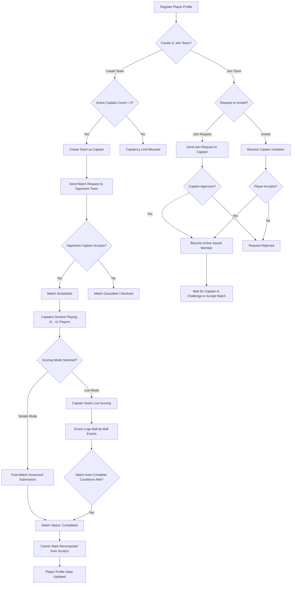
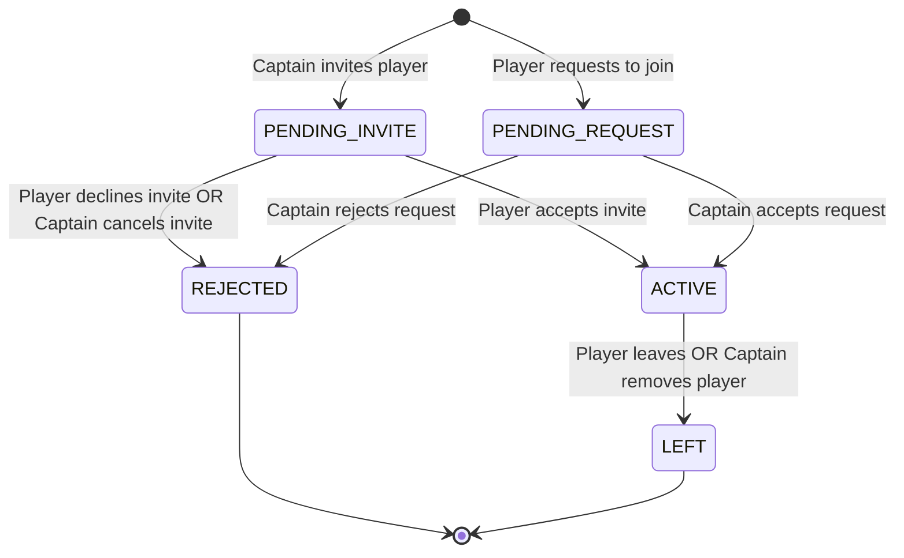
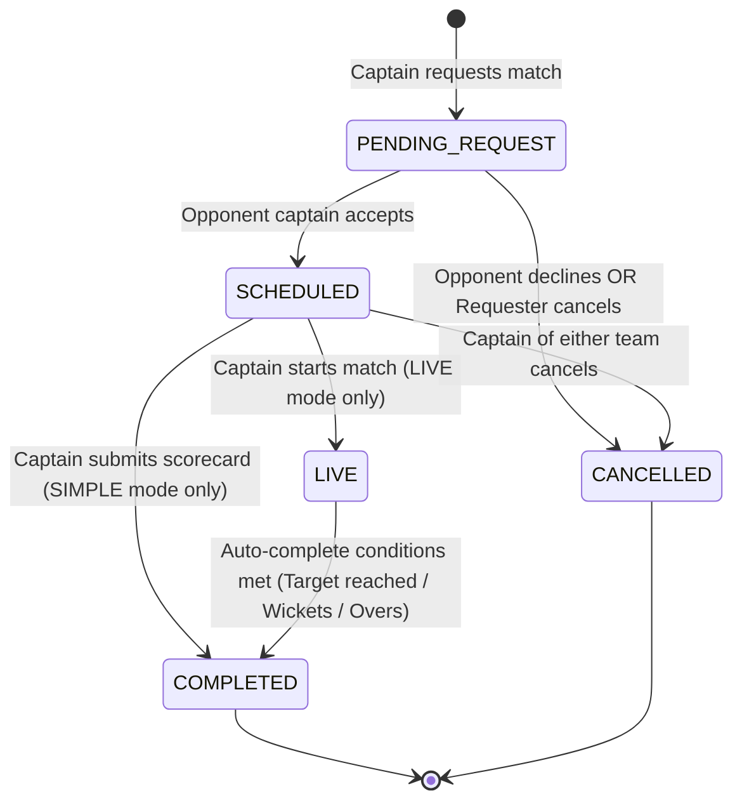
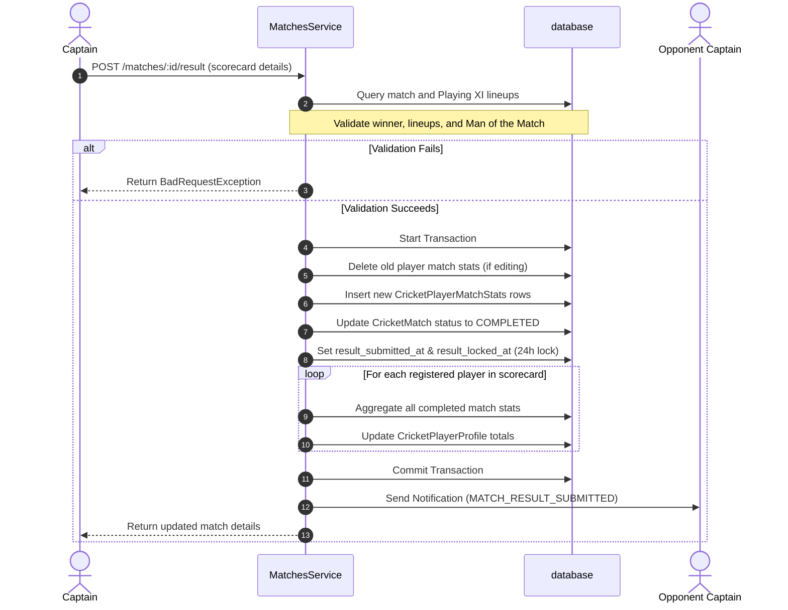
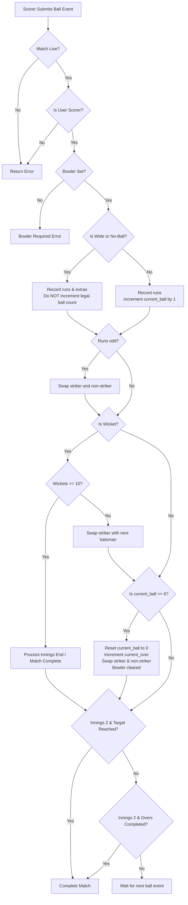
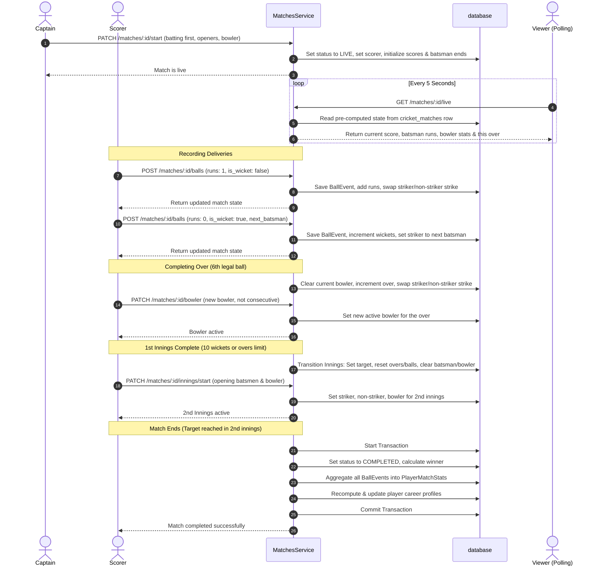
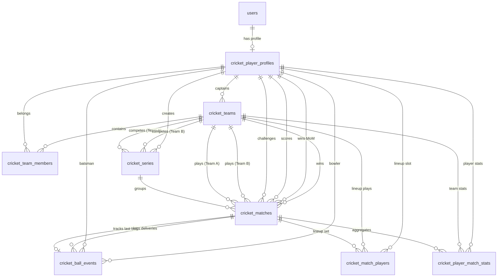

# Cricket Feature Specification and System Record

This document provides a comprehensive, end-to-end written record of the Cricket feature implemented inside the Pabaini app. It covers player profiles, teams, match scheduling, request lifecycles, and both simple (post-match) and live (ball-by-ball) scoring modes. It serves as a precise technical and business spec for developers, product managers, and other stakeholders.

---

## 1. Overview

The Cricket feature replaces manual and error-prone coordination processes—such as scheduling matches via WhatsApp, organizing teams over phone calls, and recording scores on paper scorecards—with a unified, digital match management system. 

The system provides three main modules:
*   **Player Profiles**: Digital cricket profiles containing player roles, hand/arm styles, and automatically aggregated career stats.
*   **Teams**: Squad management tools that support team creation, captaincy limits, squad invitations, player join requests, and captaincy transfers.
*   **Matches**: A multi-stage match engine supporting match requests, Playing XI lineup declaration, simple post-match scorecard entry (with a 24-hour edit lock window), and real-time live ball-by-ball scoring. Live matches write to a permanent ball log while updating a pre-computed "live state" directly on the match record to support high-performance, real-time polling.

---

## 2. Player Journey Map

The flowchart below traces the complete lifecycle of a player from their initial registration to joining squads, participating in matches, and seeing their career statistics automatically update on their profile.

---

## 3. Player Profiles

Every player in the Pabaini cricket system must establish a digital profile before interacting with teams or matches. Player profiles map one-to-one with user accounts and track individual playing styles and career stats.

### Data Fields

The following fields exist on the player profile entity (`CricketPlayerProfile`):

| Database Column | Data Type | Required / Optional | Description |
| :--- | :--- | :--- | :--- |
| `id` | `integer` (Primary Key) | Required | Auto-incrementing unique identifier. |
| `user_id` | `integer` (Unique FK) | Required | References the central user account (`users.id`). |
| `role` | `enum` (`CricketRole`) | Required | Player style: `batsman`, `bowler`, `allrounder`, or `keeper`. |
| `batting_hand` | `enum` (`BattingHand`) | Required | Left or right handed batsman: `left` or `right`. |
| `bowling_arm` | `enum` (`BowlingArm`) | Required | Arm used for bowling: `left`, `right`, or `none`. |
| `bowling_type` | `enum` (`BowlingType`) | Required | Type of bowling: `fast`, `medium`, `spin`, or `none`. |
| `is_active` | `boolean` | Required | Defaults to `true`. Determines if the player profile is active. |
| `total_matches` | `integer` | Required | Career matches played. Defaults to `0`. |
| `total_runs` | `integer` | Required | Total runs scored. Defaults to `0`. |
| `total_balls_faced` | `integer` | Required | Total deliveries faced while batting. Defaults to `0`. |
| `total_fours` | `integer` | Required | Total fours hit. Defaults to `0`. |
| `total_sixes` | `integer` | Required | Total sixes hit. Defaults to `0`. |
| `highest_score` | `integer` | Required | Maximum runs scored in a single innings. Defaults to `0`. |
| `total_wickets` | `integer` | Required | Total wickets taken as a bowler. Defaults to `0`. |
| `total_overs_bowled`| `decimal(5,1)` | Required | Total overs bowled. Defaults to `0.0`. |
| `total_runs_given` | `integer` | Required | Total runs conceded while bowling. Defaults to `0`. |
| `created_at` | `timestamp` | Required | Auto-set timestamp when the profile is created. |
| `updated_at` | `timestamp` | Required | Auto-set timestamp when the profile is updated. |

### Validation Rules
1.  **Bowling Arm & Type Consistency**: If a player's `bowling_arm` is set to `none`, then their `bowling_type` must also be set to `none`. Any attempt to violate this consistency rule throws a `BadRequestException` ("If bowling arm is none, bowling type must also be none"). This is enforced during profile creation and profile updates.
2.  **Unique Profile**: A user can only have one cricket player profile. Creating a duplicate profile throws a `ConflictException` ("Cricket player profile already exists").

---

## 4. Teams

Teams gather player profiles into formal squads. Squad management enforces structural limits to prevent players from over-committing as captains, while leaving player membership open for flexible participation.

### Team Creation and Captaincy Limit
*   **Captaincy Limit**: A player can be the active captain of at most **2 active teams**. This constraint is enforced in the `TeamsService.createTeam` method. It counts the active teams where `captain_id` equals the player's profile ID and `is_active` is `true`. If this count is 2 or more, it throws a `BadRequestException` ("You are already captain of 2 active teams. Transfer captaincy or dissolve a team before creating a new one.").
*   **Team Name Uniqueness**: Team names must be unique across the platform. Creating a team with a name that is already in use throws a `ConflictException` ("Team name already exists").

### Squad Membership Rules
*   **No Membership Cap**: There is currently no cap on how many teams a player can join as a normal squad member. This design decision was made to allow players to play in various friendly matches, deferring strict team limits to tournament-level rules when the tournament feature is introduced.
*   **Squad Invites**: Captains can invite players to join their squad (`TeamsService.invitePlayer`). The system validates that the target player is active, is not the captain themselves, and doesn't already have an active or pending membership on the team. If valid, a membership record is created with the status `pending_invite`, and a notification (`TEAM_INVITE`) is sent to the player.
*   **Join Requests**: A player can request to join an active team (`TeamsService.joinRequest`). The system validates that the team is active, that the player isn't already the captain of the team, and that they do not already have an active or pending membership on the team. A membership record is created with the status `pending_request`, and a notification (`TEAM_JOIN_REQUEST`) is sent to the team captain.

### Captaincy Transfer
A captain can transfer captaincy to any active team member using the `TeamsService.transferCaptaincy` method.
*   **Validation**: The target player must be an active member of the team.
*   **Transaction**: The transfer is processed inside a database transaction:
    1.  The old captain's membership role is changed from `captain` to `player`.
    2.  The new captain's membership role is changed to `captain`.
    3.  The team's `captain_id` column is updated to reference the new captain's profile ID.
*   **Notification**: A notification (`TEAM_CAPTAINCY_TRANSFERRED`) is sent to the new captain.

### Squad Membership State Machine
Team membership transitions are controlled by the `TeamMemberStatus` enum (`pending_invite`, `pending_request`, `active`, `rejected`, `left`).

---

## 5. Matches

Matches represent the central gameplay engine of the cricket feature. The system supports scheduling, challenge validation, and two distinct scoring pathways.

### 5A. Match Request Lifecycle

Matches begin as challenges between two squads. The lifecycle transitions through various statuses (`pending_request`, `scheduled`, `live`, `completed`, `cancelled`, `no_result`).

#### Match Request Business Rules

| Rule | Description | File / Method |
| :--- | :--- | :--- |
| **Who can request** | Only team captains can send match requests to other teams. | `MatchesService.requestMatch` |
| **Self-Challenge Block** | A captain cannot challenge their own team. | `MatchesService.requestMatch` |
| **Duplicate Challenge Prevention** | Teams cannot have multiple pending requests active between them. | `MatchesService.requestMatch` |
| **Accept/Decline** | Only the captain of the challenged team can accept or decline a pending match request. | `MatchesService.acceptMatch` / `declineMatch` |
| **Who can edit** | Only the requesting captain can edit match details (overs, venue, schedule, scoring mode), and only while it is pending. | `MatchesService.updateMatch` |
| **Who can cancel** | If the match is in `pending_request`, only the requesting captain can cancel. If `scheduled`, the captain of either team can cancel. | `MatchesService.cancelMatch` |

---

### 5B. Playing XI Declaration

Before starting live scoring or submitting a scorecard, captains must declare their starting lineup (the Playing XI).

*   **Lineup Requirement**: A lineup must consist of **exactly 11 players**.
*   **Registered vs. Guest Players**:
    *   **Registered Players**: Users with profile accounts (`player_id` is set). Career stats are tracked and updated dynamically for these players.
    *   **Guest Players**: Players who do not have accounts (`guest_name` is set, `player_id` is null). This allows squads to record complete scorecards when playing with temporary players or non-users.
*   **Lineup Validation**:
    *   Registered players declared in the lineup must be active squad members (`status: active` in `cricket_team_members` for that team).
    *   Each lineup entry must specify either a `player_id` or a `guest_name`, but never both.
    *   Each player must be assigned a unique batting order between `1` and `11`.
*   **Prerequisite Gate**: Lineup declaration is an absolute prerequisite. Live scoring cannot be started unless both teams have successfully set `team_a_lineup_set = true` and `team_b_lineup_set = true`.

---

### 5C. Simple Scoring Mode

Simple Scoring Mode is a retroactive, post-match data entry tool. It is used to record the results of completed matches in a single, one-time submission.

*   **Who can submit**: The captain of either team.
*   **Submission Payload**: Includes final team scores, the winner, the Man of the Match, and complete match cards for every player (runs, balls faced, boundaries, wickets, runs conceded, and bowling extras).
*   **Validation Rules**:
    *   The match must be in `scheduled` status.
    *   The winner team ID must match one of the participating team IDs.
    *   All player stats submitted must belong to players declared in the Playing XI.
    *   The Man of the Match must be a registered player in the lineup.
*   **24-Hour Edit Window**:
    *   Upon result submission, the backend records `result_submitted_at = now()` and sets a lock boundary `result_locked_at = now() + 24 hours`.
    *   Captains can edit the results (`MatchesService.editResult`) as long as the current time is before `result_locked_at`.
    *   Once `result_locked_at` passes, the edit endpoint throws a `BadRequestException` ("Match results are locked and can no longer be edited").
*   **Career Stats Aggregation**:
    *   **Recompute from Scratch**: Rather than incrementing stats, the backend runs a complete re-calculation query on every submission or edit. It fetches all completed match stats for the affected players, aggregates them, and overwrites the totals in the `cricket_player_profiles` table.
    *   **Why**: This approach is far safer than incremental updates. It guarantees that data edits, cancellations, or out-of-order result submissions never result in stat drift, double counting, or database race conditions.

---

### 5D. Live Ball-by-Ball Scoring Mode

Live ball-by-ball scoring tracks matches in real time, creating a permanent ball log while providing fans and diaspora abroad with an instant, lightweight live view.

#### 1. Scorer Assignment
During the live match start call, the captain designates a **scorer** (`scorer_id`). If not explicitly provided, it defaults to the captain starting the match. The scorer must be an active squad member of either team. The scorer gains exclusive write permissions to all live-scoring endpoints (`/balls`, `/bowler`, `/innings/start`, `/balls/undo`).

#### 2. Match Start
Either captain starts the match by calling `PATCH /matches/:id/start` with the toss details, batting first team, and opening striker, non-striker, and bowler. This call transitions the match status to `live`, initializes the scoring fields (`current_innings = 1`, `current_over = 0`, `current_ball = 0`), and notifies both captains (`MATCH_STARTED`).

#### 3. Ball Entry and Delivery Rules
For every delivery, the scorer posts runs, extra types, runs from extras, and wicket details to `POST /matches/:id/balls`.
*   **Legal Deliveries**: Deliveries where `extra_type` is not `wide` or `no_ball`. Legal deliveries increment the over's ball counter (`current_ball`).
*   **Illegal Deliveries**: Wides and no-balls do *not* increment `current_ball`. They add a penalty run to the batting team's score and are recorded in the bowler's runs conceded, but the batsman is not credited with facing a ball.
*   **Strike Rotation**:
    *   **Runs-based Rotation**: Scoring an odd number of runs (1, 3, or 5) swaps the striker and non-striker.
    *   **Over Completion Rotation**: At the end of an over (after 6 legal deliveries), the striker and non-striker swap ends.
    *   *Note*: If an odd run is scored on the 6th legal delivery of an over, the strike rotates twice, effectively returning the batsmen to their original ends.

#### 4. Over Completion and Bowler Rotation
An over is complete when `current_ball` reaches 6. 
*   The system increments `current_over`, resets `current_ball` to 0, swaps striker/non-striker, and clears the bowler fields (`current_bowler_id = null`).
*   The scorer must select a bowler (`PATCH /matches/:id/bowler`) before entering the next ball.
*   **Consecutive Over Restriction**: A bowler cannot bowl two consecutive overs. The system enforces this by checking the new bowler's identity against the bowler ID recorded in the previous over's final ball event, throwing a `BadRequestException` ("Bowler cannot bowl two consecutive overs") if they match.

#### 5. Wicket Handling
If a wicket falls (`is_wicket = true`), the scorer records the wicket type.
*   **Striker Dismissal Simplification**: To keep scoring fast and simple, run-outs and other wickets are always assumed to dismiss the **striker**.
*   If the innings has wickets remaining (wickets < 10), the scorer must provide a `next_batsman_id` or `next_batsman_guest_name` in the payload. The dismissed striker is replaced on the field by this next batsman.

#### 6. Innings Transition
An innings transitions when 10 wickets fall or the scheduled overs are complete.
*   **Transition from 1st to 2nd Innings**: The system calculates the target score (`innings_1_score + 1`), increments `current_innings` to 2, resets overs/balls to 0, swaps the batting team, and clears the batsmen and bowler fields.
*   The scorer must call `PATCH /matches/:id/innings/start` to set the new opening batsmen and opening bowler for the second innings.

#### 7. Match Auto-Completion
A live match automatically completes and transitions status to `completed` when one of these conditions is met in the second innings:
1.  **Target Reached**: The batting team's score matches or exceeds `target` (Batting team wins).
2.  **All Out**: The batting team loses 10 wickets (Bowling team wins, or tie if scores are equal).
3.  **Overs Complete**: The batting team faces all scheduled overs (Bowling team wins if batting score is less than `target - 1`, tie if score matches `target - 1`).

Upon auto-completion, the backend:
*   Sets status to `completed`, computes the winner (or sets `is_tie`), and formats final scorecards.
*   Aggregates the raw ball logs in `cricket_ball_events` into `cricket_player_match_stats` for all Playing XI players.
*   Runs the career stats recompute transaction for all registered players in the match.
*   Sends notifications (`MATCH_COMPLETED`) to both captains.

#### 8. Undo Last Ball Feature
The scorer can revert mistakes using `PATCH /matches/:id/balls/undo`.
*   **Limitation**: The undo action is restricted to the **single most recent ball** only. Multi-step history undoes are not supported.
*   **Effect**: The backend fetches the event referenced by `last_ball_event_id`, reverses the run changes, wicket counts, overs/balls counters, strike rotations, and bowler assignments, deletes the ball event row, and sets `last_ball_event_id` to the previous ball event.

#### 9. Live Viewing Performance
The public live endpoint `GET /matches/:id/live` fetches pre-computed, current-state fields stored directly on the `cricket_matches` row.
*   **Performance Rationale**: Querying and aggregating the entire `cricket_ball_events` table on every poll request would cause significant database load during popular matches. Reading the pre-computed state from the match row ensures that response times remain fast and database resource consumption is minimized, even when thousands of users are polling simultaneously.

#### Ball Entry Decision Flowchart

#### End-to-End Live Scoring Sequence Diagram

---

## 6. Data Model Reference

The backend database runs on Supabase (PostgreSQL). The relationships and tables supporting the cricket feature are detailed below.

### 1. `cricket_player_profiles`
Stores profiles and aggregated career stats for registered players.
*   `id` (`SERIAL PRIMARY KEY`): Unique profile identifier.
*   `user_id` (`INTEGER UNIQUE REFERENCES users(id) ON DELETE CASCADE`): Maps profile one-to-one to user.
*   `role` (`VARCHAR`): Player role (`batsman`, `bowler`, `allrounder`, `keeper`).
*   `batting_hand` (`VARCHAR`): Batting hand (`left`, `right`).
*   `bowling_arm` (`VARCHAR`): Bowling arm (`left`, `right`, `none`).
*   `bowling_type` (`VARCHAR`): Bowling style (`fast`, `medium`, `spin`, `none`).
*   `is_active` (`BOOLEAN DEFAULT true`): Status indicator.
*   `total_matches` (`INTEGER DEFAULT 0`): Career match counter.
*   `total_runs` (`INTEGER DEFAULT 0`): Career runs.
*   `total_balls_faced` (`INTEGER DEFAULT 0`): Career balls faced.
*   `total_fours` (`INTEGER DEFAULT 0`): Career fours.
*   `total_sixes` (`INTEGER DEFAULT 0`): Career sixes.
*   `highest_score` (`INTEGER DEFAULT 0`): Career high score.
*   `total_wickets` (`INTEGER DEFAULT 0`): Career wickets.
*   `total_overs_bowled` (`DECIMAL(5,1) DEFAULT 0.0`): Career overs bowled.
*   `total_runs_given` (`INTEGER DEFAULT 0`): Career runs conceded.
*   `created_at` (`TIMESTAMP DEFAULT NOW()`): Profile creation time.
*   `updated_at` (`TIMESTAMP DEFAULT NOW()`): Last update time.

### 2. `cricket_teams`
Stores team details and registers team captains.
*   `id` (`SERIAL PRIMARY KEY`): Unique team identifier.
*   `name` (`VARCHAR(100) UNIQUE NOT NULL`): Team name.
*   `description` (`TEXT`): Description of team.
*   `logo_url` (`VARCHAR(500)`): Logo file URL in storage.
*   `home_ground` (`VARCHAR(200)`): Team's home field.
*   `captain_id` (`INTEGER NOT NULL REFERENCES cricket_player_profiles(id) ON DELETE CASCADE`): Profile ID of captain.
*   `founded_year` (`INTEGER`): Year team founded.
*   `is_active` (`BOOLEAN DEFAULT true`): Team status.
*   `created_at` (`TIMESTAMP DEFAULT NOW()`): Team creation time.
*   `updated_at` (`TIMESTAMP DEFAULT NOW()`): Last update time.

### 3. `cricket_team_members`
Stores team memberships and request statuses.
*   `id` (`SERIAL PRIMARY KEY`): Unique membership record ID.
*   `team_id` (`INTEGER REFERENCES cricket_teams(id) ON DELETE CASCADE`): Team ID.
*   `player_id` (`INTEGER REFERENCES cricket_player_profiles(id) ON DELETE CASCADE`): Player profile ID.
*   `role` (`VARCHAR DEFAULT 'player'`): Membership role (`captain`, `vice_captain`, `player`).
*   `status` (`VARCHAR`): Member status (`pending_invite`, `pending_request`, `active`, `rejected`, `left`).
*   `invited_by` (`INTEGER REFERENCES cricket_player_profiles(id) ON DELETE SET NULL`): Inviting captain profile ID.
*   `joined_at` (`TIMESTAMP`): Time membership became active.
*   `created_at` (`TIMESTAMP DEFAULT NOW()`): Record creation time.
*   `updated_at` (`TIMESTAMP DEFAULT NOW()`): Last update time.
*   *Constraint*: Unique composite key on `(team_id, player_id)`.

### 4. `cricket_series`
Stores multi-match bilateral tournament groupings.
*   `id` (`SERIAL PRIMARY KEY`): Series identifier.
*   `title` (`VARCHAR(150) NOT NULL`): Series title.
*   `team_a_id` (`INTEGER NOT NULL REFERENCES cricket_teams(id) ON DELETE CASCADE`): First team.
*   `team_b_id` (`INTEGER NOT NULL REFERENCES cricket_teams(id) ON DELETE CASCADE`): Second team.
*   `total_matches` (`INTEGER NOT NULL`): Total matches scheduled.
*   `team_a_wins` (`INTEGER DEFAULT 0`): Match wins for Team A.
*   `team_b_wins` (`INTEGER DEFAULT 0`): Match wins for Team B.
*   `status` (`VARCHAR DEFAULT 'ongoing'`): Series status (`ongoing`, `completed`).
*   `created_by` (`INTEGER REFERENCES cricket_player_profiles(id) ON DELETE SET NULL`): Creator profile ID.
*   `created_at` (`TIMESTAMP DEFAULT NOW()`): Series creation time.
*   `updated_at` (`TIMESTAMP DEFAULT NOW()`): Last update time.

### 5. `cricket_matches`
Tracks scheduling, request statuses, final results, and pre-computed live score variables.
*   `id` (`SERIAL PRIMARY KEY`): Match identifier.
*   `series_id` (`INTEGER REFERENCES cricket_series(id) ON DELETE SET NULL`): Associated series.
*   `tournament_id` (`INTEGER`): Reserved for future tournament table association.
*   `team_a_id` (`INTEGER NOT NULL REFERENCES cricket_teams(id) ON DELETE CASCADE`): First team.
*   `team_b_id` (`INTEGER NOT NULL REFERENCES cricket_teams(id) ON DELETE CASCADE`): Second team.
*   `requested_by` (`INTEGER NOT NULL REFERENCES cricket_player_profiles(id) ON DELETE CASCADE`): Challenge sender.
*   `overs` (`INTEGER NOT NULL`): Scheduled overs limit.
*   `venue` (`VARCHAR(200)`): Match venue.
*   `scheduled_at` (`TIMESTAMP`): Scheduled match time.
*   `scoring_mode` (`VARCHAR`): Scoring method (`simple`, `live`).
*   `scorer_id` (`INTEGER REFERENCES cricket_player_profiles(id) ON DELETE SET NULL`): Assigned scorer.
*   `status` (`VARCHAR DEFAULT 'pending_request'`): Match status (`pending_request`, `scheduled`, `live`, `completed`, `cancelled`, `no_result`).
*   `winner_team_id` (`INTEGER REFERENCES cricket_teams(id) ON DELETE SET NULL`): Winning team.
*   `man_of_match_id` (`INTEGER REFERENCES cricket_player_profiles(id) ON DELETE SET NULL`): Man of Match.
*   `team_a_score` (`VARCHAR(20)`): Formatted final score string for Team A (e.g. `120/5 (20.0)`).
*   `team_b_score` (`VARCHAR(20)`): Formatted final score string for Team B.
*   `team_a_lineup_set` (`BOOLEAN DEFAULT false`): Lineup flag.
*   `team_b_lineup_set` (`BOOLEAN DEFAULT false`): Lineup flag.
*   `current_innings` (`INTEGER`): Active innings during live play (`1` or `2`).
*   `current_over` (`INTEGER DEFAULT 0`): Active over number.
*   `current_ball` (`INTEGER DEFAULT 0`): Active legal ball count in over (0-5).
*   `current_batting_team_id` (`INTEGER REFERENCES cricket_teams(id) ON DELETE SET NULL`): Team currently batting.
*   `striker_id` (`INTEGER REFERENCES cricket_player_profiles(id) ON DELETE SET NULL`): Striker profile ID.
*   `striker_guest_name` (`VARCHAR(100)`): Striker name if guest.
*   `non_striker_id` (`INTEGER REFERENCES cricket_player_profiles(id) ON DELETE SET NULL`): Non-striker profile ID.
*   `non_striker_guest_name` (`VARCHAR(100)`): Non-striker name if guest.
*   `current_bowler_id` (`INTEGER REFERENCES cricket_player_profiles(id) ON DELETE SET NULL`): Bowler profile ID.
*   `current_bowler_guest_name` (`VARCHAR(100)`): Bowler name if guest.
*   `innings_1_score` (`INTEGER DEFAULT 0`): Total score in 1st innings.
*   `innings_1_wickets` (`INTEGER DEFAULT 0`): Total wickets down in 1st innings.
*   `innings_1_overs` (`DECIMAL(4,1) DEFAULT 0.0`): Total overs bowled in 1st innings.
*   `innings_1_batting_team_id` (`INTEGER REFERENCES cricket_teams(id) ON DELETE SET NULL`): Batting team in 1st innings.
*   `innings_2_score` (`INTEGER DEFAULT 0`): Total score in 2nd innings.
*   `innings_2_wickets` (`INTEGER DEFAULT 0`): Total wickets down in 2nd innings.
*   `innings_2_overs` (`DECIMAL(4,1) DEFAULT 0.0`): Total overs bowled in 2nd innings.
*   `innings_2_batting_team_id` (`INTEGER REFERENCES cricket_teams(id) ON DELETE SET NULL`): Batting team in 2nd innings.
*   `target` (`INTEGER`): Runs required to win in 2nd innings.
*   `last_ball_event_id` (`INTEGER REFERENCES cricket_ball_events(id) ON DELETE SET NULL`): Pointer to last recorded ball.
*   `is_tie` (`BOOLEAN DEFAULT false`): Tie flag.
*   `result_submitted_at` (`TIMESTAMP`): Time scorecard results were first submitted.
*   `result_locked_at` (`TIMESTAMP`): Time result submission lock expires.
*   `created_at` (`TIMESTAMP DEFAULT NOW()`): Match record creation time.
*   `updated_at` (`TIMESTAMP DEFAULT NOW()`): Last update time.
*   *Constraint*: Composite check constraint: `series_id IS NULL OR tournament_id IS NULL`.

### 6. `cricket_match_players`
Stores declared lineups for matches.
*   `id` (`SERIAL PRIMARY KEY`): Lineup entry identifier.
*   `match_id` (`INTEGER NOT NULL REFERENCES cricket_matches(id) ON DELETE CASCADE`): Match ID.
*   `team_id` (`INTEGER NOT NULL REFERENCES cricket_teams(id) ON DELETE CASCADE`): Team ID.
*   `player_id` (`INTEGER REFERENCES cricket_player_profiles(id) ON DELETE SET NULL`): Player profile ID (if registered).
*   `guest_name` (`VARCHAR(100)`): Guest name (if guest player).
*   `batting_order` (`INTEGER`): Batting order slot (1-11).
*   `created_at` (`TIMESTAMP DEFAULT NOW()`): Record creation time.
*   *Constraint*: Composite check constraint: `player_id IS NOT NULL OR guest_name IS NOT NULL`.

### 7. `cricket_player_match_stats`
Stores scorecard stats per player per match. This table is written to by post-match result submission or live-match auto-aggregation.
*   `id` (`SERIAL PRIMARY KEY`): Stats entry identifier.
*   `match_id` (`INTEGER NOT NULL REFERENCES cricket_matches(id) ON DELETE CASCADE`): Match ID.
*   `team_id` (`INTEGER NOT NULL REFERENCES cricket_teams(id) ON DELETE CASCADE`): Team ID.
*   `player_id` (`INTEGER REFERENCES cricket_player_profiles(id) ON DELETE SET NULL`): Player profile ID.
*   `guest_name` (`VARCHAR(100)`): Guest name.
*   `runs` (`INTEGER DEFAULT 0`): Batting runs scored.
*   `balls_faced` (`INTEGER DEFAULT 0`): Batting balls faced.
*   `fours` (`INTEGER DEFAULT 0`): Batting fours hit.
*   `sixes` (`INTEGER DEFAULT 0`): Batting sixes hit.
*   `how_out` (`VARCHAR`): Method of dismissal (`bowled`, `caught`, `run_out`, `lbw`, `stumped`, `hit_wicket`, `retired`).
*   `is_not_out` (`BOOLEAN DEFAULT false`): True if batsman was not dismissed.
*   `overs_bowled` (`DECIMAL(4,1) DEFAULT 0.0`): Overs bowled (decimal representation).
*   `runs_given` (`INTEGER DEFAULT 0`): Runs conceded.
*   `wickets` (`INTEGER DEFAULT 0`): Bowled wickets taken.
*   `wides` (`INTEGER DEFAULT 0`): Wides bowled.
*   `no_balls` (`INTEGER DEFAULT 0`): No-balls bowled.
*   `created_at` (`TIMESTAMP DEFAULT NOW()`): Stats creation time.
*   `updated_at` (`TIMESTAMP DEFAULT NOW()`): Last update time.

### 8. `cricket_ball_events`
Stores a permanent chronological log of every delivery in a live match.
*   `id` (`SERIAL PRIMARY KEY`): Event identifier.
*   `match_id` (`INTEGER NOT NULL REFERENCES cricket_matches(id) ON DELETE CASCADE`): Match ID.
*   `innings` (`INTEGER NOT NULL`): Innings count (`1` or `2`).
*   `over_number` (`INTEGER NOT NULL`): Chronological over count (starts at 0).
*   `ball_number` (`INTEGER NOT NULL`): Incremental index of delivery in the over (both legal and illegal).
*   `batsman_id` (`INTEGER REFERENCES cricket_player_profiles(id) ON DELETE SET NULL`): Facing batsman.
*   `batsman_guest_name` (`VARCHAR(100)`): Facing guest batsman.
*   `bowler_id` (`INTEGER REFERENCES cricket_player_profiles(id) ON DELETE SET NULL`): Delivering bowler.
*   `bowler_guest_name` (`VARCHAR(100)`): Delivering guest bowler.
*   `runs` (`INTEGER DEFAULT 0`): Runs scored off bat.
*   `extra_type` (`VARCHAR`): Extra category (`wide`, `no_ball`, `bye`, `leg_bye`).
*   `extra_runs` (`INTEGER DEFAULT 0`): Runs scored off extras.
*   `is_wicket` (`BOOLEAN DEFAULT false`): Wicket event flag.
*   `wicket_type` (`VARCHAR`): Dismissal type.
*   `created_at` (`TIMESTAMP DEFAULT NOW()`): Log creation time.
*   *Constraint*: Composite unique index on `(match_id, innings, over_number, ball_number)`.

### Database Relationships (ER Diagram)

The relationships between all these tables are shown in the ER diagram below:

---

## 7. Complete Business Rules Ledger

The following ledger details every constraint, business rule, and validation check implemented across players, teams, and matches.

| No. | Rule | Code Location | Exception Thrown / Error Message |
| :--- | :--- | :--- | :--- |
| 1 | **Bowling Arm/Style consistency** | `CricketPlayersService.createProfile` & `updateMyProfile` | `BadRequestException` ("If bowling arm is none, bowling type must also be none") |
| 2 | **One Player Profile per User** | `CricketPlayersService.createProfile` | `ConflictException` ("Cricket player profile already exists") |
| 3 | **Must have profile first** | `TeamsService.getCurrentPlayerProfile` | `ForbiddenException` ("You must set up a cricket player profile first") |
| 4 | **Captaincy Team Limit** | `TeamsService.createTeam` | `BadRequestException` ("You are already captain of 2 active teams. Transfer captaincy or dissolve a team before creating a new one.") |
| 5 | **Unique Team Names** | `TeamsService.createTeam` & `updateTeam` | `ConflictException` ("Team name already exists") |
| 6 | **Inviting self blocked** | `TeamsService.invitePlayer` | `BadRequestException` ("Captain cannot invite themselves") |
| 7 | **Already team member (invite)** | `TeamsService.invitePlayer` | `ConflictException` ("Player is already an active member of this team") |
| 8 | **Pending membership check (invite)** | `TeamsService.invitePlayer` | `ConflictException` ("A pending invite or request already exists for this player") |
| 9 | **Already team member (join)** | `TeamsService.joinRequest` | `ConflictException` ("You are already an active member of this team") |
| 10 | **Pending membership check (join)** | `TeamsService.joinRequest` | `ConflictException` ("A pending invite or request already exists for this team") |
| 11 | **Join own captained team blocked** | `TeamsService.joinRequest` | `BadRequestException` ("You are the captain of this team") |
| 12 | **Captain Accept join request** | `TeamsService.acceptMember` | `ForbiddenException` ("Only the team captain can accept join requests") |
| 13 | **Player Accept invitation** | `TeamsService.acceptMember` | `ForbiddenException` ("Only the invited player can accept invitations") |
| 14 | **Captain Reject join request** | `TeamsService.rejectMember` | `ForbiddenException` ("Only the team captain can reject join requests") |
| 15 | **Declining/Canceling Invite** | `TeamsService.rejectMember` | `ForbiddenException` ("Only the invited player or the team captain can cancel or decline invitations") |
| 16 | **Captain leaving squad** | `TeamsService.removeOrLeaveMember` | `BadRequestException` ("Transfer captaincy before leaving the team") |
| 17 | **Removing team captain** | `TeamsService.removeOrLeaveMember` | `BadRequestException` ("Cannot remove the team captain") |
| 18 | **Remove squad member permissions** | `TeamsService.removeOrLeaveMember` | `ForbiddenException` ("Only the captain or the member themselves can perform this action") |
| 19 | **Transfer captaincy membership** | `TeamsService.transferCaptaincy` | `BadRequestException` ("New captain must be an active member of the team") |
| 20 | **Challenge self team** | `MatchesService.requestMatch` | `BadRequestException` ("You cannot challenge your own team") |
| 21 | **Only captains can challenge** | `MatchesService.requestMatch` | `ForbiddenException` ("Only team captains can perform this action") |
| 22 | **Duplicate match requests** | `MatchesService.requestMatch` | `ConflictException` ("A pending match request already exists between these two teams") |
| 23 | **Accept match status** | `MatchesService.acceptMatch` & `declineMatch` | `BadRequestException` ("Match is not in pending request status") |
| 24 | **Accept match permissions** | `MatchesService.acceptMatch` & `declineMatch` | `ForbiddenException` ("Only the opponent team captain can accept this match request") |
| 25 | **Match Edit status** | `MatchesService.updateMatch` | `BadRequestException` ("Match can only be edited while pending. Cancel and create a new request if needed.") |
| 26 | **Match Edit permissions** | `MatchesService.updateMatch` | `ForbiddenException` ("Only the captain who requested the match can edit it") |
| 27 | **Cancel Match status** | `MatchesService.cancelMatch` | `BadRequestException` ("Only pending or scheduled matches can be cancelled") |
| 28 | **Cancel Match permissions** | `MatchesService.cancelMatch` | `ForbiddenException` ("Only the requesting captain can cancel a pending match request" or "Only the captain of Team A or Team B can cancel a scheduled match") |
| 29 | **Playing XI lineup size** | `MatchesService.declareLineup` | `BadRequestException` ("Playing XI must have exactly 11 players") |
| 30 | **Declare member guest / profile** | `MatchesService.declareLineup` | `BadRequestException` ("Each player in the lineup must have either a player_id or a guest_name" or "cannot have both") |
| 31 | **Roster alignment check** | `MatchesService.declareLineup` | `BadRequestException` ("Player [id] is not an active member of your team") |
| 32 | **Unique Batting Order** | `MatchesService.declareLineup` | `BadRequestException` ("Each player must have a unique batting order") |
| 33 | **Valid batting order range** | `MatchesService.declareLineup` | `BadRequestException` ("Batting order must be between 1 and 11") |
| 34 | **Declaring lineup status** | `MatchesService.declareLineup` | `BadRequestException` ("Lineups can only be declared for scheduled matches") |
| 35 | **Declaring lineup permissions** | `MatchesService.declareLineup` | `ForbiddenException` ("Only the captain of Team A or Team B can declare lineups") |
| 36 | **Submit Result match status** | `MatchesService.submitResult` | `BadRequestException` ("Match is not in scheduled status") |
| 37 | **Submit Result match mode** | `MatchesService.submitResult` | `BadRequestException` ("Match is not in simple scoring mode") |
| 38 | **Submit Result permissions** | `MatchesService.submitResult` | `ForbiddenException` ("Only the captain of Team A or Team B can submit results") |
| 39 | **Submit empty scorecard** | `MatchesService.submitResult` | `BadRequestException` ("Player stats cannot be empty") |
| 40 | **Winner validation** | `MatchesService.submitResult` & `editResult` | `BadRequestException` ("Winner team must be one of the participating teams") |
| 41 | **Playing XI lineup set check** | `MatchesService.submitResult` | `BadRequestException` ("Playing XI lineup has not been declared for this match") |
| 42 | **Stats match squad list** | `MatchesService.submitResult` & `editResult` | `BadRequestException` ("Player [identifier] is not in the declared Playing XI lineup for team [id]") |
| 43 | **Man of match alignment** | `MatchesService.submitResult` & `editResult` | `BadRequestException` ("Man of the match must be a registered player in the match lineup") |
| 44 | **Result Edit lock window** | `MatchesService.editResult` | `BadRequestException` ("Match results are locked and can no longer be edited") |
| 45 | **Result Edit permissions** | `MatchesService.editResult` | `ForbiddenException` ("Only the captain of Team A or Team B can edit results") |
| 46 | **Start Live match status** | `MatchesService.startMatch` | `BadRequestException` ("Match is not in scheduled status") |
| 47 | **Start Live match mode** | `MatchesService.startMatch` | `BadRequestException` ("This match is not set to live scoring mode") |
| 48 | **Lineups set before Live** | `MatchesService.startMatch` | `BadRequestException` ("Both teams must declare their Playing XI before starting") |
| 49 | **Start Live permissions** | `MatchesService.startMatch` | `ForbiddenException` ("Only the captain of Team A or Team B can start the match") |
| 50 | **Batting first validation** | `MatchesService.startMatch` | `BadRequestException` ("Batting first team must be one of the participating teams") |
| 51 | **Scorer active member check** | `MatchesService.startMatch` | `BadRequestException` ("The selected scorer is not an active member of either participating team") |
| 52 | **Openers Playing XI check** | `MatchesService.startMatch` | `BadRequestException` ("Opening striker/non-striker/bowler must be in the [batting/bowling] team Playing XI") |
| 53 | **Live Scorer exclusivity** | `MatchesService.recordBall` & `selectBowler` & `startSecondInnings` & `undoLastBall` | `ForbiddenException` ("Only the assigned scorer can record balls / select bowlers / start the second innings / undo balls") |
| 54 | **Fielders exist on live field** | `MatchesService.recordBall` | `BadRequestException` ("No striker batsman set on the field" or "No bowler set for the current over") |
| 55 | **Next batsman alignment** | `MatchesService.recordBall` | `BadRequestException` ("Next batsman must belong to the batting Playing XI") |
| 56 | **Next batsman distinct from non-striker** | `MatchesService.recordBall` | `BadRequestException` ("Next batsman cannot be the current non-striker") |
| 57 | **Select Bowler status** | `MatchesService.selectBowler` | `BadRequestException` ("Match is not live") |
| 58 | **Over bowler slot empty** | `MatchesService.selectBowler` | `BadRequestException` ("A bowler is already set for the current over") |
| 59 | **Select Bowler roster check** | `MatchesService.selectBowler` | `BadRequestException` ("Selected bowler must be in the bowling team Playing XI") |
| 60 | **Consecutive Over bowling check** | `MatchesService.selectBowler` | `BadRequestException` ("Bowler cannot bowl two consecutive overs") |
| 61 | **Start 2nd Innings status** | `MatchesService.startSecondInnings` | `BadRequestException` ("Match is not live" or "Second innings is not active") |
| 62 | **Start 2nd Innings state** | `MatchesService.startSecondInnings` | `BadRequestException` ("Second innings has already started") |
| 63 | **Undo ball live status** | `MatchesService.undoLastBall` | `BadRequestException` ("Match is not live") |
| 64 | **Undo ball existence** | `MatchesService.undoLastBall` | `BadRequestException` ("No ball to undo") |

---

## 8. Known Simplifications and Deferred Work

The current system implementation focuses on core functionality and includes the following simplifications and deferred work:

1.  **Run-Out Striker Dismissal Simplification**: When a batsman is run out, the system always records the striker as dismissed, even if the non-striker was actually the one caught out of their crease. Dismissal mapping is simplified to keep scoring quick.
2.  **Single-Step Ball Undo Limit**: The live scoring undo feature is limited to the single most recent delivery (`last_ball_event_id`). The system does not maintain a full session stack, so scorers cannot undo multiple events in succession.
3.  **No Team Membership Cap**: There is no database or service-level limit on how many teams a player can join as a normal squad member. This has been deferred to future tournament-level roster enforcement.
4.  **Unused `tournament_id` on Matches**: The `cricket_matches` table has a `tournament_id` column with a database check constraint (`chk_match_context`). This column is currently unused and is reserved for future tournament feature expansion.
5.  **Vice-Captain Role Lack of Permissions**: The `TeamMemberRole` enum defines a `vice_captain` role. However, the backend services do not currently grant the vice-captain any administrative or scheduling privileges—they are treated identically to normal players. Exposing a vice-captain administrative endpoint remains a pending item.
6.  **Unwired Client-Side Notification Listeners**: Notifications (e.g. `TEAM_INVITE`, `MATCH_REQUEST`) are successfully saved to the backend database, but client-side FCM listeners in the mobile frontend must be wired to handle background notification popups.
7.  **Tier-Based Stats Stubbing**: The `CricketStatsService` contains stub methods returning empty metrics for `competitive` and `casual` statistics categories. This has been deferred to Phase 4, and player stats are currently read directly from the aggregated totals on `cricket_player_profiles`.

---

## 9. Glossary

Below are definitions for common terms used in the Pabaini cricket system:

*   **Scorer**: A designated player profile assigned during a live match start who holds exclusive administrative rights to enter balls, select bowlers, and undo events.
*   **Guest Player**: A temporary participant in a match lineup who does not have a user profile account in the app.
*   **Playing XI**: The starting lineup of exactly 11 players declared by a team captain before a match begins.
*   **Innings**: A single turn of batting by one team. Limited-overs matches consist of two innings (one per team).
*   **Legal Delivery**: A bowler's delivery that does not result in a wide or a no-ball. The over length tracks only legal deliveries.
*   **Strike Rotation**: The process of changing which of the two active batsmen is facing the bowler. This occurs when an odd number of runs is scored or when an over completes.
*   **Simple Mode**: A post-match result submission mode where the complete scorecard is entered in one transaction.
*   **Live Mode**: A ball-by-ball real-time match logging mode.
*   **Captaincy Limit**: A rule restricting a single player to captaining a maximum of 2 active teams.
*   **Target**: The score the second batting team must reach to win the match, calculated as `innings_1_score + 1`.
*   **Extras**: Penalty runs awarded to the batting team that are not scored off the bat, including wides, no-balls, byes, and leg-byes.
*   **Wide**: An illegal delivery that passes too far outside the batsman's reach. It awards 1 extra run and does not count as a legal ball in the over.
*   **No-Ball**: An illegal delivery (e.g., foot fault or high bounce). It awards 1 extra run, does not count as a legal ball in the over, and batsmen cannot be dismissed off a no-ball except by run-out.
