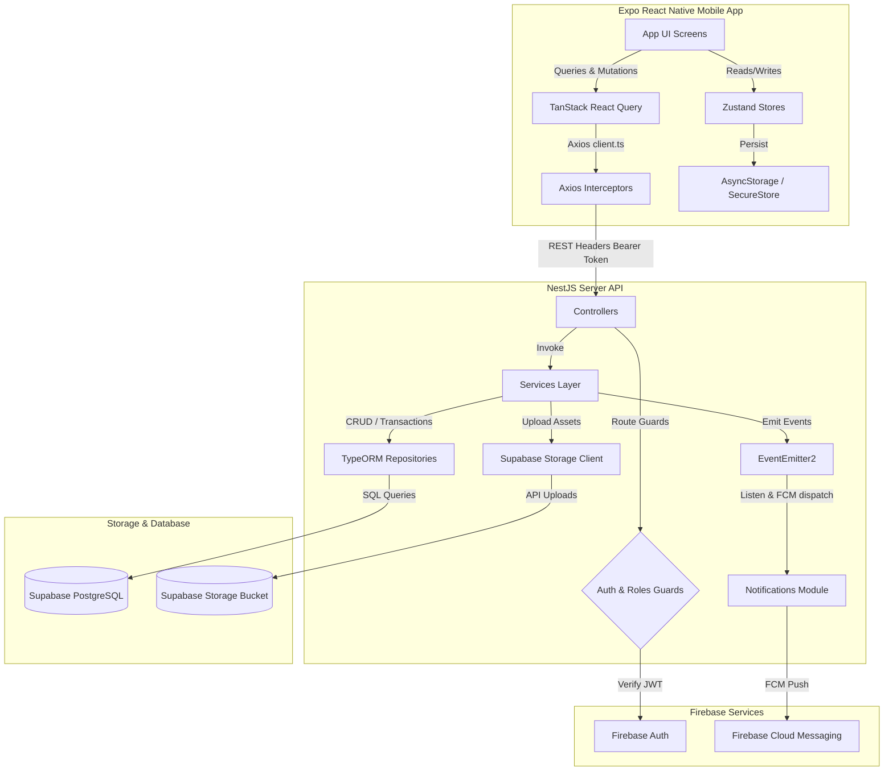
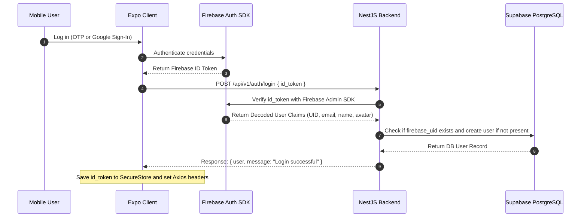
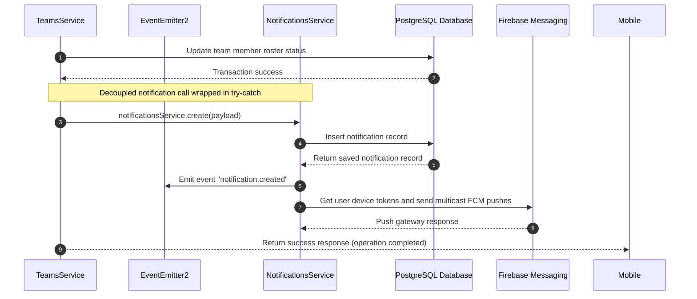
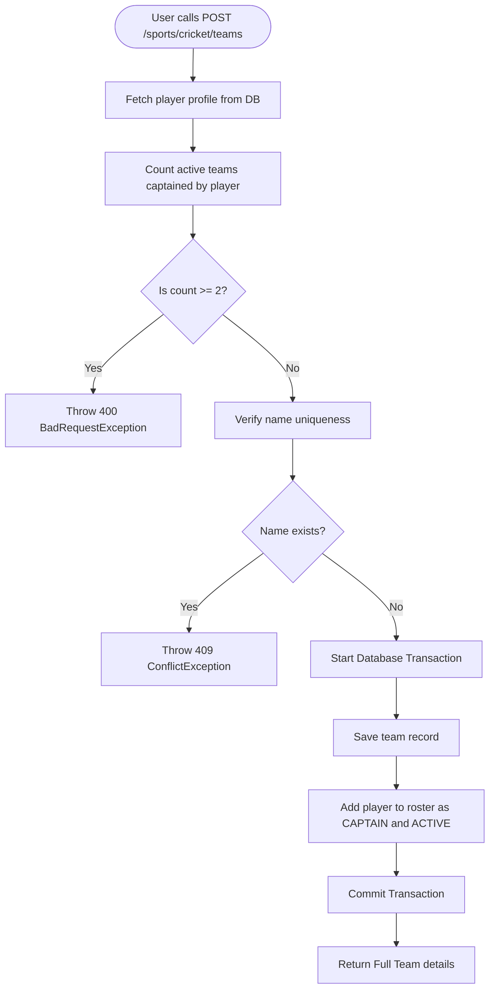
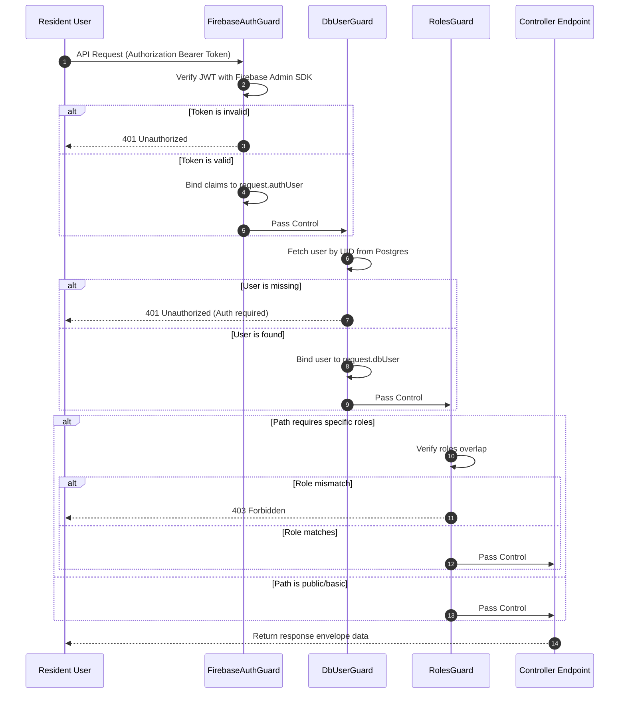
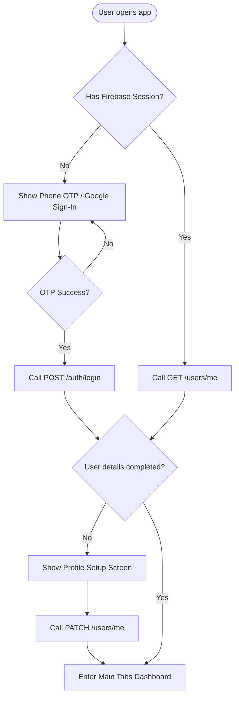

# PROJECT_CONTEXT.md

## 22. EXECUTIVE AI SUMMARY (READ THIS FIRST)

> [!IMPORTANT]
> **READ THIS FIRST BEFORE WRITING CODE:**
> * **Architecture Design**: The codebase is split into a **NestJS (v11.0) backend** with PostgreSQL (hosted on Supabase) and an **Expo React Native (v56.0) mobile client**.
> * **Authentication Engine**: Custom Firebase JWT validation. The mobile client obtains a token from Firebase Auth and attaches it as a Bearer header. The backend validates it in `FirebaseAuthGuard` (binds `request.authUser`) and resolves the PostgreSQL user in `DbUserGuard` (binds `request.dbUser`).
> * **Standard Response Envelope**: Every backend response is wrapped in a global interceptor outputting `{ success: boolean, status: number, message?: string, data: T }`. Error filters capture Nest `HttpException` objects and map them to `{ success: false, status: number, message: string, errors?: string[], data: null }`.
> * **Notice Board (Announcements)**: CRUD operations on the announcements feed. Admins and moderators can post, pin, and edit notices. Categories like `urgent` and `jirga_decision` trigger global push notifications via Firebase Cloud Messaging (FCM).
> * **Sports Hub (Cricket)**: Features a player registration wizard, team creation, team rosters, squad invite systems, join requests, and notification alerts.
> * **State Management & Caching**: TanStack React Query manages mobile data caches, while Zustand stores manage transient/persisted UI state (auth session, sports registrations, unread notification badges).

---

## 1. PROJECT OVERVIEW

*   **Project Name**: Pabaini
*   **Purpose**: The central digital hub for the community of Pabaini village (Swabi District, KPK, Pakistan).
*   **Product Vision**: Connect local village residents and the Pabaini diaspora living abroad. It bridges communication gaps by introducing a notice board, an organized local sports hub (focusing on cricket profiles, squad coordination, scheduling, scoring, and stats), and a blood donor registry.
*   **Target Audience**: Local residents of Pabaini village, community organizers, local sports captains, and Pabaini diaspora members who want to stay updated on village affairs (such as Jirga decisions, community announcements, and events).
*   **Core Problems Solved**:
    *   **Communication Fragmentation**: Consolidates notices, announcements, and Jirga decisions into a single notice board.
    *   **Local Sports Organization**: Replaces unstructured match scheduling and roster coordinate calls with a community leaderboard, player style registry, and captaincy dashboard.
    *   **Emergency Services**: Establishes a future blood donor matchmaking network.
*   **Key Features**:
    *   **Notice Board**: Category-based notices (general, event, urgent, jirga_decision) with toggle likes, image uploads (stored on Supabase Storage), pinned posts, and soft/hard deletion safety rules.
    *   **Notification Center**: Grouped in-app alert inbox (Today, Yesterday, Earlier) and Firebase Cloud Messaging (FCM) background/foreground push notifications.
    *   **Sports Hub (Cricket)**: Multi-step style onboarding (batsman/bowler details), custom team creation (names, home grounds, founding years), captain dashboards (inviting players, accepting join requests, transferring captaincy), and mock player stats profiles.
    *   **Profile Setup**: Inline editing of user names, diaspora status, village of origin, and profile photo uploads.
*   **Current Development Stage**: Active Development. Backend and mobile compilation are successful. The database schema is live on Supabase, and basic CRUD, auth, users, announcements, sports, and notifications are implemented.

---

## 2. TECH STACK

### Backend (`pabaini-backend`)
*   **Core Framework**: NestJS (v11.0)
*   **Language**: TypeScript (v5.7)
*   **Database ORM**: TypeORM (v1.0)
*   **Database Engine**: PostgreSQL (hosted on Supabase)
*   **Authentication**: Firebase Admin SDK (token verification and claim decoding)
*   **Storage Provider**: Supabase Storage (media bucket `pabaini-media` for avatars and announcement images)
*   **Event System**: NestJS `EventEmitter2` (asynchronous, decoupled internal event messaging)
*   **Push Notification Gateway**: Firebase Cloud Messaging (FCM via Admin SDK)

### Frontend (`pabaini-mobile`)
*   **Core Framework**: React Native (via Expo SDK 56.0.x / React 19)
*   **Navigation & Routing**: Expo Router (file-based navigation stack with layout groups)
*   **State Management**: Zustand (v5.0)
*   **Server State & Caching**: TanStack React Query (v5.101)
*   **HTTP Client**: Axios (with custom request token interceptors and response error filters)
*   **Authentication**: Firebase Client SDK (Phone OTP & Google Sign-In)
*   **Storage Utility**: `@react-native-async-storage/async-storage` for Zustand persisted stores, and `expo-secure-store` for credentials (Firebase ID token and guest mode flags)
*   **UI Primitives**: Custom theme-based React Native widgets, TailwindCSS configurations, Lucide icons (`lucide-react-native`)

### Infrastructure
*   **Database Hosting**: Supabase DB instances
*   **Configuration**: Environment configuration files (`.env` in backend and frontend)
*   **Build & Tooling**: `tsconfig.build.json`, TypeScript compiler checks (`npx tsc --noEmit`)

---

## 3. HIGH LEVEL ARCHITECTURE



### Authentication Flow



### Notification Trigger Flow



---

## 4. REPOSITORY STRUCTURE

### Backend Folders (`pabaini-backend`)
```
pabaini-backend/
├── docs/                      # Developer guides and API specifications
│   └── API_ENDPOINTS.md       # Exhaustive list of backend REST endpoints
├── src/
│   ├── common/                # Shared decorators, guards, filters, interceptors
│   │   ├── decorators/        # @Roles(), @DbUser() parameter decorators
│   │   ├── filters/           # Global HttpExceptionFilter mapping response envelopes
│   │   ├── guards/            # FirebaseAuthGuard, DbUserGuard, RolesGuard
│   │   ├── interceptors/      # TransformInterceptor wrapping success data
│   │   └── middleware/        # LoggerMiddleware logging request metadata
│   ├── config/                # Environment, Database, and Firebase initializers
│   │   ├── database.health.ts # Database connection checking health utility
│   │   ├── fcm.service.ts     # Firebase Cloud Messaging push dispatcher
│   │   ├── firebase.module.ts # Firebase dependency container
│   │   ├── firebase.service.ts# Firebase Admin SDK credential loader
│   │   ├── supabase.config.ts # Supabase storage client initialization
│   │   └── typeorm.config.ts  # TypeORM configurations
│   ├── modules/               # Domain feature modules
│   │   ├── announcements/     # Village board notices, image uploads, toggle likes
│   │   ├── auth/              # Firebase ID token verify logins
│   │   ├── notifications/     # In-app notifications feed, unread metrics
│   │   ├── sports/            # Sports container
│   │   │   └── cricket/       # Cricket sub-scope
│   │   │       ├── entities/  # CricketPlayerProfile entity
│   │   │       ├── enums/     # CricketRole, BattingHand, BowlingArm, BowlingType
│   │   │       ├── players/   # Player profile signup controllers/services
│   │   │       ├── stats/     # Player stats (competitive/casual matches)
│   │   │       └── teams/     # Team squads, invites, requests, captaincy
│   │   └── users/             # User profiles, avatar uploads, FCM device tokens
│   ├── app.controller.ts      # Root app controller
│   ├── app.module.ts          # Imports modules and registers middleware logs
│   └── main.ts                # Bootstrap script, prefixes, validation validation
└── test/                      # Integration and end-to-end specs
```

### Frontend Folders (`pabaini-mobile`)
```
pabaini-mobile/
├── app/                       # Expo Router routes folder
│   ├── (auth)/                # Authorization flow screens (login.tsx)
│   ├── (onboarding)/          # Onboarding flows (profile-setup.tsx)
│   ├── (tabs)/                # Main bottom-tab layout group
│   │   ├── index.tsx          # Notice Feed Screen
│   │   ├── sports.tsx         # Sports Hub Screen (Players, Teams, Matches)
│   │   ├── donors.tsx         # Blood Donors Screen
│   │   └── profile.tsx        # Profile configuration tab
│   ├── announcement/          # Announcement views and creating interfaces
│   │   ├── [id].tsx           # Detailed announcement view
│   │   └── create.tsx         # Notice editor screen
│   ├── profile/               # Public user profiles
│   │   └── [id].tsx           # Dynamic user profile details
│   ├── sports/                # Sports detail stack
│   │   └── cricket/           # Cricket-specific onboarding and squads
│   │       ├── onboarding/    # Style registration screens
│   │       └── teams/         # Roster creation and management interfaces
│   ├── _layout.tsx            # Global stack navigator and providers
│   └── notifications.tsx      # Central in-app notifications inbox screen
└── src/
    ├── api/                   # Axios HTTP requests
    │   ├── announcements.ts   # Announcements API endpoints
    │   ├── auth.ts            # Auth login calls
    │   ├── client.ts          # Axios base client, token interceptors
    │   ├── firebaseAuth.ts    # Firebase client initialization wrapper
    │   ├── sports.ts          # Player registration endpoints
    │   └── users.ts           # Users profile update actions
    ├── components/            # Reusable UI widgets and skeletons
    │   ├── ui/                # Core primitives (Button, Input, Avatar)
    │   ├── profile/           # UserProfileView, GeneralInfo, CricketSection
    │   └── notice/            # Notice cards and category selectors
    ├── constants/             # TanStack query cache keys, style variables
    ├── context/               # React contexts (ThemeContext, AuthContext)
    ├── hooks/                 # Custom Hooks wrapper (useAuth, useAnnouncements)
    ├── services/              # Domain-specific services (notifications, teams)
    ├── store/                 # Zustand state caches
    │   ├── sports/            # sportsStore, teamsStore, cricketOnboardingStore
    │   └── notificationsStore.ts# Notifications store badge counting
    ├── theme/                 # Standard layouts and color codes
    ├── types/                 # TypeScript type interface wrappers
    └── utils/                 # General helper functions
```

---

## 5. DATABASE DOCUMENTATION

### 1. `users` Table
*   **Purpose**: Stores user profile details, system roles, and FCM registration tokens.
*   **Columns**:
    *   `id` (`integer`, Primary Key, Autoincrement): Internal system identifier.
    *   `firebase_uid` (`varchar`, Unique, Required): Firebase Auth unique identifier.
    *   `phone` (`varchar`, Unique, Nullable): Authenticated phone number.
    *   `email` (`varchar`, Unique, Nullable): Authenticated email address.
    *   `name` (`varchar`, Nullable): User's display name.
    *   `avatar_url` (`varchar`, Nullable): Supabase public storage URL for user's profile picture.
    *   `village` (`varchar`, Nullable): Residence village indicator (defaults to `"Pabaini"`).
    *   `is_diaspora` (`boolean`, Default: `false`): Flag identifying if user resides outside Pakistan.
    *   `role` (`enum`, Default: `'resident'`): Access privileges (`'resident'`, `'moderator'`, `'admin'`).
    *   `device_tokens` (`text[]` / `simple-array`, Nullable): Registered FCM tokens for push delivery.
    *   `created_at` (`timestamp`): Automatically populated creation timestamp.
    *   `updated_at` (`timestamp`): Automatically updated modification timestamp.
*   **Relationships**:
    *   One-to-One with `cricket_player_profiles` (mapped by `user_id` in profiles).
    *   One-to-Many with `announcements` (mapped by `author_id` in announcements).
    *   One-to-Many with `notifications` (mapped by `user_id` in notifications).
    *   One-to-Many with `announcement_likes` (mapped by `user_id` in likes).
*   **Indexes**:
    *   Unique Index on `firebase_uid`.
    *   Unique Index on `phone`.
    *   Unique Index on `email`.

### 2. `announcements` Table
*   **Purpose**: Stores announcements posted for the community notice board.
*   **Columns**:
    *   `id` (`integer`, Primary Key, Autoincrement): Core post identifier.
    *   `title` (`varchar`, Required): Header title of the announcement notice.
    *   `content` (`text`, Required): Core body message description.
    *   `category` (`enum`, Default: `'general'`): Categorization tag (`'general'`, `'urgent'`, `'event'`, `'jirga_decision'`).
    *   `image_url` (`varchar`, Nullable): Accompanying visual attachment URL.
    *   `likes_count` (`integer`, Default: `0`): Denormalized counter tracking positive reactions.
    *   `is_pinned` (`boolean`, Default: `false`): Pin status indicating priority placement.
    *   `is_deleted` (`boolean`, Default: `false`): Soft-delete flag.
    *   `location` (`varchar`, Nullable): Landmark or event location.
    *   `author_id` (`integer`, Required): ForeignKey referencing `users(id)`.
    *   `created_at` (`timestamp`): Creation timestamp.
    *   `updated_at` (`timestamp`): Last modified timestamp.
*   **Relationships**:
    *   Many-to-One with `users` (mapped by `author_id`).
    *   One-to-Many with `announcement_likes` (mapped by `announcement_id` in likes).

### 3. `announcement_likes` Table
*   **Purpose**: Tracks announcement likes to prevent double-likes.
*   **Columns**:
    *   `id` (`integer`, Primary Key, Autoincrement): Like record identifier.
    *   `user_id` (`integer`, Required): ForeignKey mapping to `users(id)`.
    *   `announcement_id` (`integer`, Required): ForeignKey mapping to `announcements(id)`.
    *   `created_at` (`timestamp`): Saved date.
*   **Relationships**:
    *   Many-to-One with `users` (mapped by `user_id`).
    *   Many-to-One with `announcements` (mapped by `announcement_id`).
*   **Indexes**:
    *   Unique composite constraint: `Unique(['user_id', 'announcement_id'])`.

### 4. `notifications` Table
*   **Purpose**: Central logs for user notifications.
*   **Columns**:
    *   `id` (`integer`, Primary Key, Autoincrement): System identifier.
    *   `user_id` (`integer`, Required): ForeignKey mapping target receiver `users(id)`.
    *   `type` (`varchar(50)`, Required): Notification category.
    *   `title` (`varchar(150)`, Required): Short summary title.
    *   `body` (`varchar(300)`, Nullable): Detailed descriptive string message.
    *   `deep_link` (`varchar(300)`, Nullable): Navigation deep-link route within the client app.
    *   `metadata` (`jsonb`, Nullable): Key-value payload tags (e.g., `{ "team_id": 1 }`).
    *   `is_read` (`boolean`, Default: `false`): Indicator identifying if read.
    *   `created_at` (`timestamp`): Message generated timestamp.
*   **Relationships**:
    *   Many-to-One with `users` (mapped by `user_id`).
*   **Indexes**:
    *   Composite performance index: `Index(['user_id', 'is_read', 'created_at'])`.

### 5. `cricket_player_profiles` Table
*   **Purpose**: Player styles and registration configurations for cricket players.
*   **Columns**:
    *   `id` (`integer`, Primary Key, Autoincrement): System identifier.
    *   `user_id` (`integer`, Unique, Required): ForeignKey mapping to `users(id)`.
    *   `role` (`enum`, Required): `batsman`, `bowler`, `allrounder`, `keeper`.
    *   `batting_hand` (`enum`, Required): `right`, `left`.
    *   `bowling_arm` (`enum`, Required): `right`, `left`, `none`.
    *   `bowling_type` (`enum`, Required): `fast`, `medium`, `spin`, `none`.
    *   `is_active` (`boolean`, Default: `true`): Active status flag.
    *   `created_at` (`timestamp`): Profile registration date.
    *   `updated_at` (`timestamp`): Last updated profile date.
*   **Relationships**:
    *   One-to-One with `users` (mapped by `user_id`).
    *   One-to-Many with `cricket_teams` (mapped by `captain_id` in teams).
    *   One-to-Many with `cricket_team_members` (mapped by `player_id`).

### 6. `cricket_teams` Table
*   **Purpose**: Details of registered teams.
*   **Columns**:
    *   `id` (`integer`, Primary Key, Autoincrement): Core team identifier.
    *   `name` (`varchar(100)`, Unique, Required): Unique team name.
    *   `description` (`text`, Nullable): Long details or description of team.
    *   `logo_url` (`varchar(500)`, Nullable): Supabase media logo location.
    *   `home_ground` (`varchar(200)`, Nullable): Home venue.
    *   `captain_id` (`integer`, Required): ForeignKey mapping to `cricket_player_profiles(id)`.
    *   `founded_year` (`integer`, Nullable): Founded year.
    *   `is_active` (`boolean`, Default: `true`): Active status flag.
    *   `created_at` (`timestamp`): Creation date.
    *   `updated_at` (`timestamp`): Last modified date.
*   **Relationships**:
    *   Many-to-One with `cricket_player_profiles` (as captain).
    *   One-to-Many with `cricket_team_members` (as team squad members).

### 7. `cricket_team_members` Table
*   **Purpose**: Roster listings mapping players to teams.
*   **Columns**:
    *   `id` (`integer`, Primary Key, Autoincrement): Roster listing identifier.
    *   `team_id` (`integer`, Required): ForeignKey mapping to `cricket_teams(id)`.
    *   `player_id` (`integer`, Required): ForeignKey mapping to `cricket_player_profiles(id)`.
    *   `role` (`enum`, Default: `'player'`): Member role (`'captain'`, `'vice_captain'`, `'player'`).
    *   `status` (`enum`, Required): `pending_invite`, `pending_request`, `active`, `rejected`, `left`.
    *   `invited_by` (`integer`, Nullable): ForeignKey mapping to `cricket_player_profiles(id)`.
    *   `joined_at` (`timestamp`, Nullable): Date membership active.
    *   `created_at` (`timestamp`): Roster entry created.
    *   `updated_at` (`timestamp`): Last modified date.
*   **Relationships**:
    *   Many-to-One with `cricket_teams` (mapped by `team_id`).
    *   Many-to-One with `cricket_player_profiles` (mapped by `player_id`).
    *   Many-to-One with `cricket_player_profiles` (mapped by `invited_by`).
*   **Indexes**:
    *   Unique composite constraint: `Unique(['team_id', 'player_id'])`.

---

## 6. BACKEND MODULES

### Auth Module
*   **Purpose**: Manages Firebase ID token validation and maps users to local PostgreSQL records.
*   **Folder Structure**:
    ```
    auth/
    ├── dto/
    │   └── firebase-auth.dto.ts  # Validates inbound id_token format
    ├── auth.controller.ts        # POST /auth/login controller route
    ├── auth.module.ts            # Wire auth service with user module imports
    └── auth.service.ts           # Verification logic with Firebase Admin SDK
    ```
*   **Key Logic**: The `AuthService` verifies incoming Firebase ID tokens. On first login, it registers the user in the database (find or create).

### Users Module
*   **Purpose**: Manages user details, FCM push token lifecycle, and profile avatars.
*   **Folder Structure**:
    ```
    users/
    ├── dto/                      # Create, Update, UpdateRole DTOs
    ├── entities/
    │   └── user.entity.ts        # core user schema and roles enum
    ├── users.controller.ts       # profile updates, tokens, and avatar upload endpoints
    ├── users.module.ts           # TypeORM registration and module exports
    └── users.service.ts          # Core service layer
    ```
*   **Key Logic**: Handles image file buffer uploads to the Supabase storage client under the path `avatars/{firebase_uid}-{timestamp}.{ext}` and stores the returned public URL on the user's profile.

### Announcements Module
*   **Purpose**: Notice board system.
*   **Folder Structure**:
    ```
    announcements/
    ├── dto/                      # Create, Update DTO filters
    ├── entities/                 # Announcement and AnnouncementLike entities
    ├── announcements.controller.ts # notice board routes, likes, and image uploads
    ├── announcements.module.ts   # registers TypeORM features and services
    └── announcements.service.ts  # like toggles, pins, soft-deletes, and push triggers
    ```
*   **Key Logic**:
    *   **Atomic Like Toggles**: Uses TypeORM transaction managers to execute checking and inserting/deleting likes atomically. If duplicate likes are caught, it throws an error.
    *   **Push Notification Triggers**: When creating an announcement with category `urgent` or `jirga_decision`, it automatically queries all users with active device tokens and sends a multicast notification.

### Sports Module
*   **Purpose**: Handles player registrations, teams, invitations, and statistics.
*   **Folder Structure**:
    ```
    sports/
    ├── cricket/
    │   ├── entities/             # Player profile schemas
    │   ├── enums/                # Batting/bowling hands and role enums
    │   ├── players/              # Profile signups, list queries
    │   ├── stats/                # Matches count, economy metrics
    │   └── teams/                # Squad invites, request loops, transfers
    └── sports.module.ts          # Routes mapping to /sports/cricket/teams
    ```
*   **Key Logic**:
    *   **Style Validation**: Ensures that if `bowling_arm` is `none`, `bowling_type` must be `none` (returns `400 Bad Request` if invalid).
    *   **Roster Rules**:
        *   Creating a team executes a transaction that creates the team record and inserts the captain as an active member.
        *   Active members cannot request to join a team again.
        *   Only captains can invite players or transfer captaincy.

### Notifications Module
*   **Purpose**: Centralized inbox database logging and push notifications.
*   **Folder Structure**:
    ```
    notifications/
    ├── dto/                      # query notifications page filters
    ├── entities/                 # notifications DB entity schema
    ├── enums/                    # notification action type tags
    ├── notifications.controller.ts # inbox retrieval, read flags, and counts
    ├── notifications.module.ts   # registers notification features and EventEmitters
    └── notifications.service.ts  # bulk update calls, event triggers, and inserts
    ```
*   **Key Logic**: Decorates event emissions using NestJS `EventEmitter2`. Decouples notification delivery so that team roster operations don't fail if notification delivery fails.

---

## 7. API DOCUMENTATION

### Authentication Module

#### POST `/auth/login`
*   **Route**: `/api/v1/auth/login`
*   **Auth Required**: 🟢 No
*   **Body**:
    ```json
    { "id_token": "firebase_id_token_here" }
    ```
*   **Business Logic**: Decodes the Firebase ID token. If the user is logging in for the first time, it registers a user profile in PostgreSQL using the UID, email, name, and avatar URL.
*   **Success Response (`201 Created`)**:
    ```json
    {
      "success": true,
      "status": 201,
      "message": "Login successful",
      "data": {
        "user": {
          "id": 1,
          "firebase_uid": "C0Np...",
          "phone": "+923001234567",
          "email": "user@test.com",
          "name": "User Name",
          "avatar_url": null,
          "village": "Pabaini",
          "is_diaspora": false,
          "role": "resident"
        }
      }
    }
    ```
*   **Error Responses**:
    *   `400 Bad Request`: Email/Phone already in use by another account.
    *   `401 Unauthorized`: Invalid Firebase ID token.

---

### Users Module

#### GET `/users/me`
*   **Route**: `/api/v1/users/me`
*   **Auth Required**: 🔐 Yes (Resident / Moderator / Admin)
*   **Success Response (`200 OK`)**:
    ```json
    { "success": true, "status": 200, "data": { "id": 1, "name": "Name", "role": "resident" } }
    ```

#### PATCH `/users/me`
*   **Route**: `/api/v1/users/me`
*   **Auth Required**: 🔐 Yes
*   **Body**:
    ```json
    {
      "name": "Updated Name",
      "village": "New Village",
      "is_diaspora": true
    }
    ```
*   **Success Response (`200 OK`)**:
    ```json
    { "success": true, "status": 200, "message": "Updated details", "data": { "id": 1, "name": "Updated Name" } }
    ```

#### POST `/users/me/avatar`
*   **Route**: `/api/v1/users/me/avatar`
*   **Auth Required**: 🔐 Yes
*   **Body**: `multipart/form-data` with `avatar` file key.
*   **Success Response (`201 Created`)**:
    ```json
    { "success": true, "status": 201, "data": { "id": 1, "avatar_url": "https://supabase-bucket/avatars/avatar.jpg" } }
    ```

#### POST `/users/device-token`
*   **Route**: `/api/v1/users/device-token`
*   **Auth Required**: 🔐 Yes
*   **Body**:
    ```json
    { "token": "fcm_token_here" }
    ```
*   **Business Logic**: Adds the FCM token to the user's `device_tokens` array if it is not already present.
*   **Success Response (`201 Created`)**:
    ```json
    { "success": true, "status": 201, "data": { "success": true } }
    ```

#### DELETE `/users/device-token`
*   **Route**: `/api/v1/users/device-token`
*   **Auth Required**: 🔐 Yes
*   **Body**:
    ```json
    { "token": "fcm_token_here" }
    ```
*   **Success Response (`200 OK`)**:
    ```json
    { "success": true, "status": 200, "data": { "success": true } }
    ```

#### GET `/users/:id/profile`
*   **Route**: `/api/v1/users/:id/profile`
*   **Auth Required**: 🟢 No (Public)
*   **Success Response (`200 OK`)**:
    ```json
    {
      "success": true,
      "status": 200,
      "data": {
        "user": { "id": 13, "name": "User Name", "village": "Pabaini" },
        "cricket": {
          "player_profile": { "id": 1, "role": "batsman" },
          "stats": { "competitive": { "matches": 0 }, "casual": { "matches": 0 } },
          "current_teams": [],
          "past_teams": []
        }
      }
    }
    ```

---

### Announcements Module

#### GET `/announcements`
*   **Route**: `/api/v1/announcements`
*   **Auth Required**: 🟢 No
*   **Query Params**: `page` (default 1), `limit` (default 10), `category` (optional)
*   **Success Response (`200 OK`)**:
    ```json
    {
      "success": true,
      "status": 200,
      "data": [{ "id": 1, "title": "Water Shortage Notice", "is_pinned": true }],
      "pagination": { "total": 12, "page": 1, "limit": 10, "totalPages": 2 }
    }
    ```

#### POST `/announcements`
*   **Route**: `/api/v1/announcements`
*   **Auth Required**: 🔐 Yes (Moderator / Admin Only)
*   **Body**:
    ```json
    {
      "title": "Jirga assembly rules",
      "content": "Water distribution guidelines.",
      "category": "jirga_decision",
      "location": "Central Hujra"
    }
    ```
*   **Business Logic**: Saves the announcement. If the category is `urgent` or `jirga_decision`, it triggers FCM push notifications to all users with active tokens.
*   **Success Response (`201 Created`)**:
    ```json
    { "success": true, "status": 201, "data": { "id": 1, "title": "Jirga assembly rules", "category": "jirga_decision" } }
    ```

#### POST `/announcements/:id/like`
*   **Route**: `/api/v1/announcements/:id/like`
*   **Auth Required**: 🔐 Yes
*   **Business Logic**: Toggles the like status on an announcement. Decrements/increments the counter and updates `liked_by_me` atomically.
*   **Success Response (`201 Created`)**:
    ```json
    { "success": true, "status": 201, "data": { "id": 1, "likes_count": 8, "liked_by_me": true } }
    ```

---

### Sports Module

#### POST `/sports/cricket/players/me`
*   **Route**: `/api/v1/sports/cricket/players/me`
*   **Auth Required**: 🔐 Yes
*   **Body**:
    ```json
    {
      "role": "allrounder",
      "batting_hand": "right",
      "bowling_arm": "right",
      "bowling_type": "medium"
    }
    ```
*   **Business Logic**: Creates a cricket player profile. Mismatched bowling style validations apply (`bowling_arm = none` requires `bowling_type = none`).
*   **Success Response (`201 Created`)**:
    ```json
    { "success": true, "status": 201, "data": { "id": 1, "role": "allrounder" } }
    ```

#### POST `/sports/cricket/teams`
*   **Route**: `/api/v1/sports/cricket/teams`
*   **Auth Required**: 🔐 Yes
*   **Body**:
    ```json
    {
      "name": "Pabaini XI",
      "description": "Swabi League",
      "home_ground": "Pabaini Cricket Ground",
      "founded_year": 2024
    }
    ```
*   **Business Logic**: Creates the team and automatically inserts the creator as the captain.
    > [!IMPORTANT]
    > **Active Captaincy Limit Rule**:
    > * A player cannot create a new team if they are already the captain of **2 or more** active teams (`is_active = true`).
    > * Rejects with `400 BadRequestException` and message: `"You are already captain of 2 active teams. Transfer captaincy or dissolve a team before creating a new one."`
*   **Success Response (`201 Created`)**:
    ```json
    { "success": true, "status": 201, "data": { "id": 1, "name": "Pabaini XI", "captain_id": 1 } }
    ```

<details>
<summary>💡 Captaincy Limit Details & Flow Diagram (Click to Expand)</summary>

### Business Validation Rules:
1. **Target**: Count active teams (`is_active = true`) where `captain_id = playerProfile.id`.
2. **Limit**: Maximum 2 active teams.
3. **Action on Violation**: Rejects with `400 BadRequestException`.
4. **Action on Success**: Proceed with team creation and roster registration in transaction.

### Flow Diagram:

</details>

#### POST `/sports/cricket/teams/:id/invite`
*   **Route**: `/api/v1/sports/cricket/teams/:id/invite`
*   **Auth Required**: 🔐 Yes (Captain only)
*   **Body**:
    ```json
    { "player_id": 5 }
    ```
*   **Business Logic**: Sends a team invitation. Adds the player with status `pending_invite` and triggers a `TEAM_INVITE` notification to the player.
*   **Success Response (`201 Created`)**:
    ```json
    { "success": true, "status": 201, "data": { "message": "Invitation sent successfully" } }
    ```

#### POST `/sports/cricket/teams/:id/request`
*   **Route**: `/api/v1/sports/cricket/teams/:id/request`
*   **Auth Required**: 🔐 Yes
*   **Business Logic**: Sends a request to join the team. Adds the user with status `pending_request` and triggers a `TEAM_JOIN_REQUEST` notification to the team captain.
*   **Success Response (`201 Created`)**:
    ```json
    { "success": true, "status": 201, "data": { "message": "Join request sent successfully" } }
    ```

#### PATCH `/sports/cricket/teams/:id/members/:memberId/accept`
*   **Route**: `/api/v1/sports/cricket/teams/:id/members/:memberId/accept`
*   **Auth Required**: 🔐 Yes
*   **Business Logic**: Accepts a pending request or invitation. Updates status to `active` and sends a confirmation notification.
*   **Success Response (`200 OK`)**:
    ```json
    { "success": true, "status": 200, "data": { "id": 5, "status": "active" } }
    ```

---

### Notifications Module

#### GET `/notifications`
*   **Route**: `/api/v1/notifications`
*   **Auth Required**: 🔐 Yes
*   **Query Params**: `unread_only` (optional), `page` (default 1), `limit` (default 20)
*   **Success Response (`200 OK`)**:
    ```json
    {
      "success": true,
      "status": 200,
      "data": {
        "notifications": [{ "id": 1, "title": "Invitation to Pabaini XI", "is_read": false }],
        "total": 1,
        "page": 1,
        "limit": 20
      }
    }
    ```

---

## 8. EVENT SYSTEM

### Core Events
1.  **`notification.created`**
    *   **When Emitted**: Dispatched inside `NotificationsService.create` after a notification is saved to the database.
    *   **Payload**: The saved `Notification` database entity.
    *   **Listeners**: None currently registered. Intended for future WebSocket/realtime messaging gateways.
    *   **Resulting Actions**: Fires asynchronously; does not block the caller execution thread.

---

## 9. NOTIFICATION SYSTEM

*   **Architecture**: Decoupled from core operations. If notification creation fails, it is caught and logged as a warning without failing the user's primary action.
*   **Notification Types**:
    *   `team_join_request` (to captain)
    *   `team_invite` (to player)
    *   `team_request_accepted` (to player)
    *   `team_request_rejected` (to player)
    *   `team_invite_accepted` (to captain)
    *   `team_invite_declined` (to captain)
    *   `team_member_removed` (to player)
    *   `team_captaincy_transferred` (to new captain)
*   **Read/Unread System**:
    *   The mobile client displays a red notification badge on the bell icon.
    *   Uses a **35-second polling loop** on the Sports tab to update the unread badge count via TanStack Query and Zustand.
    *   Marking all notifications as read performs a bulk SQL update.

---

## 10. AUTHENTICATION & AUTHORIZATION

### Flow Diagrams



---

## 11. FRONTEND ARCHITECTURE

```
+-------------------------------------------------------------+
|                      Expo Root Layout                       |
|   (QueryClientProvider -> ThemeProvider -> AuthProvider)    |
+-------------------------------------------------------------+
                               |
       +-----------------------+-----------------------+
       |                                               |
+--------------------------+               +--------------------------+
|      (auth)/login        |               |      (tabs)/_layout      |
|    (Firebase Client)     |               |   (SafeAreaView + Tabs)  |
+--------------------------+               +--------------------------+
                                                       |
               +-------------------+-------------------+-------------------+
               |                   |                   |                   |
        +-------------+     +-------------+     +-------------+     +-------------+
        |    Home     |     |   Sports    |     |   Donors    |     |   Profile   |
        |   (Feed)    |     |   (Hub)     |     |  (Placeholder)|   |   (Self)    |
        +-------------+     +-------------+     +-------------+     +-------------+
```

*   **Routing**: Handles stack pages such as `/announcement/[id]`, `/announcement/create`, and public profiles `/profile/[id]`.
*   **State Management**:
    *   **Zustand Stores**: Lightweight, client-side global stores. `sportsStore` persists seen onboarding configurations, `teamsStore` caches user rosters, and `notificationsStore` handles unread counts.
    *   **TanStack Query**: Manages query invalidations and asynchronous data fetching.
*   **Theme System**: Configures spacing, radius, fonts, and colors (e.g. green hues matching Swabi identity).

---

## 12. FRONTEND STORES

### 1. `useAuth` (React Context)
*   **Purpose**: Manages authenticated user state and profile updates.
*   **State**: `user` (User | null), `isLoading` (boolean), `isGuest` (boolean).
*   **Actions**: `login(idToken)`, `logout()`, `setGuest()`, `updateProfile()`.
*   **Usage Locations**: Throughout the app to verify auth states.

### 2. `useSportsStore` (Zustand - Persisted)
*   **Purpose**: Tracks if the user has opted-in to the sports hub and caches their registration status.
*   **State**: `seenOptIn` (Record<string, boolean>), `registrations` (Record<string, PlayerRegistration>).
*   **Actions**: `markOptInSeen()`, `setRegistration()`, `clearRegistration()`.

### 3. `useTeamsStore` (Zustand)
*   **Purpose**: Caches teams the user is associated with.
*   **State**: `myTeams` (MyTeamResponse[]), `isLoadingMyTeams` (boolean).
*   **Actions**: `fetchMyTeams()`, `clearMyTeams()`.

### 4. `useNotificationsStore` (Zustand)
*   **Purpose**: Manages the unread notification badge count.
*   **State**: `unreadCount` (number).
*   **Actions**: `fetchUnreadCount()`, `decrementUnreadCount()`, `clearUnreadCount()`.

---

## 13. SCREEN DOCUMENTATION

### 1. Notice Board Feed (`(tabs)/index.tsx`)
*   **Purpose**: Displays the notice board.
*   **Route**: `/` (tabs root)
*   **User Actions**: Toggle likes, share notice posts, open settings modal to pin/delete announcements (admins/moderators).
*   **Store/Hook Usage**: `useAuth` context, `useAnnouncements` query hook.

### 2. Sports Hub (`(tabs)/sports.tsx`)
*   **Purpose**: Sports sub-tabs directory.
*   **Route**: `/sports`
*   **Tabs**:
    *   `Players`: Lists registered players.
    *   `Teams`: Displays the user's teams and allows team discovery.
    *   `Matches`: Displays match schedules (placeholder state).
    *   `Leaderboard`: Displays the leaderboard (placeholder state).
*   **Store Usage**: `useSportsStore`, `useTeamsStore`, `useNotificationsStore`.

### 3. Team Details (`sports/cricket/teams/[id]/index.tsx`)
*   **Purpose**: Displays the team's squad list.
*   **User Actions**: Join requests (players), manage settings (captains).

---

## 14. COMPLETE USER FLOWS

### User Registration & Onboarding



### Team Request & Onboarding Flow


---

## 15. BUSINESS RULES

*   **Player Registration Consistency**: Mismatched bowling style validations apply (`bowling_arm = none` requires `bowling_type = none`).
*   **Announcement Notification Rules**: Announcements posted under the `urgent` or `jirga_decision` categories trigger push notifications to all users with active tokens.
*   **Team Captain Rules**:
    *   Creating a team sets the creator as the Captain.
    *   A player cannot create a new team if they are already the captain of 2 or more active teams (where `is_active = true`).
    *   A Captain cannot invite themselves.
    *   A Captain must transfer captaincy to another active squad member before leaving the team.
    *   A team cannot be soft-deleted if it has active matches (to be enforced in a future update).

---

## 16. CURRENT IMPLEMENTATION STATUS

### Completed Features
*   **Authentication**: Firebase ID token validation and PG user profile creation.
*   **Notice Board**: Announcements feed, category filters, toggle likes, and image uploads.
*   **Sports Hub (Cricket)**: Player registrations, teams management, and squad invitations.
*   **Notifications**: Centralized notifications feed and unread badge polling.

### Partially Complete Features
*   **Push Notifications**: FCM push notification delivery is implemented in the backend, but client-side background/foreground listeners are not yet fully wired.

### Planned Features
*   **Matches & Standings**: Tournament scheduling, scoring systems, standings, and leaders ranking metrics (Phase 3).
*   **Donors Registry**: Blood donors registry search list.

---

## 17. RECENT DEVELOPMENT HISTORY

*   **Recently Implemented**: Sports Phase 2 squad organization (squad management, captaincy transfers, invites, and requests) and unread notification badge count polling.
*   **Next Priorities**: Match scheduling, tournament scorecards, MVP standings, and the blood donors registry database structure.

---

## 18. KNOWN TECHNICAL DEBT

*   **Mock Player Stats**: The stats engine currently returns empty mock statistics; real aggregation queries against match tables must be implemented once the matches module is built.
*   **FCM Token Storage**: Firebase tokens are stored directly on the `User` record as a string array; scaling this may cause locking issues. Moving tokens to a separate `user_device_tokens` table is recommended for future production use.
*   **Client FCM Observers**: Needs foreground and background push event handlers inside the client mobile app.

---

## 19. DEVELOPMENT CONVENTIONS

*   **TypeScript Strict Mode**: Code must build without compiler flags or errors.
*   **TypeORM Transaction Managers**: Critical state changes (like captaincy transfers and team creation) must be executed inside database transactions.
*   **Authentication Guards**: Route handlers must use `FirebaseAuthGuard` before `DbUserGuard` to ensure the authentication context is properly established.

---

## 20. FUTURE ROADMAP

*   **Short-term Goals**: Implement match scheduling, score recording, and tournament standings interfaces.
*   **Medium-term Goals**: Wire up background push notifications and launch the blood donor matching network.
*   **Long-term Goals**: Introduce tournament brackets, match history graphs, and support for additional sports (like football and volleyball).

---

## 21. AGENT INSTRUCTIONS

*   **Guard Sequence**: Always declare route guards in the order: `FirebaseAuthGuard` -> `DbUserGuard` -> `RolesGuard`.
*   **Decoupled Notifications**: Always wrap `notificationsService.create` calls inside a try-catch block to prevent notification failures from rolling back core database transactions.
*   **Inline Edits**: Maintain zero-flash rendering on the self-profile tab by pre-filling fields from local Zustand stores on mount.
