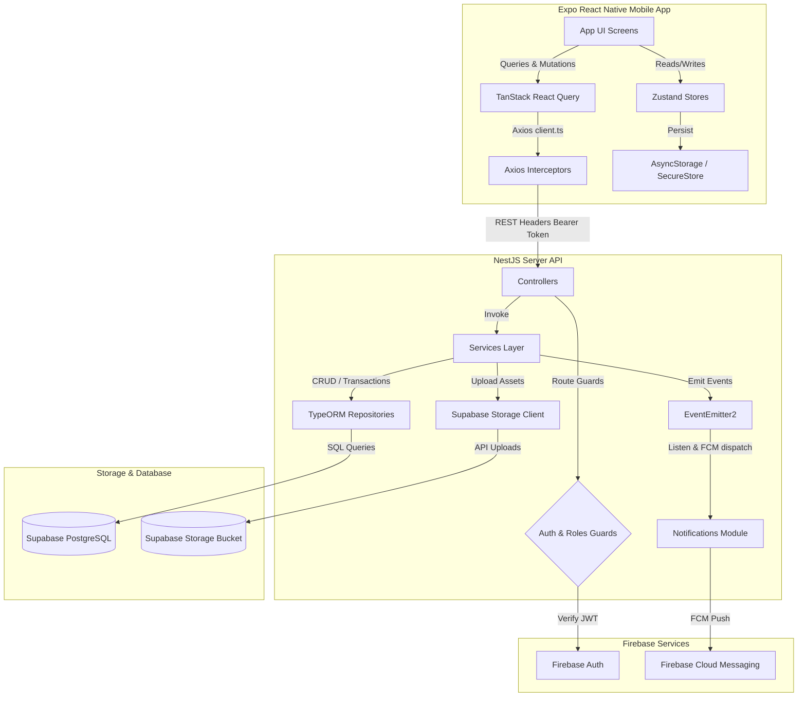
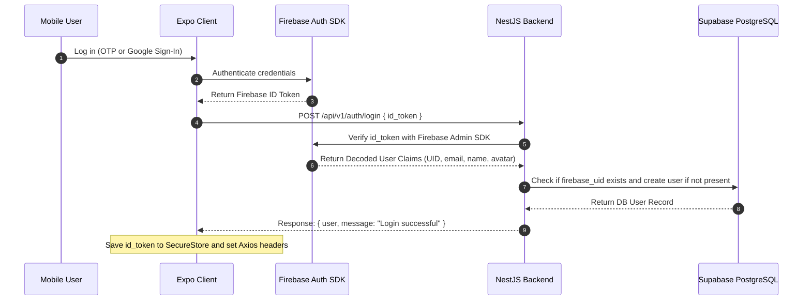
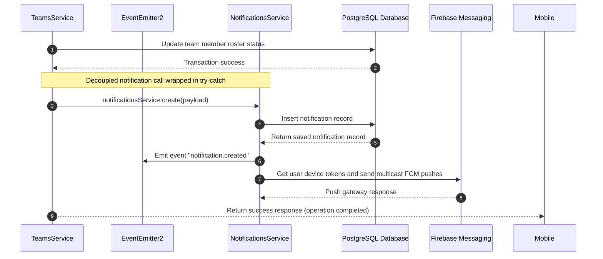
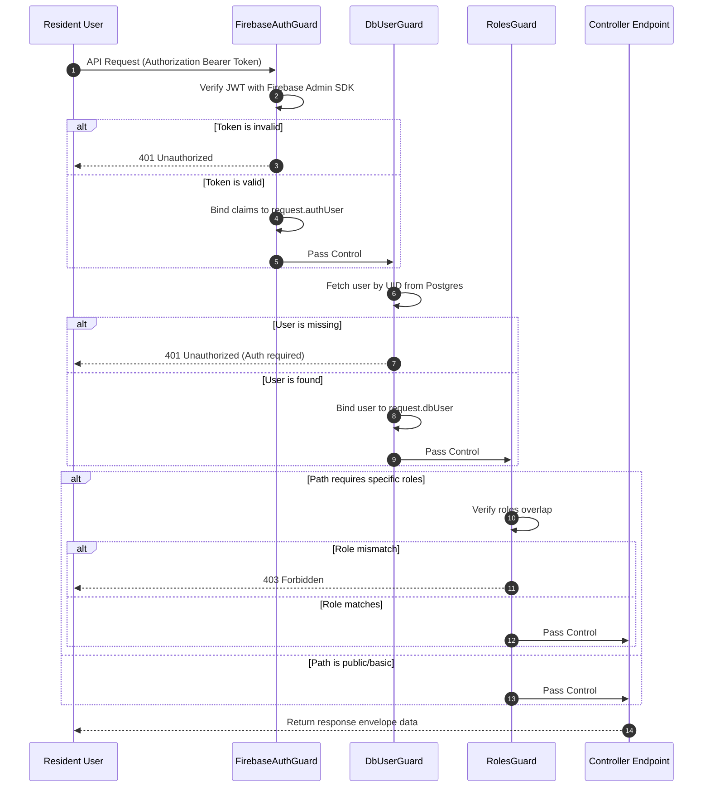
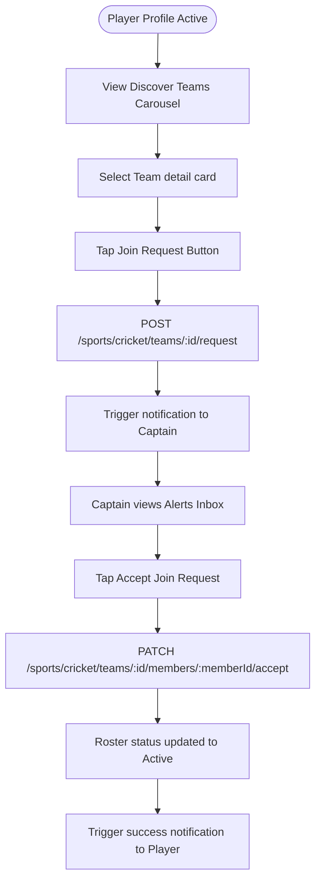

# PROJECT_CONTEXT.md

## 22. EXECUTIVE AI SUMMARY (READ THIS FIRST)

> [!IMPORTANT]
> **READ THIS FIRST BEFORE WRITING CODE:**
> * **Architecture Design**: The codebase is split into a **NestJS (v11.0) backend** with PostgreSQL (hosted on Supabase) and an **Expo React Native (v56.0) mobile client**.
> * **Authentication Engine**: Custom Firebase JWT validation. The mobile client obtains a token from Firebase Auth and attaches it as a Bearer header. The backend validates it in `FirebaseAuthGuard` (binds `request.authUser`) and resolves the PostgreSQL user in `DbUserGuard` (binds `request.dbUser`).
> * **Standard Response Envelope**: Every backend response is wrapped in a global interceptor outputting `{ success: boolean, status: number, message?: string, data: T }`. Error filters capture Nest `HttpException` objects and map them to `{ success: false, status: number, message: string, errors?: string[], data: null }`.
> * **Notice Board (Announcements)**: CRUD operations on the announcements feed with focus-based automatic background polling (20-second interval) that automatically stops when the screen is blurred. Admins and moderators can post, pin, and edit notices. Categories like `urgent` and `jirga_decision` trigger global push notifications via Firebase Cloud Messaging (FCM).
> * **Global Search**: Unifies search capabilities across the app under a single `/search` path. Accessed from compact matching header buttons (Search & Bell) on both the Home notice feed and Sports hub. Features interactive sub-category filtering (Posts, Users, Players, Teams) with simulated debounced loading states and visual card renderers.
> * **Sports Hub (Cricket)**: Features player registration, searchable player discover directory (name search, pull-to-refresh, infinite scroll), team squad management (invites/requests), match scheduling request lifecycle, Playing XI declarations, and two scoring modes: Simple (retroactive scorecards with a 24-hour edit lock, collapsible team scorecard stats, guest player "Man of the Match" support, and real-time player statistics calculation) and Live (real-time ball-by-ball scoring console with bowler consecutive over validation, confirmation overrides, selection double-tap locks, strike rotation, innings transition, dismissed batsmen dropdown filtering, auto-closing console modals on match completion, undo features, and optimized pre-computed polling views). Post-match detail features a premium, tabbed `MatchScorecard` interface detailing batsman strike rates, bowler maidens, opponent extras, and chronological fall of wickets (FoW) timelines calculated dynamically from live events or simple records. Completed matches render with a styled victory badge displaying the winning margin on match cards. Includes theme-aware shimmering loading skeletons (`MatchDetailSkeleton` and `TeamProfileSkeleton`) to replace fullscreen spinners on match details and team profiles, alongside refined segmented tab buttons.
> * **State Management & Caching**: TanStack React Query manages mobile data caches, while Zustand stores manage transient/persisted UI state (auth session, sports registrations, unread notification badges).
> * **Guest Mode & Authentication Gating**: Unauthenticated guests are allowed read-only access to notices and matches feeds. All active write paths (liking, commenting, scheduling, scoring) and user details screens are gated by a reusable `LoginRequiredGate` or global `LoginPromptModal` interceptor. Backend route guards conditionally bypass Firebase claims for public GET requests, and the frontend client stops token retrieval for guest states, resolving 401 exceptions. Logouts and guest transitions flush all Zustand and TanStack Query caches.

---

## 1. PROJECT OVERVIEW

*   **Project Name**: Pabaini
*   **Purpose**: The central digital hub for the community of Pabaini village (Swabi District, KPK, Pakistan).
*   **Product Vision**: Connect local village residents and the Pabaini diaspora living abroad. It bridges communication gaps by introducing a notice board, an organized local sports hub (focusing on cricket profiles, squad coordination, scheduling, scoring, and stats), and a blood donor registry.
*   **Target Audience**: Local residents of Pabaini village, community organizers, local sports captains, and Pabaini diaspora members who want to stay updated on village affairs (such as Jirga decisions, community announcements, and events).
*   **Core Problems Solved**:
    *   **Communication Fragmentation**: Consolidates notices, announcements, and Jirga decisions into a single notice board.
    *   **Local Sports Organization**: Replaces unstructured match scheduling and roster coordinate calls with a community leaderboard, player style registry, and captaincy dashboard.
    *   **Emergency Services**: Establishes a future blood donor matchmaking network.
*   **Key Features**:
    *   **Notice Board**: Category-based notices (general, event, urgent, jirga_decision) with toggle likes, image uploads (stored on Supabase Storage), pinned posts, and soft/hard deletion safety rules.
    *   **Notification Center**: Grouped in-app alert inbox (Today, Yesterday, Earlier) and Firebase Cloud Messaging (FCM) background/foreground push notifications.
    *   **Sports Hub (Cricket)**: Multi-step style onboarding (batsman/bowler details), custom team creation (names, home grounds, founding years), captain dashboards (inviting players, accepting join requests, transferring captaincy), match scheduling requests (captain-to-captain challenges), Playing XI selection (registered & guest players), simple scoring scorecard submission (24h edit window), live ball-by-ball scoring (scorer console, live viewer), and automatically aggregated career player statistics profiles.
    *   **Profile Setup**: Inline editing of user names, diaspora status, village of origin, and profile photo uploads.
*   **Current Development Stage**: Active Development. Backend and mobile compilation are successful. The database schema is live on Supabase, and basic CRUD, auth, users, announcements, sports, and notifications are implemented.

---

## 2. TECH STACK

### Backend (`pabaini-backend`)
*   **Core Framework**: NestJS (v11.0)
*   **Language**: TypeScript (v5.7)
*   **Database ORM**: TypeORM (v1.0)
*   **Database Engine**: PostgreSQL (hosted on Supabase)
*   **Authentication**: Firebase Admin SDK (token verification and claim decoding)
*   **Storage Provider**: Supabase Storage (media bucket `pabaini-media` for avatars and announcement images)
*   **Event System**: NestJS `EventEmitter2` (asynchronous, decoupled internal event messaging)
*   **Push Notification Gateway**: Firebase Cloud Messaging (FCM via Admin SDK)

### Frontend (`pabaini-mobile`)
*   **Core Framework**: React Native (via Expo SDK 56.0.x / React 19)
*   **Navigation & Routing**: Expo Router (file-based navigation stack with layout groups)
*   **State Management**: Zustand (v5.0)
*   **Server State & Caching**: TanStack React Query (v5.101)
*   **HTTP Client**: Axios (with custom request token interceptors and response error filters)
*   **Authentication**: Firebase Client SDK (Phone OTP & Google Sign-In)
*   **Storage Utility**: `@react-native-async-storage/async-storage` for Zustand persisted stores, and `expo-secure-store` for credentials (Firebase ID token and guest mode flags)
*   **UI Primitives**: Custom theme-based React Native widgets, TailwindCSS configurations, Lucide icons (`lucide-react-native`)

### Infrastructure
*   **Database Hosting**: Supabase DB instances
*   **Configuration**: Environment configuration files (`.env` in backend and frontend)
*   **Build & Tooling**: `tsconfig.build.json`, TypeScript compiler checks (`npx tsc --noEmit`)

---

## 3. HIGH LEVEL ARCHITECTURE



### Authentication Flow



### Notification Trigger Flow



---

## 4. REPOSITORY STRUCTURE

### Backend Folders (`pabaini-backend`)
```
pabaini-backend/
├── docs/                      # Developer guides and API specifications
│   └── API_ENDPOINTS.md       # Exhaustive list of backend REST endpoints
├── src/
│   ├── common/                # Shared decorators, guards, filters, interceptors
│   │   ├── decorators/        # @Roles(), @DbUser() parameter decorators
│   │   ├── filters/           # Global HttpExceptionFilter mapping response envelopes
│   │   ├── guards/            # FirebaseAuthGuard, DbUserGuard, RolesGuard
│   │   ├── interceptors/      # TransformInterceptor wrapping success data
│   │   └── middleware/        # LoggerMiddleware logging request metadata
│   ├── config/                # Environment, Database, and Firebase initializers
│   │   ├── database.health.ts # Database connection checking health utility
│   │   ├── fcm.service.ts     # Firebase Cloud Messaging push dispatcher
│   │   ├── firebase.module.ts # Firebase dependency container
│   │   ├── firebase.service.ts# Firebase Admin SDK credential loader
│   │   ├── supabase.config.ts # Supabase storage client initialization
│   │   └── typeorm.config.ts  # TypeORM configurations
│   ├── modules/               # Domain feature modules
│   │   ├── announcements/     # Village board notices, image uploads, toggle likes
│   │   ├── auth/              # Firebase ID token verify logins
│   │   ├── notifications/     # In-app notifications feed, unread metrics
│   │   ├── sports/            # Sports container
│   │   │   └── cricket/       # Cricket sub-scope
│   │   │       ├── entities/  # CricketPlayerProfile entity
│   │   │       ├── enums/     # CricketRole, BattingHand, BowlingArm, BowlingType
│   │   │       ├── matches/   # Matches request, lineups, and series coordination
│   │   │       │   ├── dto/   # DTOs: request-match.dto.ts, declare-lineup.dto.ts, etc.
│   │   │       │   ├── entities/ # Entities: cricket-match.entity.ts, cricket-series.entity.ts, etc.
│   │   │       │   ├── enums/ # enums: matches.enums.ts
│   │   │       │   ├── matches.controller.ts
│   │   │       │   ├── matches.module.ts
│   │   │       │   └── matches.service.ts
│   │   │       ├── players/   # Player profile signup controllers/services
│   │   │       ├── stats/     # Player stats (competitive/casual matches)
│   │   │       └── teams/     # Team squads, invites, requests, captaincy
│   │   └── users/             # User profiles, avatar uploads, FCM device tokens
│   ├── app.controller.ts      # Root app controller
│   ├── app.module.ts          # Imports modules and registers middleware logs
│   └── main.ts                # Bootstrap script, prefixes, validation validation
└── test/                      # Integration and end-to-end specs
```

### Frontend Folders (`pabaini-mobile`)
```
pabaini-mobile/
├── app/                       # Expo Router routes folder
│   ├── (auth)/                # Authorization flow screens (login.tsx)
│   ├── (onboarding)/          # Onboarding flows (profile-setup.tsx)
│   ├── (tabs)/                # Main bottom-tab layout group
│   │   ├── index.tsx          # Notice Feed Screen
│   │   ├── sports.tsx         # Sports Hub Screen (Players, Teams, Matches)
│   │   ├── donors.tsx         # Blood Donors Screen
│   │   └── profile.tsx        # Profile configuration tab
│   ├── announcement/          # Announcement views and creating interfaces
│   │   ├── [id].tsx           # Detailed announcement view
│   │   └── create.tsx         # Notice editor screen
│   ├── profile/               # Public user profiles
│   │   └── [id].tsx           # Dynamic user profile details
│   ├── sports/                # Sports detail stack
│   │   └── cricket/           # Cricket onboarding, squads, and matches
│   │       ├── matches/       # Matches routing and live dashboard views
│   │       │   ├── [id]/      # Dynamic match scoring and details stack
│   │       │   │   ├── index.tsx  # Match details and action controls
│   │       │   │   ├── lineup.tsx # Playing XI selector and reordering
│   │       │   │   ├── live.tsx   # Live spectator match viewer (5s poll)
│   │       │   │   ├── result.tsx # Simple post-match scorecard form
│   │       │   │   ├── score.tsx  # Scorer real-time ball-by-ball console
│   │       │   │   └── start.tsx  # Toss declaration and openers setup
│   │       │   ├── _layout.tsx    # Matches stack routing definition
│   │       │   └── request.tsx    # Match request/edit challenge wizard
│   │       ├── onboarding/    # Style registration screens
│   │       └── teams/         # Roster creation and management interfaces
│   ├── _layout.tsx            # Global stack navigator and providers
│   └── notifications.tsx      # Central in-app notifications inbox screen
└── src/
    ├── api/                   # Axios HTTP requests
    │   ├── announcements.ts   # Announcements API endpoints
    │   ├── auth.ts            # Auth login calls
    │   ├── client.ts          # Axios base client, token interceptors
    │   ├── firebaseAuth.ts    # Firebase client initialization wrapper
    │   ├── sports.ts          # Player registration endpoints
    │   └── users.ts           # Users profile update actions
    ├── components/            # Reusable UI widgets and skeletons
    │   ├── ui/                # Core primitives (Button, Input, Avatar)
    │   ├── profile/           # UserProfileView, GeneralInfo, CricketSection
    │   └── notice/            # Notice cards and category selectors
    ├── constants/             # TanStack query cache keys, style variables
    ├── context/               # React contexts (ThemeContext, AuthContext)
    ├── hooks/                 # Custom Hooks wrapper (useAuth, useAnnouncements)
    ├── services/              # Domain-specific services (notifications, teams)
    ├── store/                 # Zustand state caches
    │   ├── sports/            # sportsStore, teamsStore, cricketOnboardingStore
    │   └── notificationsStore.ts# Notifications store badge counting
    ├── theme/                 # Standard layouts and color codes
    ├── types/                 # TypeScript type interface wrappers
    └── utils/                 # General helper functions
```

---

## 5. DATABASE DOCUMENTATION

### 1. `users` Table
*   **Purpose**: Stores user profile details, system roles, and FCM registration tokens.
*   **Columns**:
    *   `id` (`integer`, Primary Key, Autoincrement): Internal system identifier.
    *   `firebase_uid` (`varchar`, Unique, Required): Firebase Auth unique identifier.
    *   `phone` (`varchar`, Unique, Nullable): Authenticated phone number.
    *   `email` (`varchar`, Unique, Nullable): Authenticated email address.
    *   `name` (`varchar`, Nullable): User's display name.
    *   `avatar_url` (`varchar`, Nullable): Supabase public storage URL for user's profile picture.
    *   `village` (`varchar`, Nullable): Residence village indicator (defaults to `"Pabaini"`).
    *   `is_diaspora` (`boolean`, Default: `false`): Flag identifying if user resides outside Pakistan.
    *   `role` (`enum`, Default: `'resident'`): Access privileges (`'resident'`, `'moderator'`, `'admin'`).
    *   `device_tokens` (`text[]` / `simple-array`, Nullable): Registered FCM tokens for push delivery.
    *   `created_at` (`timestamp`): Automatically populated creation timestamp.
    *   `updated_at` (`timestamp`): Automatically updated modification timestamp.
*   **Relationships**:
    *   One-to-One with `cricket_player_profiles` (mapped by `user_id` in profiles).
    *   One-to-Many with `announcements` (mapped by `author_id` in announcements).
    *   One-to-Many with `notifications` (mapped by `user_id` in notifications).
    *   One-to-Many with `announcement_likes` (mapped by `user_id` in likes).
*   **Indexes**:
    *   Unique Index on `firebase_uid`.
    *   Unique Index on `phone`.
    *   Unique Index on `email`.

### 2. `announcements` Table
*   **Purpose**: Stores announcements posted for the community notice board.
*   **Columns**:
    *   `id` (`integer`, Primary Key, Autoincrement): Core post identifier.
    *   `title` (`varchar`, Required): Header title of the announcement notice.
    *   `content` (`text`, Required): Core body message description.
    *   `category` (`enum`, Default: `'general'`): Categorization tag (`'general'`, `'urgent'`, `'event'`, `'jirga_decision'`).
    *   `image_url` (`varchar`, Nullable): Accompanying visual attachment URL.
    *   `likes_count` (`integer`, Default: `0`): Denormalized counter tracking positive reactions.
    *   `is_pinned` (`boolean`, Default: `false`): Pin status indicating priority placement.
    *   `is_deleted` (`boolean`, Default: `false`): Soft-delete flag.
    *   `location` (`varchar`, Nullable): Landmark or event location.
    *   `author_id` (`integer`, Required): ForeignKey referencing `users(id)`.
    *   `created_at` (`timestamp`): Creation timestamp.
    *   `updated_at` (`timestamp`): Last modified timestamp.
*   **Relationships**:
    *   Many-to-One with `users` (mapped by `author_id`).
    *   One-to-Many with `announcement_likes` (mapped by `announcement_id` in likes).

### 3. `announcement_likes` Table
*   **Purpose**: Tracks announcement likes to prevent double-likes.
*   **Columns**:
    *   `id` (`integer`, Primary Key, Autoincrement): Like record identifier.
    *   `user_id` (`integer`, Required): ForeignKey mapping to `users(id)`.
    *   `announcement_id` (`integer`, Required): ForeignKey mapping to `announcements(id)`.
    *   `created_at` (`timestamp`): Saved date.
*   **Relationships**:
    *   Many-to-One with `users` (mapped by `user_id`).
    *   Many-to-One with `announcements` (mapped by `announcement_id`).
*   **Indexes**:
    *   Unique composite constraint: `Unique(['user_id', 'announcement_id'])`.

### 4. `notifications` Table
*   **Purpose**: Central logs for user notifications.
*   **Columns**:
    *   `id` (`integer`, Primary Key, Autoincrement): System identifier.
    *   `user_id` (`integer`, Required): ForeignKey mapping target receiver `users(id)`.
    *   `type` (`varchar(50)`, Required): Notification category.
    *   `title` (`varchar(150)`, Required): Short summary title.
    *   `body` (`varchar(300)`, Nullable): Detailed descriptive string message.
    *   `deep_link` (`varchar(300)`, Nullable): Navigation deep-link route within the client app.
    *   `metadata` (`jsonb`, Nullable): Key-value payload tags (e.g., `{ "team_id": 1 }`).
    *   `is_read` (`boolean`, Default: `false`): Indicator identifying if read.
    *   `created_at` (`timestamp`): Message generated timestamp.
*   **Relationships**:
    *   Many-to-One with `users` (mapped by `user_id`).
*   **Indexes**:
    *   Composite performance index: `Index(['user_id', 'is_read', 'created_at'])`.

### 5. `cricket_player_profiles` Table
*   **Purpose**: Player styles, registration configurations, and career statistics for cricket players.
*   **Columns**:
    *   `id` (`integer`, Primary Key, Autoincrement): System identifier.
    *   `user_id` (`integer`, Unique, Required): ForeignKey mapping to `users(id)`.
    *   `role` (`enum`, Required): `batsman`, `bowler`, `allrounder`, `keeper`.
    *   `batting_hand` (`enum`, Required): `right`, `left`.
    *   `bowling_arm` (`enum`, Required): `right`, `left`, `none`.
    *   `bowling_type` (`enum`, Required): `fast`, `medium`, `spin`, `none`.
    *   `is_active` (`boolean`, Default: `true`): Active status flag.
    *   `total_matches` (`integer`, Default: `0`): Aggregated count of matches played.
    *   `total_runs` (`integer`, Default: `0`): Aggregated total career runs scored.
    *   `total_balls_faced` (`integer`, Default: `0`): Aggregated total balls faced while batting.
    *   `total_fours` (`integer`, Default: `0`): Aggregated total career fours hit.
    *   `total_sixes` (`integer`, Default: `0`): Aggregated total career sixes hit.
    *   `highest_score` (`integer`, Default: `0`): Personal best/highest score in an innings.
    *   `total_wickets` (`integer`, Default: `0`): Aggregated total career bowling wickets taken.
    *   `total_overs_bowled` (`decimal(5,1)`, Default: `0.0`): Aggregated total overs bowled.
    *   `total_runs_given` (`integer`, Default: `0`): Aggregated total runs conceded while bowling.
    *   `created_at` (`timestamp`): Profile registration date.
    *   `updated_at` (`timestamp`): Last updated profile date.
*   **Relationships**:
    *   One-to-One with `users` (mapped by `user_id`).
    *   One-to-Many with `cricket_teams` (mapped by `captain_id` in teams).
    *   One-to-Many with `cricket_team_members` (mapped by `player_id`).

### 6. `cricket_teams` Table
*   **Purpose**: Details of registered teams.
*   **Columns**:
    *   `id` (`integer`, Primary Key, Autoincrement): Core team identifier.
    *   `name` (`varchar(100)`, Unique, Required): Unique team name.
    *   `description` (`text`, Nullable): Long details or description of team.
    *   `logo_url` (`varchar(500)`, Nullable): Supabase media logo location.
    *   `home_ground` (`varchar(200)`, Nullable): Home venue.
    *   `captain_id` (`integer`, Required): ForeignKey mapping to `cricket_player_profiles(id)`.
    *   `founded_year` (`integer`, Nullable): Founded year.
    *   `is_active` (`boolean`, Default: `true`): Active status flag.
    *   `created_at` (`timestamp`): Creation date.
    *   `updated_at` (`timestamp`): Last modified date.
*   **Relationships**:
    *   Many-to-One with `cricket_player_profiles` (as captain).
    *   One-to-Many with `cricket_team_members` (as team squad members).

### 7. `cricket_team_members` Table
*   **Purpose**: Roster listings mapping players to teams.
*   **Columns**:
    *   `id` (`integer`, Primary Key, Autoincrement): Roster listing identifier.
    *   `team_id` (`integer`, Required): ForeignKey mapping to `cricket_teams(id)`.
    *   `player_id` (`integer`, Required): ForeignKey mapping to `cricket_player_profiles(id)`.
    *   `role` (`enum`, Default: `'player'`): Member role (`'captain'`, `'vice_captain'`, `'player'`).
    *   `status` (`enum`, Required): `pending_invite`, `pending_request`, `active`, `rejected`, `left`.
    *   `invited_by` (`integer`, Nullable): ForeignKey mapping to `cricket_player_profiles(id)`.
    *   `joined_at` (`timestamp`, Nullable): Date membership active.
    *   `created_at` (`timestamp`): Roster entry created.
    *   `updated_at` (`timestamp`): Last modified date.
*   **Relationships**:
    *   Many-to-One with `cricket_teams` (mapped by `team_id`).
    *   Many-to-One with `cricket_player_profiles` (mapped by `player_id`).
    *   Many-to-One with `cricket_player_profiles` (mapped by `invited_by`).
*   **Indexes**:
    *   Unique composite constraint: `Unique(['team_id', 'player_id'])`.

### 8. `cricket_series` Table
*   **Purpose**: Manages multi-match cricket series played between two teams.
*   **Columns**:
    *   `id` (`integer`, Primary Key, Autoincrement): Core series identifier.
    *   `title` (`varchar(150)`, Required): Display name of the series.
    *   `team_a_id` (`integer`, Required): ForeignKey referencing `cricket_teams(id)` ON DELETE CASCADE.
    *   `team_b_id` (`integer`, Required): ForeignKey referencing `cricket_teams(id)` ON DELETE CASCADE.
    *   `total_matches` (`integer`, Required): Maximum planned match count.
    *   `team_a_wins` (`integer`, Default: `0`): Wins tally for Team A.
    *   `team_b_wins` (`integer`, Default: `0`): Wins tally for Team B.
    *   `status` (`enum`, Default: `'ongoing'`): Series status (`'ongoing'`, `'completed'`).
    *   `created_by` (`integer`, Nullable): ForeignKey referencing `cricket_player_profiles(id)` ON DELETE SET NULL.
    *   `created_at` (`timestamp`): Automatically populated creation date.
    *   `updated_at` (`timestamp`): Automatically updated modification date.
*   **Relationships**:
    *   Many-to-One with `cricket_teams` (as `team_a` and `team_b`).
    *   Many-to-One with `cricket_player_profiles` (as series creator).
    *   One-to-Many with `cricket_matches` (mapped by `series_id`).

### 9. `cricket_matches` Table
*   **Purpose**: Stores scheduled and completed match entries along with pre-computed live scoring data.
*   **Columns**:
    *   `id` (`integer`, Primary Key, Autoincrement): Core match identifier.
    *   `series_id` (`integer`, Nullable): ForeignKey referencing `cricket_series(id)` ON DELETE SET NULL.
    *   `tournament_id` (`integer`, Nullable): Placeholder for tournament associations.
    *   `team_a_id` (`integer`, Required): ForeignKey referencing `cricket_teams(id)` ON DELETE CASCADE.
    *   `team_b_id` (`integer`, Required): ForeignKey referencing `cricket_teams(id)` ON DELETE CASCADE.
    *   `requested_by` (`integer`, Required): ForeignKey referencing `cricket_player_profiles(id)` ON DELETE CASCADE.
    *   `overs` (`integer`, Required): Total overs count per innings (minimum 1).
    *   `venue` (`varchar(200)`, Nullable): Match venue name.
    *   `scheduled_at` (`timestamp`, Nullable): ISO-8601 scheduled datetime.
    *   `scoring_mode` (`enum`, Default: `'simple'`): Scoring style (`'simple'`, `'live'`).
    *   `scorer_id` (`integer`, Nullable): ForeignKey referencing `cricket_player_profiles(id)` ON DELETE SET NULL.
    *   `status` (`enum`, Default: `'pending_request'`): Match status (`'pending_request'`, `'scheduled'`, `'live'`, `'completed'`, `'cancelled'`, `'no_result'`).
    *   `winner_team_id` (`integer`, Nullable): ForeignKey referencing `cricket_teams(id)` ON DELETE SET NULL.
    *   `man_of_match_id` (`integer`, Nullable): ForeignKey referencing `cricket_player_profiles(id)` ON DELETE SET NULL.
    *   `team_a_score` (`varchar(20)`, Nullable): Formatted scoreboard score string for Team A.
    *   `team_b_score` (`varchar(20)`, Nullable): Formatted scoreboard score string for Team B.
    *   `team_a_lineup_set` (`boolean`, Default: `false`): Flag identifying if Team A lineup was declared.
    *   `team_b_lineup_set` (`boolean`, Default: `false`): Flag identifying if Team B lineup was declared.
    *   `current_innings` (`integer`, Nullable): The current active innings (1 or 2) for live matches.
    *   `current_over` (`integer`, Default: `0`): The completed overs count during live play.
    *   `current_ball` (`integer`, Default: `0`): The legal ball count of the current over (0-5).
    *   `current_batting_team_id` (`integer`, Nullable): ForeignKey referencing `cricket_teams(id)` for the active batting side.
    *   `striker_id` (`integer`, Nullable): ForeignKey referencing `cricket_player_profiles(id)` for the striker.
    *   `striker_guest_name` (`varchar(100)`, Nullable): Guest batsman name currently on strike.
    *   `non_striker_id` (`integer`, Nullable): ForeignKey referencing `cricket_player_profiles(id)` for the non-striker.
    *   `non_striker_guest_name` (`varchar(100)`, Nullable): Guest batsman name at the non-striker end.
    *   `current_bowler_id` (`integer`, Nullable): ForeignKey referencing `cricket_player_profiles(id)` for the current bowler.
    *   `current_bowler_guest_name` (`varchar(100)`, Nullable): Guest bowler name.
    *   `innings_1_score` (`integer`, Default: `0`): Innings 1 accumulated runs.
    *   `innings_1_wickets` (`integer`, Default: `0`): Innings 1 wickets fallen.
    *   `innings_1_overs` (`decimal(4,1)`, Default: `0.0`): Innings 1 overs bowled count.
    *   `innings_1_batting_team_id` (`integer`, Nullable): ForeignKey referencing `cricket_teams(id)`.
    *   `innings_2_score` (`integer`, Default: `0`): Innings 2 accumulated runs.
    *   `innings_2_wickets` (`integer`, Default: `0`): Innings 2 wickets fallen.
    *   `innings_2_overs` (`decimal(4,1)`, Default: `0.0`): Innings 2 overs bowled count.
    *   `innings_2_batting_team_id` (`integer`, Nullable): ForeignKey referencing `cricket_teams(id)`.
    *   `target` (`integer`, Nullable): Target score to win (innings 1 score + 1).
    *   `last_ball_event_id` (`integer`, Nullable): ForeignKey referencing the latest recorded `cricket_ball_events(id)`.
    *   `is_tie` (`boolean`, Default: `false`): Flag indicating if the completed match was a tie.
    *   `result_submitted_at` (`timestamp`, Nullable): Datetime when simple scorecard or live match ended.
    *   `result_locked_at` (`timestamp`, Nullable): Datetime when the 24-hour result editing window expires.
    *   `created_at` (`timestamp`): Automatically populated creation date.
    *   `updated_at` (`timestamp`): Automatically updated modification date.
*   **Constraints**:
    *   `chk_match_context`: Verifies that `series_id` and `tournament_id` cannot both be set at the same time (`CHECK (series_id IS NULL OR tournament_id IS NULL)`).
*   **Relationships**:
    *   Many-to-One with `cricket_series` (mapped by `series_id`).
    *   Many-to-One with `cricket_teams` (as `team_a`, `team_b`, and `winner_team`).
    *   Many-to-One with `cricket_player_profiles` (as requester, scorer, and MVP).
    *   One-to-Many with `cricket_match_players` (as playing lineup).
    *   One-to-Many with `cricket_player_match_stats` (as player scorecard entries).
    *   One-to-Many with `cricket_ball_events` (as ball-by-ball log).

### 10. `cricket_match_players` Table
*   **Purpose**: Roster of declared playing XI lineups for scheduled matches.
*   **Columns**:
    *   `id` (`integer`, Primary Key, Autoincrement): Lineup player identifier.
    *   `match_id` (`integer`, Required): ForeignKey referencing `cricket_matches(id)` ON DELETE CASCADE.
    *   `team_id` (`integer`, Required): ForeignKey referencing `cricket_teams(id)` ON DELETE CASCADE.
    *   `player_id` (`integer`, Nullable): ForeignKey referencing `cricket_player_profiles(id)` ON DELETE SET NULL for registered players.
    *   `guest_name` (`varchar(100)`, Nullable): Name of guest player (unregistered).
    *   `batting_order` (`integer`, Nullable): Integer index between 1 and 11 indicating batting order.
    *   `created_at` (`timestamp`): Populated creation date.
*   **Constraints**:
    *   `chk_player_or_guest`: Verifies either `player_id` is defined OR `guest_name` is set, but never both null (`CHECK (player_id IS NOT NULL OR guest_name IS NOT NULL)`).
*   **Relationships**:
    *   Many-to-One with `cricket_matches` (mapped by `match_id`).
    *   Many-to-One with `cricket_teams` (mapped by `team_id`).
    *   Many-to-One with `cricket_player_profiles` (mapped by `player_id`).

### 11. `cricket_player_match_stats` Table
*   **Purpose**: Performance scorecards/statistics per player per match.
*   **Columns**:
    *   `id` (`integer`, Primary Key, Autoincrement): Performance stats entry identifier.
    *   `match_id` (`integer`, Required): ForeignKey referencing `cricket_matches(id)` ON DELETE CASCADE.
    *   `team_id` (`integer`, Required): ForeignKey referencing `cricket_teams(id)` ON DELETE CASCADE.
    *   `player_id` (`integer`, Nullable): ForeignKey referencing `cricket_player_profiles(id)` ON DELETE SET NULL.
    *   `guest_name` (`varchar(100)`, Nullable): Name of guest player (if unregistered).
    *   `runs` (`integer`, Default: `0`): Batting runs scored.
    *   `balls_faced` (`integer`, Default: `0`): Batting balls faced.
    *   `fours` (`integer`, Default: `0`): Batting fours hit.
    *   `sixes` (`integer`, Default: `0`): Batting sixes hit.
    *   `how_out` (`varchar(50)`, Nullable): Mode of dismissal (`'bowled'`, `'caught'`, etc.).
    *   `is_not_out` (`boolean`, Default: `false`): Flag for unbeaten innings.
    *   `overs_bowled` (`decimal(4,1)`, Default: `0`): Bowling overs bowled.
    *   `runs_given` (`integer`, Default: `0`): Bowling runs conceded.
    *   `wickets` (`integer`, Default: `0`): Bowling wickets taken.
    *   `wides` (`integer`, Default: `0`): Bowling wide balls delivered.
    *   `no_balls` (`integer`, Default: `0`): Bowling no-balls delivered.
    *   `created_at` (`timestamp`): Populated creation date.
    *   `updated_at` (`timestamp`): Last modified date.
*   **Relationships**:
    *   Many-to-One with `cricket_matches` (mapped by `match_id`).
    *   Many-to-One with `cricket_teams` (mapped by `team_id`).
    *   Many-to-One with `cricket_player_profiles` (mapped by `player_id`).

### 12. `cricket_ball_events` Table
*   **Purpose**: Ball-by-ball record of matches for live scoring and detailed stats.
*   **Columns**:
    *   `id` (`integer`, Primary Key, Autoincrement): Ball event identifier.
    *   `match_id` (`integer`, Required): ForeignKey referencing `cricket_matches(id)` ON DELETE CASCADE.
    *   `innings` (`integer`, Required): Innings number (e.g. `1` or `2`).
    *   `over_number` (`integer`, Required): Over index (0-indexed or 1-indexed).
    *   `ball_number` (`integer`, Required): Ball index in the current over.
    *   `batsman_id` (`integer`, Nullable): ForeignKey referencing `cricket_player_profiles(id)` ON DELETE SET NULL.
    *   `bowler_id` (`integer`, Nullable): ForeignKey referencing `cricket_player_profiles(id)` ON DELETE SET NULL.
    *   `batsman_guest_name` (`varchar(100)`, Nullable): Guest batsman name if unregistered.
    *   `bowler_guest_name` (`varchar(100)`, Nullable): Guest bowler name if unregistered.
    *   `runs` (`integer`, Default: `0`): Runs off the bat.
    *   `extra_type` (`varchar(20)`, Nullable): Special delivery types (`'wide'`, `'no_ball'`, etc.).
    *   `extra_runs` (`integer`, Default: `0`): Runs scored off extra deliveries.
    *   `is_wicket` (`boolean`, Default: `false`): Wicket flag.
    *   `wicket_type` (`varchar(50)`, Nullable): Wicket classification mode.
    *   `created_at` (`timestamp`): Automatically populated creation date.
*   **Relationships**:
    *   Many-to-One with `cricket_matches` (mapped by `match_id`).
    *   Many-to-One with `cricket_player_profiles` (as batsman and bowler).
*   **Indexes**:
    *   Unique composite index `idx_ball_events_unique`: `Unique(['match_id', 'innings', 'over_number', 'ball_number'])` to ensure uniqueness of ball event keys.

---

## 6. BACKEND MODULES

### Auth Module
*   **Purpose**: Manages Firebase ID token validation and maps users to local PostgreSQL records.
*   **Folder Structure**:
    ```
    auth/
    ├── dto/
    │   └── firebase-auth.dto.ts  # Validates inbound id_token format
    ├── auth.controller.ts        # POST /auth/login controller route
    ├── auth.module.ts            # Wire auth service with user module imports
    └── auth.service.ts           # Verification logic with Firebase Admin SDK
    ```
*   **Key Logic**: The `AuthService` verifies incoming Firebase ID tokens. On first login, it registers the user in the database (find or create).

### Users Module
*   **Purpose**: Manages user details, FCM push token lifecycle, and profile avatars.
*   **Folder Structure**:
    ```
    users/
    ├── dto/                      # Create, Update, UpdateRole DTOs
    ├── entities/
    │   └── user.entity.ts        # core user schema and roles enum
    ├── users.controller.ts       # profile updates, tokens, and avatar upload endpoints
    ├── users.module.ts           # TypeORM registration and module exports
    └── users.service.ts          # Core service layer
    ```
*   **Key Logic**: Handles image file buffer uploads to the Supabase storage client under the path `avatars/{firebase_uid}-{timestamp}.{ext}` and stores the returned public URL on the user's profile.

### Announcements Module
*   **Purpose**: Notice board system.
*   **Folder Structure**:
    ```
    announcements/
    ├── dto/                      # Create, Update DTO filters
    ├── entities/                 # Announcement and AnnouncementLike entities
    ├── announcements.controller.ts # notice board routes, likes, and image uploads
    ├── announcements.module.ts   # registers TypeORM features and services
    └── announcements.service.ts  # like toggles, pins, soft-deletes, and push triggers
    ```
*   **Key Logic**:
    *   **Atomic Like Toggles**: Uses TypeORM transaction managers to execute checking and inserting/deleting likes atomically. If duplicate likes are caught, it throws an error.
    *   **Push Notification Triggers**: When creating an announcement with category `urgent` or `jirga_decision`, it automatically queries all users with active device tokens and sends a multicast notification.

### Sports Module
*   **Purpose**: Handles player registrations, teams, invitations, and statistics.
*   **Folder Structure**:
    ```
    sports/
    ├── cricket/
    │   ├── entities/             # Player profile schemas
    │   ├── enums/                # Batting/bowling hands and role enums
    │   ├── matches/              # Matches request, lineups, and series coordination
    │   │   ├── dto/              # DTOs: request-match.dto.ts, declare-lineup.dto.ts, etc.
    │   │   ├── entities/         # Entities: cricket-match.entity.ts, cricket-series.entity.ts, etc.
    │   │   ├── enums/            # enums: matches.enums.ts
    │   │   ├── matches.controller.ts
    │   │   ├── matches.module.ts
    │   │   └── matches.service.ts
    │   ├── players/              # Profile signups, list queries
    │   ├── stats/                # Matches count, economy metrics
    │   └── teams/                # Squad invites, request loops, transfers
    └── sports.module.ts          # Routes mapping to /sports/cricket/teams
    ```
*   **Key Logic**:
    *   **Style Validation**: Ensures that if `bowling_arm` is `none`, `bowling_type` must be `none` (returns `400 Bad Request` if invalid).
    *   **Roster Rules**:
        *   Creating a team executes a transaction that creates the team record and inserts the captain as an active member.
        *   Active members cannot request to join a team again.
        *   Only captains can invite players or transfer captaincy.
    *   **Captain-to-Captain Challenges**: A match request represents a challenge from one team's captain to another. The requester must be the captain of `team_a` and the opponent must be `team_b`. Rejects challenges if either team is not active or if a captain is challenging their own team.
    *   **State Machine Transitions**: Matches transition through standard statuses:
        *   Challenging starts a `pending_request` status.
        *   Challenged captain can `/accept` (changes status to `scheduled`) or `/decline` (status changes to `cancelled`).
        *   Challenging captain can `/cancel` a pending match request.
        *   Scheduled matches can be cancelled by either captain.
        *   Edit match details (overs, schedule, venue) is allowed for the challenger while status is still `pending_request`.
    *   **Playing XI Lineup Declarations**: Captains must declare a roster of exactly 11 players from their registered squad members for `scheduled` matches. The lineup can mix registered squad members (linked by `player_id`) and guest players (represented by a string `guest_name`). Batting orders must be unique rankings between 1 and 11.
    *   **Match Results (Simple Scoring Mode)**: Captains can submit final scores, winner, Man of the Match, and detailed batting/bowling statistics for the Playing XI roster. The Man of the Match field supports registered players (by ID) or guest players (by name, stored in `man_of_match_guest_name` column). Submitting transitions the status to `completed` and dynamically aggregates player career statistics. Updates/edits are allowed within a strict 24-hour window from initial submission, after which results lock permanently.
    *   **Premium Match Scorecards & Winner Banner**: Completed matches render with a custom, styled banner showing the winning team and calculation margin (runs or wickets) or a tie. The scorecard is loaded dynamically via `MatchScorecard.tsx` with tabs for each innings, showing comprehensive batting statistics (including strike rates), bowling statistics (with overs, maidens, and economy rates), individual extras classification (wides, no-balls, byes, leg-byes), and a chronological fall-of-wickets (FoW) timeline.
    *   **Collapsible Team Scorecards**: On the match detail page, player scorecard performance summaries are divided by team into collapsible sections.
    *   **Real-time Career Stats Calculations**: Instead of static zeroed values, the stats engine calculates batting/bowling averages, economy, boundaries, strike rates, and personal best single-match performance records directly from the player stats tables. Stats are scoped separately by competitive (linked to tournament series) and casual tiers.
    *   **Live Ball-by-Ball Scoring Mode**:
        *   **Scorer Designation**: The starting captain assigns a `scorer_id` (defaults to the captain). Only the assigned scorer has authorization to submit ball events, assign bowlers, transition innings, or run undos.
        *   **Illegal Deliveries**: Wides and no-balls add a penalty run to the batting team, count against the bowler's runs conceded, but do *not* increment the legal over count or register as balls faced by the batsman.
        *   **Strike Rotation**: Odd runs (1, 3, 5) swap striker and non-striker. Strike also rotates at the end of each over (6 legal balls), meaning an odd run on the last ball of an over results in a double rotation (restoring the original strike).
        *   **Consecutive Bowler Restriction**: Prevents a bowler from bowling two consecutive overs. Enforced on the backend by checking the bowler selection against the final ball of the previous over. However, scorers can bypass this restriction with a confirmation prompt which passes `bypass_consecutive_check` flag. Selection double-tap locks are enforced to prevent double-submit errors, and bowler selection endpoints are idempotent.
        *   **Wickets & Replacement**: Recording a wicket dismisses the active striker. The scorer is required to select a remaining player from the lineup who has not batted yet. The next batsman selection list filters dynamically to only display remaining squad/guest players who are not out.
        *   **Match Ending & Modal Cleanups**: On match auto-completion, the scorer console automatically closes all active scoring/selection modals and prevents new bowler prompts.
        *   **Innings Transition**: Innings transitions occur when 10 wickets fall or the scheduled overs are complete. Transitioning to the second innings sets the target score (innings 1 score + 1) and resets legal counters.
        *   **Auto-Completion**: Match engines automatically complete live matches when target is reached, all out is reached, or overs run out in the second innings. On completion, raw ball events are aggregated into static player stats, and career totals are re-calculated.
        *   **Single-Ball Undo**: Reverts the single most recent delivery, restoring batsman strike, bowlers, scores, and deleting the ball event row.
        *   **Spectator Performance Views**: Spectator endpoints fetch the pre-computed match state stored directly on the match row to avoid the high database load of recalculating all ball events.
    *   **Safe Notification Triggers**: Challenging, accepting, declining, cancelling, and submitting results for matches dispatch push notification events to respective team captains and players. Decoupled in-app alert operations are handled inside a safe `try/catch` wrapper to ensure reliability.


### Notifications Module
*   **Purpose**: Centralized inbox database logging and push notifications.
*   **Folder Structure**:
    ```
    notifications/
    ├── dto/                      # query notifications page filters
    ├── entities/                 # notifications DB entity schema
    ├── enums/                    # notification action type tags
    ├── notifications.controller.ts # inbox retrieval, read flags, and counts
    ├── notifications.module.ts   # registers notification features and EventEmitters
    └── notifications.service.ts  # bulk update calls, event triggers, and inserts
    ```
*   **Key Logic**: Decorates event emissions using NestJS `EventEmitter2`. Decouples notification delivery so that team roster operations don't fail if notification delivery fails.

---

## 7. API DOCUMENTATION

### Authentication Module

#### POST `/auth/login`
*   **Route**: `/api/v1/auth/login`
*   **Auth Required**: 🟢 No
*   **Body**:
    ```json
    { "id_token": "firebase_id_token_here" }
    ```
*   **Business Logic**: Decodes the Firebase ID token. If the user is logging in for the first time, it registers a user profile in PostgreSQL using the UID, email, name, and avatar URL.
*   **Success Response (`201 Created`)**:
    ```json
    {
      "success": true,
      "status": 201,
      "message": "Login successful",
      "data": {
        "user": {
          "id": 1,
          "firebase_uid": "C0Np...",
          "phone": "+923001234567",
          "email": "user@test.com",
          "name": "User Name",
          "avatar_url": null,
          "village": "Pabaini",
          "is_diaspora": false,
          "role": "resident"
        }
      }
    }
    ```
*   **Error Responses**:
    *   `400 Bad Request`: Email/Phone already in use by another account.
    *   `401 Unauthorized`: Invalid Firebase ID token.

---

### Users Module

#### GET `/users/me`
*   **Route**: `/api/v1/users/me`
*   **Auth Required**: 🔐 Yes (Resident / Moderator / Admin)
*   **Success Response (`200 OK`)**:
    ```json
    { "success": true, "status": 200, "data": { "id": 1, "name": "Name", "role": "resident" } }
    ```

#### PATCH `/users/me`
*   **Route**: `/api/v1/users/me`
*   **Auth Required**: 🔐 Yes
*   **Body**:
    ```json
    {
      "name": "Updated Name",
      "village": "New Village",
      "is_diaspora": true
    }
    ```
*   **Success Response (`200 OK`)**:
    ```json
    { "success": true, "status": 200, "message": "Updated details", "data": { "id": 1, "name": "Updated Name" } }
    ```

#### POST `/users/me/avatar`
*   **Route**: `/api/v1/users/me/avatar`
*   **Auth Required**: 🔐 Yes
*   **Body**: `multipart/form-data` with `avatar` file key.
*   **Success Response (`201 Created`)**:
    ```json
    { "success": true, "status": 201, "data": { "id": 1, "avatar_url": "https://supabase-bucket/avatars/avatar.jpg" } }
    ```

#### POST `/users/device-token`
*   **Route**: `/api/v1/users/device-token`
*   **Auth Required**: 🔐 Yes
*   **Body**:
    ```json
    { "token": "fcm_token_here" }
    ```
*   **Business Logic**: Adds the FCM token to the user's `device_tokens` array if it is not already present.
*   **Success Response (`201 Created`)**:
    ```json
    { "success": true, "status": 201, "data": { "success": true } }
    ```

#### DELETE `/users/device-token`
*   **Route**: `/api/v1/users/device-token`
*   **Auth Required**: 🔐 Yes
*   **Body**:
    ```json
    { "token": "fcm_token_here" }
    ```
*   **Success Response (`200 OK`)**:
    ```json
    { "success": true, "status": 200, "data": { "success": true } }
    ```

#### GET `/users/:id/profile`
*   **Route**: `/api/v1/users/:id/profile`
*   **Auth Required**: 🟢 No (Public)
*   **Success Response (`200 OK`)**:
    ```json
    {
      "success": true,
      "status": 200,
      "data": {
        "user": { "id": 13, "name": "User Name", "village": "Pabaini" },
        "cricket": {
          "player_profile": { "id": 1, "role": "batsman" },
          "stats": { "competitive": { "matches": 0 }, "casual": { "matches": 0 } },
          "current_teams": [],
          "past_teams": []
        }
      }
    }
    ```

---

### Announcements Module

#### GET `/announcements`
*   **Route**: `/api/v1/announcements`
*   **Auth Required**: 🟢 No
*   **Query Params**: `page` (default 1), `limit` (default 10), `category` (optional)
*   **Success Response (`200 OK`)**:
    ```json
    {
      "success": true,
      "status": 200,
      "data": [{ "id": 1, "title": "Water Shortage Notice", "is_pinned": true }],
      "pagination": { "total": 12, "page": 1, "limit": 10, "totalPages": 2 }
    }
    ```

#### POST `/announcements`
*   **Route**: `/api/v1/announcements`
*   **Auth Required**: 🔐 Yes (Moderator / Admin Only)
*   **Body**:
    ```json
    {
      "title": "Jirga assembly rules",
      "content": "Water distribution guidelines.",
      "category": "jirga_decision",
      "location": "Central Hujra"
    }
    ```
*   **Business Logic**: Saves the announcement. If the category is `urgent` or `jirga_decision`, it triggers FCM push notifications to all users with active tokens.
*   **Success Response (`201 Created`)**:
    ```json
    { "success": true, "status": 201, "data": { "id": 1, "title": "Jirga assembly rules", "category": "jirga_decision" } }
    ```

#### POST `/announcements/:id/like`
*   **Route**: `/api/v1/announcements/:id/like`
*   **Auth Required**: 🔐 Yes
*   **Business Logic**: Toggles the like status on an announcement. Decrements/increments the counter and updates `liked_by_me` atomically.
*   **Success Response (`201 Created`)**:
    ```json
    { "success": true, "status": 201, "data": { "id": 1, "likes_count": 8, "liked_by_me": true } }
    ```

---

### Sports Module

#### POST `/sports/cricket/players/me`
*   **Route**: `/api/v1/sports/cricket/players/me`
*   **Auth Required**: 🔐 Yes
*   **Body**:
    ```json
    {
      "role": "allrounder",
      "batting_hand": "right",
      "bowling_arm": "right",
      "bowling_type": "medium"
    }
    ```
*   **Business Logic**: Creates a cricket player profile. Mismatched bowling style validations apply (`bowling_arm = none` requires `bowling_type = none`).
*   **Success Response (`201 Created`)**:
    ```json
    { "success": true, "status": 201, "data": { "id": 1, "role": "allrounder" } }
    ```

#### POST `/sports/cricket/teams`
*   **Route**: `/api/v1/sports/cricket/teams`
*   **Auth Required**: 🔐 Yes
*   **Body**:
    ```json
    {
      "name": "Pabaini XI",
      "description": "Swabi League",
      "home_ground": "Pabaini Cricket Ground",
      "founded_year": 2024
    }
    ```
*   **Business Logic**: Creates the team and automatically inserts the creator as the captain.
    > [!IMPORTANT]
    > **Active Captaincy Limit Rule**:
    > * A player cannot create a new team if they are already the captain of **2 or more** active teams (`is_active = true`).
    > * Rejects with `400 BadRequestException` and message: `"You are already captain of 2 active teams. Transfer captaincy or dissolve a team before creating a new one."`
*   **Success Response (`201 Created`)**:
    ```json
    { "success": true, "status": 201, "data": { "id": 1, "name": "Pabaini XI", "captain_id": 1 } }
    ```

<details>
<summary>💡 Captaincy Limit Details & Flow Diagram (Click to Expand)</summary>

### Business Validation Rules:
1. **Target**: Count active teams (`is_active = true`) where `captain_id = playerProfile.id`.
2. **Limit**: Maximum 2 active teams.
3. **Action on Violation**: Rejects with `400 BadRequestException`.
4. **Action on Success**: Proceed with team creation and roster registration in transaction.

### Flow Diagram:

</details>

#### POST `/sports/cricket/teams/:id/invite`
*   **Route**: `/api/v1/sports/cricket/teams/:id/invite`
*   **Auth Required**: 🔐 Yes (Captain only)
*   **Body**:
    ```json
    { "player_id": 5 }
    ```
*   **Business Logic**: Sends a team invitation. Adds the player with status `pending_invite` and triggers a `TEAM_INVITE` notification to the player.
*   **Success Response (`201 Created`)**:
    ```json
    { "success": true, "status": 201, "data": { "message": "Invitation sent successfully" } }
    ```

#### POST `/sports/cricket/teams/:id/request`
*   **Route**: `/api/v1/sports/cricket/teams/:id/request`
*   **Auth Required**: 🔐 Yes
*   **Business Logic**: Sends a request to join the team. Adds the user with status `pending_request` and triggers a `TEAM_JOIN_REQUEST` notification to the team captain.
*   **Success Response (`201 Created`)**:
    ```json
    { "success": true, "status": 201, "data": { "message": "Join request sent successfully" } }
    ```

#### PATCH `/sports/cricket/teams/:id/members/:memberId/accept`
*   **Route**: `/api/v1/sports/cricket/teams/:id/members/:memberId/accept`
*   **Auth Required**: 🔐 Yes
*   **Business Logic**: Accepts a pending request or invitation. Updates status to `active` and sends a confirmation notification.
*   **Success Response (`200 OK`)**:
    ```json
    { "success": true, "status": 200, "data": { "id": 5, "status": "active" } }
    ```

#### POST `/sports/cricket/matches/request`
*   **Route**: `/api/v1/sports/cricket/matches/request`
*   **Auth Required**: 🔐 Yes (Captain only)
*   **Body**:
    ```json
    {
      "opponent_team_id": 2,
      "overs": 20,
      "scoring_mode": "simple",
      "venue": "Pabaini Cricket Ground",
      "scheduled_at": "2026-06-25T17:00:00.000Z"
    }
    ```
*   **Business Logic**: Creates a match request challenge. Status is initialized as `pending_request`.
*   **Success Response (`201 Created`)**:
    ```json
    {
      "success": true,
      "status": 201,
      "data": {
        "id": 1,
        "team_a_id": 1,
        "team_b_id": 2,
        "requested_by": 1,
        "status": "pending_request"
      }
    }
    ```

#### GET `/sports/cricket/matches`
*   **Route**: `/api/v1/sports/cricket/matches`
*   **Auth Required**: 🟢 No (Public)
*   **Query Params**: `status` (optional), `team_id` (optional), `page` (default 1), `limit` (default 20)
*   **Success Response (`200 OK`)**:
    ```json
    {
      "success": true,
      "status": 200,
      "data": [{ "id": 1, "status": "pending_request" }]
    }
    ```

#### GET `/sports/cricket/matches/:id`
*   **Route**: `/api/v1/sports/cricket/matches/:id`
*   **Auth Required**: 🟢 No (Public)
*   **Success Response (`200 OK`)**:
    ```json
    {
      "success": true,
      "status": 200,
      "data": { "id": 1, "status": "pending_request", "team_a": {}, "team_b": {} }
    }
    ```

#### PATCH `/sports/cricket/matches/:id/accept`
*   **Route**: `/api/v1/sports/cricket/matches/:id/accept`
*   **Auth Required**: 🔐 Yes (Team B Captain only)
*   **Business Logic**: Accepts a match challenge. Status transitions to `scheduled`.
*   **Success Response (`200 OK`)**:
    ```json
    {
      "success": true,
      "status": 200,
      "data": { "id": 1, "status": "scheduled" }
    }
    ```

#### PATCH `/sports/cricket/matches/:id/decline`
*   **Route**: `/api/v1/sports/cricket/matches/:id/decline`
*   **Auth Required**: 🔐 Yes (Team B Captain only)
*   **Business Logic**: Declines a match challenge. Status transitions to `cancelled`.
*   **Success Response (`200 OK`)**:
    ```json
    {
      "success": true,
      "status": 200,
      "data": { "message": "Match request declined" }
    }
    ```

#### PATCH `/sports/cricket/matches/:id`
*   **Route**: `/api/v1/sports/cricket/matches/:id`
*   **Auth Required**: 🔐 Yes (Requesting Captain only)
*   **Body**:
    ```json
    {
      "overs": 15,
      "venue": "New Ground"
    }
    ```
*   **Business Logic**: Edits the details of a pending match request.
*   **Success Response (`200 OK`)**:
    ```json
    {
      "success": true,
      "status": 200,
      "data": { "id": 1, "overs": 15, "venue": "New Ground" }
    }
    ```

#### PATCH `/sports/cricket/matches/:id/cancel`
*   **Route**: `/api/v1/sports/cricket/matches/:id/cancel`
*   **Auth Required**: 🔐 Yes (Captain only)
*   **Business Logic**: Cancels the match challenge or scheduled match.
*   **Success Response (`200 OK`)**:
    ```json
    {
      "success": true,
      "status": 200,
      "data": { "id": 1, "status": "cancelled" }
    }
    ```

#### POST `/sports/cricket/matches/:id/lineup`
*   **Route**: `/api/v1/sports/cricket/matches/:id/lineup`
*   **Auth Required**: 🔐 Yes (Captain only)
*   **Body**:
    ```json
    {
      "players": [
        { "player_id": 1, "batting_order": 1 },
        { "guest_name": "Asif (Guest)", "batting_order": 2 },
        { "player_id": 3, "batting_order": 3 }
      ]
    }
    ```
*   **Business Logic**: Declares a lineup of exactly 11 players for a scheduled match.
*   **Success Response (`201 Created`)**:
    ```json
    {
      "success": true,
      "status": 201,
      "data": [{ "id": 1, "match_id": 1, "batting_order": 1 }]
    }
    ```

#### GET `/sports/cricket/matches/:id/lineup`
*   **Route**: `/api/v1/sports/cricket/matches/:id/lineup`
*   **Auth Required**: 🟢 No (Public)
*   **Success Response (`200 OK`)**:
    ```json
    {
      "success": true,
      "status": 200,
      "data": { "team_a": { "lineup_set": true, "players": [] }, "team_b": { "lineup_set": false, "players": [] } }
    }
    ```

#### POST `/sports/cricket/matches/:id/result`
*   **Route**: `/api/v1/sports/cricket/matches/:id/result`
*   **Auth Required**: 🔐 Yes (Team A or Team B Captain only)
*   **Body**:
    ```json
    {
      "winner_team_id": 1,
      "man_of_match_id": 2,
      "team_a_score": "120/4 (20)",
      "team_b_score": "121/2 (18.4)",
      "player_stats": [
        {
          "player_id": 2,
          "team_id": 1,
          "runs": 45,
          "balls_faced": 30,
          "fours": 5,
          "sixes": 1,
          "how_out": "caught",
          "is_not_out": false,
          "overs_bowled": 3.0,
          "runs_given": 18,
          "wickets": 2,
          "wides": 1,
          "no_balls": 0
        }
      ]
    }
    ```
*   **Business Logic**: Submits final match result scorecard. Transitions status to `completed`, records player match stats, updates audit timestamps (`result_submitted_at` and `result_locked_at`), and recalculates career statistics for all registered players in the stats payload.
*   **Success Response (`200 OK`)**: Returns the complete match payload including populated `player_stats` list and a computed virtual flag `is_result_editable` (`true`).

#### PATCH `/sports/cricket/matches/:id/result`
*   **Route**: `/api/v1/sports/cricket/matches/:id/result`
*   **Auth Required**: 🔐 Yes (Team A or Team B Captain only)
*   **Body**: Same structure as `SubmitResultDto` but all fields are optional (for partial scorecard edits).
*   **Business Logic**: Modifies the scorecard results. Edits are allowed only within 24 hours of result submission. Overwriting player stats triggers complete recalculation of career stats for both previously recorded players and newly added players.
*   **Success Response (`200 OK`)**: Returns the updated match payload.

#### PATCH `/sports/cricket/matches/:id/start`
*   **Route**: `/api/v1/sports/cricket/matches/:id/start`
*   **Auth Required**: 🔐 Yes (Team A or Team B Captain only)
*   **Body**:
    ```json
    {
      "scorer_id": 2,
      "toss_winner_team_id": 1,
      "batting_first_team_id": 1,
      "opening_striker_id": 1,
      "opening_non_striker_id": 3,
      "opening_bowler_id": 4
    }
    ```
*   **Business Logic**: Starts live scoring for a scheduled match. Status transitions to `live`, sets assigned scorer, initializes live over/ball metrics, sets openers, and dispatches start notification.
*   **Success Response (`200 OK`)**: Returns updated match details.

#### POST `/sports/cricket/matches/:id/balls`
*   **Route**: `/api/v1/sports/cricket/matches/:id/balls`
*   **Auth Required**: 🔐 Yes (Assigned Scorer only)
*   **Body**:
    ```json
    {
      "runs": 1,
      "extra_type": null,
      "extra_runs": 0,
      "is_wicket": false
    }
    ```
*   **Business Logic**: Records a single ball delivery. Adjusts scores, legal counters, strike rotations, handles wickets with next batsman updates, and checks auto-completion triggers.
*   **Success Response (`201 Created`)**: Returns updated match details.

#### PATCH `/sports/cricket/matches/:id/bowler`
*   **Route**: `/api/v1/sports/cricket/matches/:id/bowler`
*   **Auth Required**: 🔐 Yes (Assigned Scorer only)
*   **Body**:
    ```json
    {
      "bowler_id": 5
    }
    ```
*   **Business Logic**: Sets bowler for the upcoming over. Prevents bowler from bowling two consecutive overs.
*   **Success Response (`200 OK`)**: Returns updated match details.

#### PATCH `/sports/cricket/matches/:id/innings/start`
*   **Route**: `/api/v1/sports/cricket/matches/:id/innings/start`
*   **Auth Required**: 🔐 Yes (Assigned Scorer only)
*   **Body**:
    ```json
    {
      "opening_striker_id": 4,
      "opening_non_striker_id": 5,
      "opening_bowler_id": 1
    }
    ```
*   **Business Logic**: Starts the second innings with specified openers.
*   **Success Response (`200 OK`)**: Returns updated match details.

#### PATCH `/sports/cricket/matches/:id/balls/undo`
*   **Route**: `/api/v1/sports/cricket/matches/:id/balls/undo`
*   **Auth Required**: 🔐 Yes (Assigned Scorer only)
*   **Business Logic**: Undoes the single most recent delivery in the match, reverting score details, runs, wicket counts, overs, and strike rotation.
*   **Success Response (`200 OK`)**: Returns updated match details.

#### GET `/sports/cricket/matches/:id/live`
*   **Route**: `/api/v1/sports/cricket/matches/:id/live`
*   **Auth Required**: 🟢 No (Public)
*   **Success Response (`200 OK`)**:
    ```json
    {
      "success": true,
      "status": 200,
      "data": {
        "status": "live",
        "current_innings": 1,
        "score": "1/0",
        "overs": "0.1",
        "target": null,
        "current_run_rate": 6.0,
        "required_run_rate": null,
        "striker": { "id": 1, "name": "Striker Name", "runs": 1, "balls": 1 },
        "non_striker": { "id": 3, "name": "Non Striker Name", "runs": 0, "balls": 0 },
        "bowler": { "id": 4, "name": "Bowler Name", "overs": "0.1", "runs_given": 1, "wickets": 0 },
        "this_over": [{ "runs": 1, "extra_type": null, "is_wicket": false }],
        "balls_remaining_in_over": 5
      }
    }
    ```

---

### Notifications Module

#### GET `/notifications`
*   **Route**: `/api/v1/notifications`
*   **Auth Required**: 🔐 Yes
*   **Query Params**: `unread_only` (optional), `page` (default 1), `limit` (default 20)
*   **Success Response (`200 OK`)**:
    ```json
    {
      "success": true,
      "status": 200,
      "data": {
        "notifications": [{ "id": 1, "title": "Invitation to Pabaini XI", "is_read": false }],
        "total": 1,
        "page": 1,
        "limit": 20
      }
    }
    ```

---

## 8. EVENT SYSTEM

### Core Events
1.  **`notification.created`**
    *   **When Emitted**: Dispatched inside `NotificationsService.create` after a notification is saved to the database.
    *   **Payload**: The saved `Notification` database entity.
    *   **Listeners**: None currently registered. Intended for future WebSocket/realtime messaging gateways.
    *   **Resulting Actions**: Fires asynchronously; does not block the caller execution thread.

---

## 9. NOTIFICATION SYSTEM

*   **Architecture**: Decoupled from core operations. If notification creation fails, it is caught and logged as a warning without failing the user's primary action.
*   **Notification Types**:
    *   `team_join_request` (to captain)
    *   `team_invite` (to player)
    *   `team_request_accepted` (to player)
    *   `team_request_rejected` (to player)
    *   `team_invite_accepted` (to captain)
    *   `team_invite_declined` (to captain)
    *   `team_member_removed` (to player)
    *   `team_captaincy_transferred` (to new captain)
    *   `match_request` (to opponent captain)
    *   `match_accepted` (to challenger captain)
    *   `match_declined` (to challenger captain)
    *   `match_cancelled` (to other captain)
    *   `match_result_submitted` (to other captain)
    *   `match_started` (to both captains)
    *   `match_completed` (to both captains)
*   **Read/Unread System**:
    *   The mobile client displays a red notification badge on the bell icon.
    *   Uses a **35-second polling loop** on the Sports tab to update the unread badge count via TanStack Query and Zustand.
    *   Marking all notifications as read performs a bulk SQL update.

---

## 10. AUTHENTICATION & AUTHORIZATION

### Flow Diagrams



---

## 11. FRONTEND ARCHITECTURE

```
+-------------------------------------------------------------+
|                      Expo Root Layout                       |
|   (QueryClientProvider -> ThemeProvider -> AuthProvider)    |
+-------------------------------------------------------------+
                               |
       +-----------------------+-----------------------+
       |                                               |
+--------------------------+               +--------------------------+
|      (auth)/login        |               |      (tabs)/_layout      |
|    (Firebase Client)     |               |   (SafeAreaView + Tabs)  |
+--------------------------+               +--------------------------+
                                                       |
               +-------------------+-------------------+-------------------+
               |                   |                   |                   |
        +-------------+     +-------------+     +-------------+     +-------------+
        |    Home     |     |   Sports    |     |   Donors    |     |   Profile   |
        |   (Feed)    |     |   (Hub)     |     |  (Placeholder)|   |   (Self)    |
        +-------------+     +-------------+     +-------------+     +-------------+
```

*   **Routing**: Handles stack pages such as `/announcement/[id]`, `/announcement/create`, and public profiles `/profile/[id]`.
*   **State Management**:
    *   **Zustand Stores**: Lightweight, client-side global stores. `sportsStore` persists seen onboarding configurations, `teamsStore` caches user rosters, and `notificationsStore` handles unread counts.
    *   **TanStack Query**: Manages query invalidations and asynchronous data fetching.
*   **Theme System**: Configures spacing, radius, fonts, and colors (e.g. green hues matching Swabi identity).

---

## 12. FRONTEND STORES

### 1. `useAuth` (React Context)
*   **Purpose**: Manages authenticated user state and profile updates.
*   **State**: `user` (User | null), `isLoading` (boolean), `isGuest` (boolean).
*   **Actions**: `login(idToken)`, `logout()`, `setGuest()`, `updateProfile()`.
*   **Usage Locations**: Throughout the app to verify auth states.

### 2. `useSportsStore` (Zustand - Persisted)
*   **Purpose**: Tracks if the user has opted-in to the sports hub and caches their registration status.
*   **State**: `seenOptIn` (Record<string, boolean>), `registrations` (Record<string, PlayerRegistration>).
*   **Actions**: `markOptInSeen()`, `setRegistration()`, `clearRegistration()`.

### 3. `useTeamsStore` (Zustand)
*   **Purpose**: Caches teams the user is associated with.
*   **State**: `myTeams` (MyTeamResponse[]), `isLoadingMyTeams` (boolean).
*   **Actions**: `fetchMyTeams()`, `clearMyTeams()`.

### 4. `useNotificationsStore` (Zustand)
*   **Purpose**: Manages the unread notification badge count.
*   **State**: `unreadCount` (number).
*   **Actions**: `fetchUnreadCount()`, `decrementUnreadCount()`, `clearUnreadCount()`.

---

## 13. SCREEN DOCUMENTATION

### 1. Notice Board Feed (`(tabs)/index.tsx`)
*   **Purpose**: Displays the notice board.
*   **Route**: `/` (tabs root)
*   **User Actions**: Toggle likes, share notice posts, open settings modal to pin/delete announcements (admins/moderators).
*   **Store/Hook Usage**: `useAuth` context, `useAnnouncements` query hook.

### 2. Sports Hub (`(tabs)/sports.tsx`)
*   **Purpose**: Sports sub-tabs directory.
*   **Route**: `/sports`
*   **Tabs**:
    *   `Players`: Lists registered players.
    *   `Teams`: Displays the user's teams and allows team discovery.
    *   `Matches`: Displays match schedules feed grouped by Live, Upcoming, and Completed sections with pull-to-refresh and a challenge button for captains.
    *   `Leaderboard`: Displays the leaderboard (placeholder state).
*   **Store/Hook Usage**: `useSportsStore`, `useTeamsStore`, `useNotificationsStore`, `useMatches` query hook.

### 3. Team Details (`sports/cricket/teams/[id]/index.tsx`)
*   **Purpose**: Displays the team's squad list.
*   **User Actions**: Join requests (players), manage settings (captains).

### 4. Match Request (`sports/cricket/matches/request.tsx`)
*   **Purpose**: Form for team captains to request matches (or edit pending requests), including team picker, opponent team selector modal, overs, venue, scheduled date/time with helper chips, and scoring mode choice.

### 5. Match Details (`sports/cricket/matches/[id]/index.tsx`)
*   **Purpose**: Displays match details, scores, schedule, and provides status-aware actions (Accept, Decline, Cancel, Edit) for captains.

### 6. Playing XI Lineup (`sports/cricket/matches/[id]/lineup.tsx`)
*   **Purpose**: Allows captains to choose exactly 11 active squad members or register guest players (name only), rearrange batting positions (1-11) via up/down controls, and declare or edit the team lineup.

### 7. Match Result Form (`sports/cricket/matches/[id]/result.tsx`)
*   **Purpose**: Allows captains to submit or edit match results in simple scoring mode, selecting the winner, entering scores, nominating Man of the Match, and setting batting/bowling statistics for all players.

### 8. Start Match Setup (`sports/cricket/matches/[id]/start.tsx`)
*   **Purpose**: Action wizard for captains to start live matches. Collects toss details, selects the batting first team, designates the match scorer, and picks the opening striker, non-striker, and bowler.

### 9. Scorer Console Dashboard (`sports/cricket/matches/[id]/score.tsx`)
*   **Purpose**: Dynamic scoring console for the designated scorer during live matches. Displays runs, legal over boundaries, wicket dismissals, rotates batsman strike, validates consecutive bowlers, triggers second innings setups, handles undos, and redirects to full scorecards upon automatic match completion.

### 10. Spectator Live Viewer (`sports/cricket/matches/[id]/live.tsx`)
*   **Purpose**: Read-only scoreboard polling `GET /live` every 5 seconds for spectators/diaspora. Displays pulsing live indicator badges, run rates, batsman/bowler scorecard matrices, and ball timeline details.

---

## 14. COMPLETE USER FLOWS

### User Registration & Onboarding


### Team Request & Onboarding Flow



---

## 15. BUSINESS RULES

*   **Player Registration Consistency**: Mismatched bowling style validations apply (`bowling_arm = none` requires `bowling_type = none`).
*   **Announcement Notification Rules**: Announcements posted under the `urgent` or `jirga_decision` categories trigger push notifications to all users with active tokens.
*   **Team Captain Rules**:
    *   Creating a team sets the creator as the Captain.
    *   A player cannot create a new team if they are already the captain of 2 or more active teams (where `is_active = true`).
    *   A Captain cannot invite themselves.
    *   A Captain must transfer captaincy to another active squad member before leaving the team.
    *   A team cannot be soft-deleted if it has active matches (to be enforced in a future update).

---

## 16. CURRENT IMPLEMENTATION STATUS

### Completed Features
*   **Authentication**: Firebase ID token validation and PG user profile creation.
*   **Notice Board**: Announcements feed, category filters, toggle likes, and image uploads.
*   **Global Search**: Shared search route (`/search`) accessible from Home notice board and Sports tabs, with interactive pills filtering mock datasets for Posts, Users, Players, and Teams.
*   **Sports Hub (Cricket)**: Player registrations, team squad management, invitations/join requests, match scheduling requests, Playing XI lineup declarations, Simple Scoring Mode result submissions (24-hour edit lock window), and Live ball-by-ball scoring (openers setup, live overs tracking, strike rotation, consecutive bowler validation, innings transitions, undo log, and pre-computed live spectating). UI features are fully built across all phases including: matches feed, challenge request form, status-aware details screens, custom lineup checklist picker (batting order 1-11 reordering), Simple Result Form (winner, MoM, collapsible scorecard entry), Scorer Dashboard (runs, extras, wickets, bowler selectors, next batsman modal), and Spectator Live Viewer (5s auto-polling).
*   **Notifications**: Centralized notifications feed and unread badge polling.

### Partially Complete Features
*   **Push Notifications**: FCM push notification delivery is implemented in the backend, but client-side background/foreground listeners are not yet fully wired.

### Planned Features
*   **Matches & Standings**: Standings leaderboards and MVP ranking metrics.
*   **Donors Registry**: Blood donors registry search list.

---

## 17. RECENT DEVELOPMENT HISTORY

*   **Recently Implemented**:
    *   **Live Scoring & Live Viewer UI (Stage 4)**: Start match setup, Scorer ball-by-ball console, batsman/bowler selectors, innings transitions, undo ball utility, and spectator 5-second polling Live Match Viewer.
    *   **Guest Mode & Authentication Gating**: Restricted guest (unauthenticated) sessions to read-only Announcements feed and Sports match listings. Implemented reusable `LoginRequiredGate` and modal prompt interceptors. Bypassed Firebase token fetches for guest states in the mobile API client and enabled conditional auth validations for backend public GET routes. Cleared Zustand stores and React Query caches dynamically on guest transitions/logout.
    *   **Tab Layout & Responsive Design**: Refined bottom tabs to dynamically adjust height and padding based on Android system navigation bar/safe area bottom insets. Tightened padding, margins, and gaps in the Sports header to resolve spacing and text crush issues on narrow mobile displays.
    *   **Dynamic Team Stats**: Replaced static placeholders on the Team Profile screen with dynamically aggregated statistics (wins, losses, match counts, and win rates) computed on-the-fly from the team's matches array. Categorized matches into Live, Scheduled, and Completed lists.
*   **Next Priorities**: Standings leaderboards, MVP ranking metrics, and the blood donors registry database structure.

---

## 18. KNOWN TECHNICAL DEBT

*   **FCM Token Storage**: Firebase tokens are stored directly on the `User` record as a string array; scaling this may cause locking issues. Moving tokens to a separate `user_device_tokens` table is recommended for future production use.
*   **Client FCM Observers**: Needs foreground and background push event handlers inside the client mobile app.

---

## 19. DEVELOPMENT CONVENTIONS

*   **TypeScript Strict Mode**: Code must build without compiler flags or errors.
*   **TypeORM Transaction Managers**: Critical state changes (like captaincy transfers and team creation) must be executed inside database transactions.
*   **Authentication Guards**: Route handlers must use `FirebaseAuthGuard` before `DbUserGuard` to ensure the authentication context is properly established.

---

## 20. FUTURE ROADMAP

*   **Short-term Goals**: Implement tournament standings, leaders leaderboards, and MVP ranking metrics.
*   **Medium-term Goals**: Wire up background push notifications and launch the blood donor matching network.
*   **Long-term Goals**: Introduce tournament brackets, match history graphs, and support for additional sports (like football and volleyball).

---

## 21. AGENT INSTRUCTIONS

*   **Guard Sequence**: Always declare route guards in the order: `FirebaseAuthGuard` -> `DbUserGuard` -> `RolesGuard`.
*   **Decoupled Notifications**: Always wrap `notificationsService.create` calls inside a try-catch block to prevent notification failures from rolling back core database transactions.
*   **Inline Edits**: Maintain zero-flash rendering on the self-profile tab by pre-filling fields from local Zustand stores on mount.
