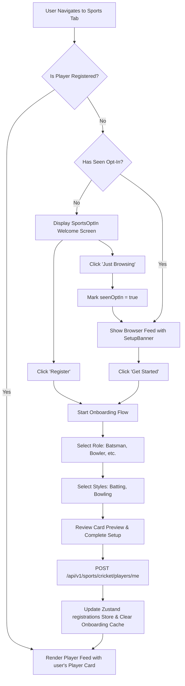

# Pabaini Mobile - Complete Features Documentation

This document provides a comprehensive overview of all features implemented in the Pabaini mobile application, covering core authentication, onboarding, announcements feed, moderation actions, and peripheral directories.

---

## 🔑 1. Authentication & Registration (`app/(auth)/login.tsx`)
**Objective**: Authenticate and dynamically register village members securely using Firebase Auth.

*   **Phone Number OTP Auth**:
    *   Accepts the user's phone number, sends a verification code via SMS, and renders a 6-digit OTP verification field.
    *   Implements a visual **Resend Code** countdown timer (preventing request flooding).
*   **Google Sign-In**:
    *   Provides a simple one-click authentication alternative for Google accounts.
*   **Dynamic Registration**:
    *   On successful authentication, the Firebase ID token is forwarded to the NestJS backend via `POST /auth/login`. If the user does not exist in the database, a record is automatically initialized.

---

## 📱 2. Post-Login Onboarding Flow (`app/(onboarding)/profile-setup.tsx`)
**Objective**: Ensure newly registered users complete essential profile data before viewing the notice board.

*   **Redirection Gate (`app/index.tsx`)**:
    *   Verifies if a logged-in user has a valid `name`. If empty, automatically routes them to the profile setup screen, blocking feed access.
*   **Setup Form**:
    *   **Avatar Upload**: Integrates `expo-image-picker` to select profile pictures from the camera roll or capture one live.
    *   **Diaspora Status**: Toggle switch indicating whether the user lives abroad (which adds a diaspora label to their posts).
    *   **Read-Only Village**: Shows the default village setting ("Pabaini").
    *   **Initials Generator**: Automatically draws initials inside a placeholder circle if no photo is uploaded.
    *   **Validation**: Restricts name length between 3 and 50 characters, showing loading indicators during sequential uploads and patches.

---

## 📢 3. Announcements Notice Feed (`app/(tabs)/index.tsx`)
**Objective**: A unified virtual village board for announcements and community updates.

*   **Filter Bar**: Horizontal scrolling bar with custom pills to filter posts by category: `General`, `Urgent`, `Event`, and `Jirga Decisions`.
*   **Liking System**:
    *   Interactive heart buttons on each card.
    *   Uses TanStack Query mutation with **optimistic UI updates** and bounce scaling animation.
*   **Landmark Location Badges**:
    *   If a creator sets a location, a `MapPin` badge is dynamically shown on the detail screen [`app/announcement/[id].tsx`](file:///c:/dev/pabaini/pabaini-mobile/app/announcement/%5Bid%5D.tsx). If empty, the badge hides itself automatically.
*   **Pin Indicators**:
    *   Posts flagged as pinned render a green `Pin` icon (rotated diagonally) next to their title.
*   **Pull-to-Refresh**:
    *   Pulls the list to execute standard refresh hooks.

---

## ⚙️ 4. Announcement Moderation Drawer (Pin & Delete Modal)
**Objective**: Context-specific administrative actions overlaying announcement cards.

*   **Three-Dots Trigger**: Renders an ellipsis icon on notice card headers, gatekept to show **only** to the post author or admins/moderators.
*   **Custom Bottom Sheet Modal**: Built with native `<Modal>` (sliding from the bottom over a translucent backdrop) to maintain high performance with zero third-party dependencies.
*   **Security Access Rules**:
    *   **Pin/Unpin**: Restrained to Admin and Moderator roles. Updates pinned state on backend.
    *   **Delete**: Restrained strictly to the Author and Admins. Triggers confirmation pop-up and executes a soft delete (marking `is_deleted = true` in the DB while keeping storage media for records).
*   **Separate Action Loaders**: Employs an `activeAction` state so that spinner animations activate only on the pressed item, keeping all controls disabled during api calls.

---

## 📝 5. Create Announcement Screen (`app/announcement/create.tsx`)
**Objective**: Enable authorized leaders to publish posts with categories and media.

*   **Header Bar**: Features Cancel (left) + "New Announcement" (center) + loading-capable Post (right). Disabled if title is under 3 characters or content is under 10.
*   **Image Attachment**: Attaches a high-quality picture using `expo-image-picker`, rendering a full-width preview with a close (X) overlay.
*   **Content Limits**: Title input (100 char limit) + Textarea (500 char limit with reactive counter).
*   **Landmark Location Input**: Styled text entry field to specify landmark details.
*   **Gatekeeping**: Routes return Access Denied if a standard resident account attempts to load the creation page.

---

## 📤 6. Native Share Sheet Integration
**Objective**: Allow sharing of notices to external apps.

*   **React Native Share API**: Opens the device's native sharing tray (supporting WhatsApp, Messenger, SMS, Mail, copy-to-clipboard, etc.).
*   **Rich Layout**: Formats the share payload with the post title, content summary, and a fallback web URL (`https://pabaini.app/announcements/:id`).

---

## 👤 7. Member Profile Screen (`app/(tabs)/profile.tsx`)
**Objective**: View account status, check roles, update details, and log out.

*   **Details Rendered**: Displays name, contact details (phone/email), role badge (`resident`, `moderator`, `admin`), village, and diaspora tags.
*   **Edit Capabilities**: Allows modifying name and diaspora status directly.
*   **Authentication Hooks**: Connects Firebase sign-out triggers, redirecting users to the login screen.

---

## 🏏 8. Sports Hub: Cricket Player Onboarding & Feed (Phase 1)
**Objective**: Build a premium sports community starting with Cricket Player Profiles, featuring a multi-step onboarding registration wizard, personal player cards, and a paginated list of all community players.

### 🌟 Phase 1: Cricket Player Profiles & Onboarding (Implemented)

#### 📝 Phase 1 in a Nutshell (High-Level Overview)
*   **Frontend**:
    *   **Sports tab with first-time opt-in screen**: Introduces the sports features with options to register or browse.
    *   **3-step cricket player onboarding (role → playing style → preview card)**: Seamless profile registration setup wizard.
    *   **Sports feed (player view + browser view)**: Displays player stats, matching registered players and browse mode layouts.
    *   **Setup banner for users who skipped**: A gentle persistent reminder cards for unregistered users to register any time.

> [!NOTE]
> **In simple words:** A user can optionally register as a cricket player by setting up their profile (role, batting hand, bowling style). This creates their permanent player identity in the app that everything else — teams, matches, stats — depends on.

*   **Initialization & State Verification**:
    *   On screen mount, the app performs a silent check against the backend: `GET /sports/cricket/players/me`.
    *   If a player profile is returned (`200 OK`), the Zustand store `registrations` is updated to cache the profile locally, ensuring instant loading next time.
    *   If `404 Not Found` is returned, the local cache is cleared.
*   **Opt-In / Just Browsing Toggle**:
    *   Renders a full-screen welcome overlay (`SportsOptIn.tsx`) if the user is unregistered and has not yet completed/skipped onboarding (`seenOptIn` is false).
    *   "Just Browsing" sets `seenOptIn` to true in the persistent Zustand store, transitioning to the Browser Feed.
    *   Unregistered users in the Browser Feed see a premium green CTA banner (`SetupBanner.tsx`) prompting them to "Register as a Player".
*   **3-Step Onboarding Stack (`app/sports/cricket/onboarding/`)**:
    *   **Step 1 (Role Selection - `role.tsx`)**: Selected specialized role: `batsman`, `bowler`, `allrounder`, or `keeper`. The "Next" button remains disabled until a selection is confirmed.
    *   **Step 2 (Play Style - `style.tsx`)**: Choose batting hand (Right/Left) and bowling arm/type (Right, Left, Spin, Fast, Medium). It applies dynamic form logic: if the user is a batsman/keeper, they can select "I don't bowl", which smoothly hides the bowling type options. If they are a bowler/all-rounder, bowling parameters are mandatory.
    *   **Step 3 (Preview & Setup - `preview.tsx`)**: Renders a card preview. Clicking "Complete Setup" fires a `POST /sports/cricket/players/me` payload, updates the Zustand store with the backend profile, clears temporary onboarding memory, and redirects to the sports feed.
*   **Premium Player Card (`CricketPlayerCard.tsx`)**:
    *   Features a dark green linear gradient, radial glow highlights, a cricket watermark bat emoji, user avatar, specialized role badges, style summaries, and a grid displaying statistics.
*   **Sub-Tabs Directory**:
    *   Includes a horizontal tab selector bar (Players, Teams, Matches, Leaderboard) styled in Swabi green.
    *   **Players Tab**: Displays the user's personal player card at the top (if registered), followed by a list of other players in the community.
    *   **Teams, Matches, Leaderboard**: Renders custom `ComingSoonState` placeholders.
*   **Paginated Player Feed**:
    *   Fetches community players via infinite-scroll pagination (`GET /sports/cricket/players?page=N&limit=10`), appending items as the user scrolls.
    *   Implements `RefreshControl` (pull-to-refresh) to sync the latest players and recheck the user's registration status.

### 🚀 Phase 2: Teams, Matches & Leaderboards (Planned / Roadmap)
*   **Teams Module**:
    *   [ ] Support custom team/squad registration.
    *   [ ] Allow team captains to send roster/squad invitations to registered players.
    *   [ ] Add a player notification dashboard to accept/reject team invite requests.
    *   [ ] Roster standings tab listing all approved squads.
*   **Matches & Fixtures**:
    *   [ ] Render upcoming tournament match listings, location directions, and timings.
    *   [ ] Live scoreboard widget to record ball-by-ball actions or final match score summaries.
    *   [ ] Match details dashboard showing runs, wickets, and man of the match outcomes.
*   **MVP Leaderboards**:
    *   [ ] Dynamically compile runs, batting averages, strike rates, wickets, economy rates, and MVP rankings.
    *   [ ] Update the Leaderboard tab feed in real-time.

### 📊 Step-by-Step Flowchart



---

## 💝 9. Donors Directory (`app/(tabs)/donors.tsx`)
**Objective**: Context landing zones to highlight charitable contributions and community sponsors.

*   **Registry Board**: List of active sponsors, project contributions, and donations.

---

## 🔔 10. Push Notifications (FCM Device Token Sync)
**Objective**: Associate active FCM device tokens with authenticated profiles to prepare for push message support.

*   **Status: PARTIALLY IMPLEMENTED (Token Registration Active)**
*   **Device Token Flow (Completed)**:
    *   On successful authentication, calls `messaging().requestPermission()` and retrieves the token via `messaging().getToken()`.
    *   Saves the token to the backend using `POST /users/device-token`.
    *   Listens for token shifts via `messaging().onTokenRefresh(...)` to maintain synchronized DB states.
    *   On user logout, queries `getToken()` and issues `DELETE /users/device-token` before finalizing Firebase sign-outs.
*   **Full Push Notification (TODO / Future Implementation)**:
    *   [ ] Configure Firebase console certificates and credentials.
    *   [ ] Handle foreground incoming payloads using `messaging().onMessage(...)`.
    *   [ ] Process background/minimized states using `messaging().setBackgroundMessageHandler(...)`.
    *   [ ] Add click triggers using `messaging().onNotificationOpenedApp()` & `getInitialNotification()` to parse the `announcementId` payload.
    *   [ ] Implement deep linking to navigate programmatically to the announcement detail screen.

---

## 🛠️ Verification & Building
All features compile cleanly under TypeScript. To check type safety at any time, run:
```bash
# In pabaini-mobile directory
npx tsc --noEmit

# In pabaini-backend directory
npx tsc --noEmit
```
