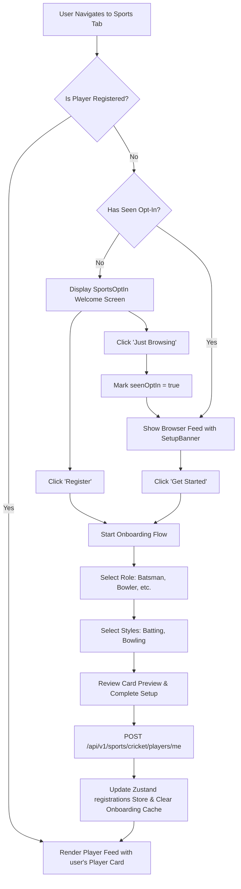

# Pabaini Mobile - Complete Features Documentation

This document provides a comprehensive overview of all features implemented in the Pabaini mobile application, covering core authentication, onboarding, announcements feed, moderation actions, and peripheral directories.

---

## 🔑 1. Authentication & Registration (`app/(auth)/login.tsx`)
**Objective**: Authenticate and dynamically register village members securely using Firebase Auth.

*   **Phone Number OTP Auth**:
    *   Accepts the user's phone number, sends a verification code via SMS, and renders a 6-digit OTP verification field.
    *   Implements a visual **Resend Code** countdown timer (preventing request flooding).
*   **Google Sign-In**:
    *   Provides a simple one-click authentication alternative for Google accounts.
*   **Dynamic Registration**:
    *   On successful authentication, the Firebase ID token is forwarded to the NestJS backend via `POST /auth/login`. If the user does not exist in the database, a record is automatically initialized.

---

## 📱 2. Post-Login Onboarding Flow (`app/(onboarding)/profile-setup.tsx`)
**Objective**: Ensure newly registered users complete essential profile data before viewing the notice board.

*   **Redirection Gate (`app/index.tsx`)**:
    *   Verifies if a logged-in user has a valid `name`. If empty, automatically routes them to the profile setup screen, blocking feed access.
*   **Setup Form**:
    *   **Avatar Upload**: Integrates `expo-image-picker` to select profile pictures from the camera roll or capture one live.
    *   **Diaspora Status**: Toggle switch indicating whether the user lives abroad (which adds a diaspora label to their posts).
    *   **Read-Only Village**: Shows the default village setting ("Pabaini").
    *   **Initials Generator**: Automatically draws initials inside a placeholder circle if no photo is uploaded.
    *   **Validation**: Restricts name length between 3 and 50 characters, showing loading indicators during sequential uploads and patches.

---

## 📢 3. Announcements Notice Feed (`app/(tabs)/index.tsx`)
**Objective**: A unified virtual village board for announcements and community updates.

*   **Filter Bar**: Horizontal scrolling bar with custom pills to filter posts by category: `General`, `Urgent`, `Event`, and `Jirga Decisions`.
*   **Liking System**:
    *   Interactive heart buttons on each card.
    *   Uses TanStack Query mutation with **optimistic UI updates** and bounce scaling animation.
*   **Landmark Location Badges**:
    *   If a creator sets a location, a `MapPin` badge is dynamically shown on the detail screen [`app/announcement/[id].tsx`](file:///c:/dev/pabaini/pabaini-mobile/app/announcement/%5Bid%5D.tsx). If empty, the badge hides itself automatically.
*   **Pin Indicators**:
    *   Posts flagged as pinned render a green `Pin` icon (rotated diagonally) next to their title.
*   **Pull-to-Refresh**:
    *   Pulls the list to execute standard refresh hooks.
*   **Automatic Focus-Based Polling**:
    *   Background polling (20-second interval) automatically fetches new notices while the Home tab screen is focused. It stops completely when the screen is blurred to save battery/network bandwidth. Entering or returning focus to the Home screen triggers an immediate query refetch.

---

## ⚙️ 4. Announcement Moderation Drawer (Pin & Delete Modal)
**Objective**: Context-specific administrative actions overlaying announcement cards.

*   **Three-Dots Trigger**: Renders an ellipsis icon on notice card headers, gatekept to show **only** to the post author or admins/moderators.
*   **Custom Bottom Sheet Modal**: Built with native `<Modal>` (sliding from the bottom over a translucent backdrop) to maintain high performance with zero third-party dependencies.
*   **Security Access Rules**:
    *   **Pin/Unpin**: Restrained to Admin and Moderator roles. Updates pinned state on backend.
    *   **Delete**: Restrained strictly to the Author and Admins. Triggers confirmation pop-up and executes a soft delete (marking `is_deleted = true` in the DB while keeping storage media for records).
*   **Separate Action Loaders**: Employs an `activeAction` state so that spinner animations activate only on the pressed item, keeping all controls disabled during api calls.

---

## 📝 5. Create Announcement Screen (`app/announcement/create.tsx`)
**Objective**: Enable authorized leaders to publish posts with categories and media.

*   **Header Bar**: Features Cancel (left) + "New Announcement" (center) + loading-capable Post (right). Disabled if title is under 3 characters or content is under 10.
*   **Image Attachment**: Attaches a high-quality picture using `expo-image-picker`, rendering a full-width preview with a close (X) overlay.
*   **Content Limits**: Title input (100 char limit) + Textarea (500 char limit with reactive counter).
*   **Landmark Location Input**: Styled text entry field to specify landmark details.
*   **Gatekeeping**: Routes return Access Denied if a standard resident account attempts to load the creation page.

---

## 📤 6. Native Share Sheet Integration
**Objective**: Allow sharing of notices to external apps.

*   **React Native Share API**: Opens the device's native sharing tray (supporting WhatsApp, Messenger, SMS, Mail, copy-to-clipboard, etc.).
*   **Rich Layout**: Formats the share payload with the post title, content summary, and a fallback web URL (`https://pabaini.app/announcements/:id`).

---

## 👤 7. Member Profile Screen (`app/(tabs)/profile.tsx`)
**Objective**: View account status, check roles, update details, and log out.

*   **Details Rendered**: Displays name, contact details (phone/email), role badge (`resident`, `moderator`, `admin`), village, and diaspora tags.
*   **Edit Capabilities**: Allows modifying name and diaspora status directly.
*   **Authentication Hooks**: Connects Firebase sign-out triggers, redirecting users to the login screen.

---

## 🏏 8. Sports Hub: Cricket Player Onboarding & Feed (Phase 1)
**Objective**: Build a premium sports community starting with Cricket Player Profiles, featuring a multi-step onboarding registration wizard, personal player cards, and a paginated list of all community players.

### 🌟 Phase 1: Cricket Player Profiles & Onboarding (Implemented)

#### 📝 Phase 1 in a Nutshell (High-Level Overview)
*   **Frontend**:
    *   **Sports tab with first-time opt-in screen**: Introduces the sports features with options to register or browse.
    *   **3-step cricket player onboarding (role → playing style → preview card)**: Seamless profile registration setup wizard.
    *   **Sports feed (player view + browser view)**: Displays player stats, matching registered players and browse mode layouts.
    *   **Setup banner for users who skipped**: A gentle persistent reminder cards for unregistered users to register any time.

> [!NOTE]
> **In simple words:** A user can optionally register as a cricket player by setting up their profile (role, batting hand, bowling style). This creates their permanent player identity in the app that everything else — teams, matches, stats — depends on.

*   **Initialization & State Verification**:
    *   On screen mount, the app performs a silent check against the backend: `GET /sports/cricket/players/me`.
    *   If a player profile is returned (`200 OK`), the Zustand store `registrations` is updated to cache the profile locally, ensuring instant loading next time.
    *   If `404 Not Found` is returned, the local cache is cleared.
*   **Opt-In / Just Browsing Toggle**:
    *   Renders a full-screen welcome overlay (`SportsOptIn.tsx`) if the user is unregistered and has not yet completed/skipped onboarding (`seenOptIn` is false).
    *   "Just Browsing" sets `seenOptIn` to true in the persistent Zustand store, transitioning to the Browser Feed.
    *   Unregistered users in the Browser Feed see a premium green CTA banner (`SetupBanner.tsx`) prompting them to "Register as a Player".
*   **3-Step Onboarding Stack (`app/sports/cricket/onboarding/`)**:
    *   **Step 1 (Role Selection - `role.tsx`)**: Selected specialized role: `batsman`, `bowler`, `allrounder`, or `keeper`. The "Next" button remains disabled until a selection is confirmed.
    *   **Step 2 (Play Style - `style.tsx`)**: Choose batting hand (Right/Left) and bowling arm/type (Right, Left, Spin, Fast, Medium). It applies dynamic form logic: if the user is a batsman/keeper, they can select "I don't bowl", which smoothly hides the bowling type options. If they are a bowler/all-rounder, bowling parameters are mandatory.
    *   **Step 3 (Preview & Setup - `preview.tsx`)**: Renders a card preview. Clicking "Complete Setup" fires a `POST /sports/cricket/players/me` payload, updates the Zustand store with the backend profile, clears temporary onboarding memory, and redirects to the sports feed.
*   **Premium Player Card (`CricketPlayerCard.tsx`)**:
    *   Features a dark green linear gradient, radial glow highlights, a cricket watermark bat emoji, user avatar, specialized role badges, style summaries, and a grid displaying statistics.
*   **Sub-Tabs Directory**:
    *   Includes an elegant segmented horizontal tab selector bar (Players, Teams, Matches, Leaders) styled in Swabi green.
    *   **Players Tab**: Displays the user's personal player card at the top (if registered), followed by a list of other players in the community.
    *   **Teams, Matches, Leaders**: Renders team directories, challenge fixtures, and leaderboards.
*   **Paginated Player Feed**:
    *   Fetches community players via infinite-scroll pagination (`GET /sports/cricket/players?page=N&limit=10`), appending items as the user scrolls.
    *   Implements `RefreshControl` (pull-to-refresh) to sync the latest players and recheck the user's registration status.

### 🌟 Phase 2: Cricket Teams & Squad Management (Implemented)

*   **Teams tab in Sports Tab**: Displays "Your Teams" list for registered players + horizontal "Discover Teams" carousel. Features a "+ Create Team" button in the app-bar for eligible users.
*   **Discover Teams ([index.tsx](file:///c:/dev/pabaini/pabaini-mobile/app/sports/cricket/teams/index.tsx))**: Full paginated list of all active village teams with client-side name search filter and pull-to-refresh.
*   **Create Team ([create.tsx](file:///c:/dev/pabaini/pabaini-mobile/app/sports/cricket/teams/create.tsx))**: Form with validations (name, description, home ground, founded year). On success, routes to the team's profile.
*   **Team Profile ([index.tsx](file:///c:/dev/pabaini/pabaini-mobile/app/sports/cricket/teams/[id]/index.tsx))**: Displays full team details, squad listings, statistics, and past/upcoming matches. Restricts admin controls dynamically based on the current user's role:
    *   *Unregistered*: Shows CTA to register as a player first.
    *   *Non-Member*: Shows "Request to Join" button.
    *   *Pending Request*: Displays "Request Pending".
    *   *Invited*: Renders "Accept" and "Decline" buttons.
    *   *Active Member*: Shows "Leave Team" button.
    *   *Captain*: Displays "Manage Team" button to open the dashboard.
*   **Captain Dashboard ([manage.tsx](file:///c:/dev/pabaini/pabaini-mobile/app/sports/cricket/teams/[id]/manage.tsx))**: Allows team captains to manage squad settings:
    *   *Requests Tab*: Accept or decline user join requests.
    *   *Invites Tab*: Send new invitations or cancel pending ones.
    *   *Squad Tab*: Renders active roster with ActionSheet for removing members or transferring captaincy.
    *   *Edit details & Logo upload*: Direct details update form and logo picker using `expo-image-picker` with multipart form-data.
    *   *Soft delete team*: Dissolves squad and flags team as inactive.
*   **Invite Player Directory ([invite.tsx](file:///c:/dev/pabaini/pabaini-mobile/app/sports/cricket/teams/[id]/invite.tsx))**: Searchable player directory filtered to registered players not already in/invited by the team.

### 🌟 Phases 3 & 4: Cricket Matches, Lineups & Scoring (Implemented)

*   **Matches Tab & List ([sports.tsx](file:///c:/dev/pabaini/pabaini-mobile/app/(tabs)/sports.tsx))**: Lists challenges in three groups:
    *   *Live Matches*: Pulses red and displays real-time score summaries.
    *   *Upcoming Matches*: Displays date, venue, and a lineup declaration counter.
    *   *Completed Matches*: Displays the winning team, trophy icon, final scores, and a styled dynamic victory badge displaying the winning margin (e.g., "Team A won by 15 runs", "Team B won by 4 wickets", or "Match Tied" / "Match Drawn"). These cards are rendered by [MatchCard.tsx](file:///c:/dev/pabaini/pabaini-mobile/src/components/sports/matches/MatchCard.tsx).
*   **Send Match Request ([request.tsx](file:///c:/dev/pabaini/pabaini-mobile/app/sports/cricket/matches/request.tsx))**: Form for captains to challenge opponent teams. Fields: team dropdown, opponent dropdown, overs (1-100), optional venue, optional schedule (with helpers), and scoring mode (Live/Simple).
*   **Match Detail ([index.tsx](file:///c:/dev/pabaini/pabaini-mobile/app/sports/cricket/matches/[id]/index.tsx))**: Detailed page rendering teams, scheduled time, venue, lineups declaration status badges, and dynamic action buttons:
    *   *Challenge Pending*: Opponent captain can accept or decline.
    *   *Scheduled*: Captains can declare lineups or cancel the match.
    *   *Lineups Ready*: Shows "Start Match" (live mode) or "Submit Result" (simple mode) buttons.
    *   *Live / Scoring*: Designated scorer can "Continue Scoring"; spectators see "Watch Live".
    *   *Completed*: Displays a premium scorecard interface (`MatchScorecard.tsx`) featuring:
        *   **Dynamic Winner Banner**: Styled notification detailing the winner and margin of victory.
        *   **Innings Tabs**: Tabbed navigation between the 1st Innings and 2nd Innings scorecards.
        *   **Batting Performance Table**: Shows batsman name/guest indicator, dismissal status, runs, balls, fours, sixes, and right-aligned strike rate.
        *   **Bowling Performance Table**: Displays bowler name/guest, overs bowled, maidens, runs given, wickets, and calculated economy rate.
        *   **Extras Breakdown**: Detailed section listing total extras conceded alongside individual splits for wides, no-balls, byes, and leg-byes.
        *   **Fall of Wickets Timeline**: A chronological list of wickets showing the batsman name, dismissal type, over of dismissal, and team score at the time the wicket fell.
        *   **Collapsible sections**: Sections can be collapsed/expanded individually for cleaner reading.
*   **Searchable Player Directory ([index.tsx](file:///c:/dev/pabaini/pabaini-mobile/app/sports/cricket/players/index.tsx))**: A dedicated directory for resident players, accessible via the "See All" button on the Sports tab dashboard next to the registered players list. Includes a sticky search bar to query names, skeleton loading views, pull-to-refresh, and infinite scroll pagination.
*   **Declare Playing XI ([lineup.tsx](file:///c:/dev/pabaini/pabaini-mobile/app/sports/cricket/matches/[id]/lineup.tsx))**: Roster picking tool requiring exactly 11 players. Captains can select registered squad members or add guest players (name only), and must assign unique batting orders (1-11).
*   **Simple Result Entry ([result.tsx](file:///c:/dev/pabaini/pabaini-mobile/app/sports/cricket/matches/[id]/result.tsx))**: Retroactive form to log completed matches: winner selection card, final score inputs, Man of the Match, and per-player statistics accordions (batting and bowling metrics).
    *   *Man of the Match picker*: Lists both registered players and guest players (with a `(Guest)` label), and includes a "None / Clear" option at the top of the picker.
    *   *24-Hour Edit Lock Window*: Results are editable for 24 hours post-submission (Rule 44). After 24 hours, the form locks, edit actions disappear, and a locked padlock icon is displayed.
*   **Initialize Match ([start.tsx](file:///c:/dev/pabaini/pabaini-mobile/app/sports/cricket/matches/[id]/start.tsx))**: Pre-match start configuration screen for captains: toss details, batting first team, opening batsmen (striker & non-striker), opening bowler, and assigned scorer.
*   **Scorer Console ([score.tsx](file:///c:/dev/pabaini/pabaini-mobile/app/sports/cricket/matches/[id]/score.tsx))**: Scorer-exclusive write-enabled interface to input ball events:
    *   *Double-Tap Locks*: Prevents duplicate requests during bowler selections.
    *   *Normal Ball / Extras*: Fast-tap buttons to submit runs, extra type overlays (Wide, No Ball, Bye, Leg Bye), and wickets.
    *   *Wicket flow*: Prompts a modal to record dismissal type and choose the next batsman. The next batsman selection list filters dynamically to only display Playing XI players who have not been dismissed yet.
    *   *Bowler selection modal*: Prompts at over boundaries (6 legal balls complete) to pick the next bowler (validating the non-consecutive bowling Rule 60). The previous bowler is shown in the list with a red `Previous Bowler` badge, and selecting them prompts a confirmation dialog to bypass consecutive over restrictions.
    *   *Match Auto-Completion*: Auto-dismisses active console modals when the match is completed.
    *   *Innings transition wizard*: Prompts when 10 wickets fall or overs finish, prompting the scorer to set Innings 2 openers and bowler.
    *   *Undo ball*: Calls `PATCH /balls/undo` to revert the single most recent delivery.
*   **Live Spectator Viewer ([live.tsx](file:///c:/dev/pabaini/pabaini-mobile/app/sports/cricket/matches/[id]/live.tsx))**: Public read-only feed polling the pre-computed match state every 5 seconds (`refetchInterval: 5000`). Renders live scorecard, active batsman run counts, active bowler stats, and over timeline widgets.

### 📊 Step-by-Step Flowchart



---

## 💝 9. Donors Directory (`app/(tabs)/donors.tsx`)
**Objective**: Context landing zones to highlight charitable contributions and community sponsors.

*   **Registry Board**: List of active sponsors, project contributions, and donations.

---

## 🔔 10. Push Notifications (FCM Device Token Sync)
**Objective**: Associate active FCM device tokens with authenticated profiles to prepare for push message support.

*   **Status: PARTIALLY IMPLEMENTED (Token Registration Active)**
*   **Device Token Flow (Completed)**:
    *   On successful authentication, calls `messaging().requestPermission()` and retrieves the token via `messaging().getToken()`.
    *   Saves the token to the backend using `POST /users/device-token`.
    *   Listens for token shifts via `messaging().onTokenRefresh(...)` to maintain synchronized DB states.
    *   On user logout, queries `getToken()` and issues `DELETE /users/device-token` before finalizing Firebase sign-outs.
*   **Full Push Notification (TODO / Future Implementation)**:
    *   [ ] Configure Firebase console certificates and credentials.
    *   [ ] Handle foreground incoming payloads using `messaging().onMessage(...)`.
    *   [ ] Process background/minimized states using `messaging().setBackgroundMessageHandler(...)`.
    *   [ ] Add click triggers using `messaging().onNotificationOpenedApp()` & `getInitialNotification()` to parse the `announcementId` payload.
    *   [ ] Implement deep linking to navigate programmatically to the announcement detail screen.

---

## 💬 11. In-App Notifications Feed & Integration
**Objective**: Serve real-time notices and deep-link updates for critical team/member actions (e.g. join requests, invitations).

*   **Zustand State Store (`src/store/notificationsStore.ts`)**:
    *   Tracks the user's unread notification count (`unreadCount`).
    *   Exposes actions to clear or decrement counts.
*   **API Services (`src/services/notificationsApi.ts`)**:
    *   `getNotifications`: Fetches paginated records (20 per page) with scroll loading support.
    *   `markAsRead` / `markAllAsRead`: Marks read status optimistically on the client while calling backend endpoints in the background.
*   **Reusable Components (`src/components/notifications/`)**:
    *   **NotificationBell**: Displays a persistent bell icon in headers. Shows a red counter badge (with `"9+"` cap) if unread count > 0.
    *   **NotificationRow**: Renders notification titles, relative timelines, and descriptive emojis mapped to each type (e.g., 🏏 for invites, 📢 for announcements). Highlights unread entries with a 3% primary background color tint.
    *   **NotificationEmptyState**: Renders a premium, centralized placeholder when no notifications are found.
*   **Inbox Screen (`app/notifications.tsx`)**:
    *   Pulls and groups notifications chronologically into **Today**, **Yesterday**, and **Earlier** sections.
    *   Supports pull-to-refresh feeds and infinite scrolling (loading pages sequentially).
    *   Features a "Mark all read" top-bar action.
*   **Real-Time Polling Hook (`app/(tabs)/sports.tsx`)**:
    *   Integrates a safe background polling loop running every 35 seconds to query the unread notification count.
    *   Uses Expo's `useFocusEffect` to spin up the polling hook when the user views the screen, and automatically cleans it up (terminating the interval) when the screen blurs to prevent memory leaks and unnecessary network calls.

### 🔀 Notifications User Flows (Flowcharts)

```mermaid
graph TD
    %% Flow A: Polling
    subgraph Flow A: Unread Count Polling
        Focus[Sports Tab Focused] --> Poll[Start 35s Poll Interval]
        Poll --> API_Count[GET /api/v1/notifications/unread-count]
        API_Count --> Store[Update Zustand Store: unreadCount]
        Store --> Badge[Render Red Badge on NotificationBell]
        Focus -- Screen Blur --> Blur[Clear Poll Interval]
    end

    %% Flow B: Inbox & Click Actions
    subgraph Flow B: Inbox & Click Actions
        Bell[Tap NotificationBell] --> API_List[GET /api/v1/notifications?page=1]
        API_List --> Group[Group: Today, Yesterday, Earlier]
        Group --> Render[Render SectionList]
        Render --> TapRow[Tap Notification Row]
        TapRow --> IsUnread{Is unread?}
        IsUnread -- Yes --> OptRead[Optimistic: Mark read & decrement count]
        OptRead --> API_Read[PATCH /api/v1/notifications/:id/read]
        IsUnread -- No --> Route[Route via deep_link]
        API_Read --> Route
        Route --> Dest[Redirect e.g. /teams/:id/manage or /teams/:id]
    end
```



---

## 🔐 12. Guest Mode & Authentication Gating
**Objective**: Allow guest (unauthenticated) users to browse announcements and sports matches while restricting access to gated pages and action triggers to avoid client and server errors.

*   **Restricted Navigation Zone**:
    *   Guests are limited to two screens: **Announcements Feed** (Home) and the **Matches tab** under Sports.
    *   The top tabs for *Players*, *Teams*, and *Leaders* on the Sports hub are hidden entirely for guests, rendering only the Matches ScrollView.
    *   Visiting gated routes directly (e.g., *Roster*, *Create Team*, *Match setup*, *Scoring*, *Notifications*, *Resident profiles*) redirects to the custom `LoginRequiredGate` component.
*   **Action Intercepting Overlay**:
    *   Interactive write triggers (such as *Liking* a notice, *Commenting*, *Registering* as a player, or *Joining* a team squad) are intercepted by the global `LoginPromptModal` which requests user authentication.
*   **Auth State & Cache Clearing**:
    *   Logouts and guest transitions flush all Zustand persistent stores (`sportsStore`, `teamsStore`, `notificationsStore`) and trigger a full TanStack Query client clear (`queryClient.clear()`) to prevent data leaking.
*   **Bypassing Auth Headers**:
    *   On the frontend, the Axios request interceptor checks `is_guest` in `SecureStore` and skips Firebase token acquisition.
    *   On the backend, `FirebaseAuthGuard` and `DbUserGuard` are configured as optional for `GET` requests, enabling public notice board and matches list requests to return data successfully instead of throwing a `401 Unauthorized` exception.

---

## 🛠️ Verification & Building
All features compile cleanly under TypeScript. To check type safety at any time, run:
```bash
# In pabaini-mobile directory
npx tsc --noEmit

# In pabaini-backend directory
npx tsc --noEmit
```
